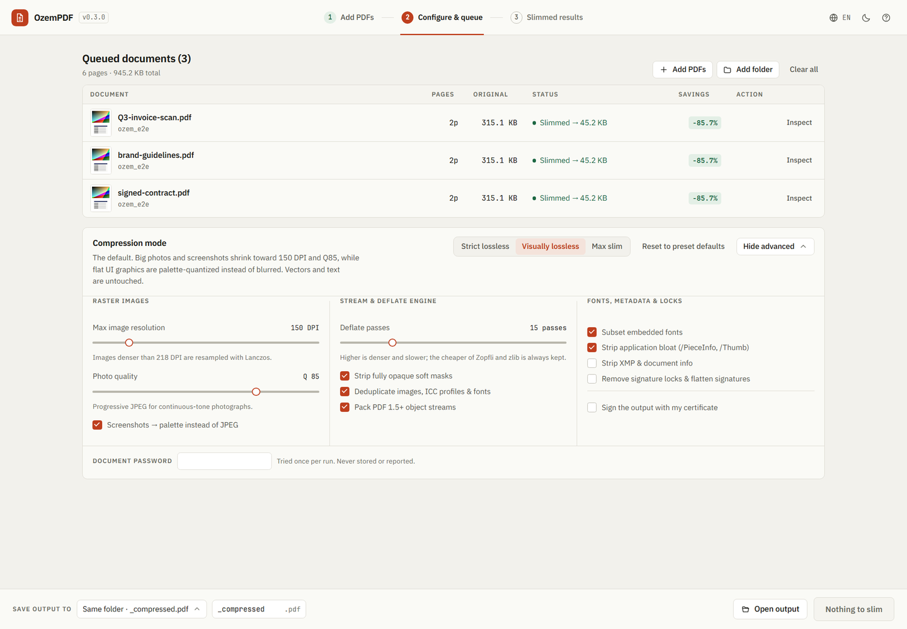
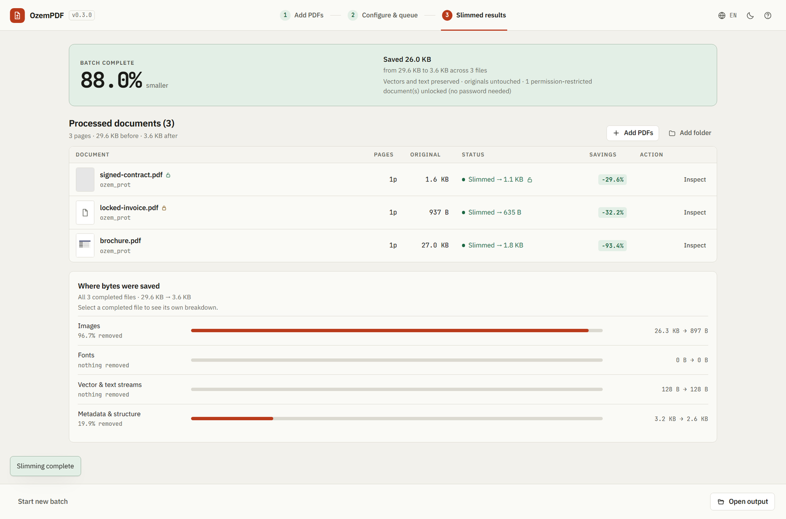

# OzemPDF

**v0.3.0** — surgical lossless and visually-lossless PDF slimming.

OzemPDF makes PDFs smaller without re-distilling pages. It never rasterizes page content and
never rewrites vector or text operators; it performs object-level surgery on embedded images,
font programs, deflate streams, metadata and the cross-reference structure.

- **Vectors and text are untouched by construction.**
- **The output is never larger than the input.** (The only exception is a transformation you
  explicitly ask for: removing signature locks or signing the result.)
- **Runs fully offline**, with no Ghostscript, Poppler or qpdf binaries.
- **The interface is plain HTML/CSS/JS**, served by the Python engine and wrapped by an Electron
  window on Windows, macOS and Linux.



## Why another PDF compressor

Most "PDF compressors" re-render pages through Ghostscript. That blurs line art, rasterizes text
and cannot promise that a result will be smaller. OzemPDF instead rewrites only the objects that
carry bloat:

| Stage | What it does |
| --- | --- |
| Unlock | Opens owner-restricted documents; optionally flattens signature stamps and removes locks (explicit consent) |
| Audit | Attributes every byte to images, fonts, vector/text streams or metadata; measures each image's real DPI from the page CTM |
| Deduplicate | SHA-256 matches repeated images, ICC profiles and font programs and shares one object |
| Images | Strict-lossless transforms, or (in the default preset) Lanczos downsampling to 150 DPI, palette quantisation for screenshots, progressive JPEG for photographs |
| Fonts | Subsets embedded TrueType with `retain_gids=True` so glyph references stay valid; recompresses CMaps |
| Streams | Removes `/PieceInfo` and `/Thumb`, recompresses deflate streams with Zopfli, packs object streams |
| Guardrail | If the result is not smaller, the original bytes are kept; writes are atomic |
| Sign | Optional PKCS#12 re-signing as the final write |

## Presets

| Knob | Strict lossless | Visually lossless (default) | Max slim |
| --- | --- | --- | --- |
| Pixel guarantee | bit-identical | perceptual | perceptual |
| Downsampling | none | 150 DPI (trigger 218) | 110 DPI (trigger 160) |
| Photo quality | untouched | JPEG Q85 | JPEG Q75 |
| Screenshots | exact palette only | palette ≤256 | palette ≤128 |
| Deflate passes | 15 | 15 | 25 |
| Metadata | kept | kept | stripped |
| Signature flattening | off | off | off (explicit opt-in) |

Any advanced knob can be tuned; editing one switches the mode to **Custom** without touching the
output destination.

## Run it

### Development (Python + Electron)

```bash
python -m venv .venv
# Windows: .venv\Scripts\activate
# POSIX:   source .venv/bin/activate
pip install -e ".[dev]"

cd app
npm install
npm start
```

`npm start` launches the Electron window, which starts the Python engine on a free loopback port
and loads the interface from it.

### Browser fallback (no Node needed)

```bash
ozempdf --serve
```

This prints a `http://127.0.0.1:<port>/` URL and opens it. Files are then added through the in-app
folder browser; dragging files into a browser copies them to the app's staging folder because a
browser cannot expose real paths. The Electron shell passes real paths, so drop-to-compress works
there as expected.

### Command line

```bash
ozempdf report.pdf                       # balanced preset, writes report_compressed.pdf
ozempdf scans/ -o slimmed/ -w 8          # recursive, one output tree, 8 workers
ozempdf contract.pdf --preset max        # smallest honest file
ozempdf scans/ --json-report report.json # machine-readable totals and per-file results
ozempdf --serve                          # open the desktop interface in a browser
ozempdf --help                           # localized help and flag reference
```

Exit codes: `0` every file succeeded, `1` no PDFs found, `2` at least one file failed.

### Re-signing a document

Flattening a signature keeps its visible stamp but permanently invalidates the cryptographic
signature. If you own a document and want a valid signature after slimming:

```bash
ozempdf contract.pdf --sign-p12 signer.p12 --sign-password "$P12_PASSWORD" \
                     --sign-reason "Slimmed for filing"
```

The old signature is removed first, the output is slimmed, and the new signature is the final
write. In the desktop interface the same flow lives under **Advanced → Sign the output with my
certificate**; the certificate password is used for that run only and is never written to the
settings file or the JSON report.

## PDF protection: what can and cannot be removed

PDF "protection" is two different things, and only one of them can be removed without a credential:

| Protection | What OzemPDF does |
| --- | --- |
| **Permission restrictions** (no open password): printing, copying, editing or assembly disabled; the file opens in any reader | **Removed automatically.** No password is asked for and none is needed: the document already opens with the empty user password. The output is a plain, unrestricted PDF. |
| **Open password** (user password): the file asks for a password before it will open at all | **Cannot be removed without that password.** The page content is encrypted with a key derived from it; there is nothing to "strip". Supply the password with `--password` or in the interface, and the output is written unencrypted. |
| **Certificate / public-key encryption** | Requires the private key. libqpdf cannot open these documents, so OzemPDF reports the file as unsupported rather than pretending to unlock it. |

OzemPDF never guesses passwords and has no dictionary attack. A permission-restricted document
does not need one — Adobe asks for a password only to *change* permissions, while the content
itself is readable with the empty password every conforming reader tries. Restricting permissions
is not encryption of the content, and removing those restrictions is not decryption.



## Configuration and data

| Platform | Location |
| --- | --- |
| Windows | `%APPDATA%\OzemPDF\settings.json` |
| macOS | `~/Library/Application Support/OzemPDF/settings.json` |
| Linux | `$XDG_CONFIG_HOME/OzemPDF/settings.json` |

The file stores the theme, language, preset, advanced knobs and output destination. Deleting it
resets the application. Passwords never enter it.

Output files are plain, unencrypted PDFs. Writes go to a `.ozempdf_*.tmp.pdf` file in the
destination folder and are promoted with an atomic replace; a crash leaves the original untouched.

## Localization

Every user-facing string — including `--help` — comes from `src/ozempdf/locales/<code>.json`.
Adding a language is copying `en.json`, translating the values, keeping the `_meta` block accurate,
and restarting. Missing keys fall back to English and never render raw key names. The interface
switches language live and remembers the choice.

## Verification

```bash
python -m pytest -v
```

The suite builds synthetic PDFs (photographs, flat screenshots, duplicate images with opaque soft
masks, an embedded TrueType font, an owner-encrypted signed contract, a password-protected file)
and asserts observable properties: pixel-identical strict-lossless output, CTM-derived DPI,
palette colour spaces that renderers accept, the never-grow guardrail, JSON exit codes, the HTTP
API, locale key coverage, and that signing produces a real signature.

## Packaging

```bash
python build_cross_platform.py   # frozen engine -> dist/engine/ozempdf-engine/ozempdf-engine[.exe]
cd app && npm run dist           # Electron installer for the current platform
```

The engine is a PyInstaller directory build carrying `locales/`, `web/` and fonts; the Electron
builder bundles the whole directory as an extra resource. A packaged build prefers the sidecar; a
source checkout runs the live Python package so edits take effect. Set `OZEMPDF_USE_BUNDLED=1` to
exercise the frozen sidecar locally.

## Repository layout

```
src/ozempdf/            Python engine, CLI, HTTP server, locales, web UI
src/ozempdf/web/        index.html, styles.css, app.js, fonts
app/                    Electron main + preload and packaging config
tests/                  pytest suite and synthetic fixtures
docs/                   user stories, technical specification, discrepancy ledger
PRODUCT.md / DESIGN.md  product truth and the design system
```

## Known limitations

- No OCR, text editing or page manipulation; page content is never touched.
- Signature *preservation* is impossible after re-encoding: the app flattens or re-signs instead.
- Very large rasters are held in memory one at a time per worker; use `--workers` to bound memory.
- The GUI's file picker is server-side, so a plain browser cannot drag-drop real paths (the
  Electron shell can).
- PDF/A and PDF/X conformance are not validated.

The full list of discrepancies from the previous PySide6 architecture, and how each was resolved
here, is in [`docs/DISCREPANCIES.md`](docs/DISCREPANCIES.md).

## License

MIT. Bundled IBM Plex Sans and JetBrains Mono are licensed under the SIL Open Font License; their
license texts ship in `src/ozempdf/web/fonts/`.
