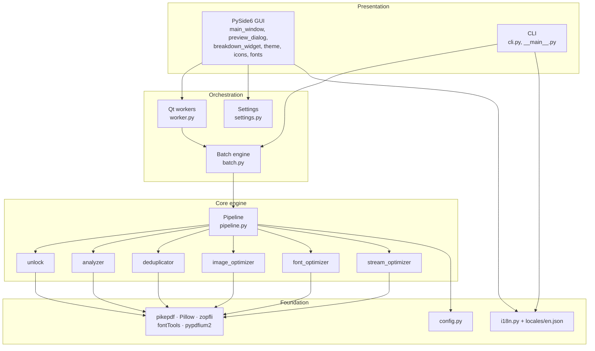
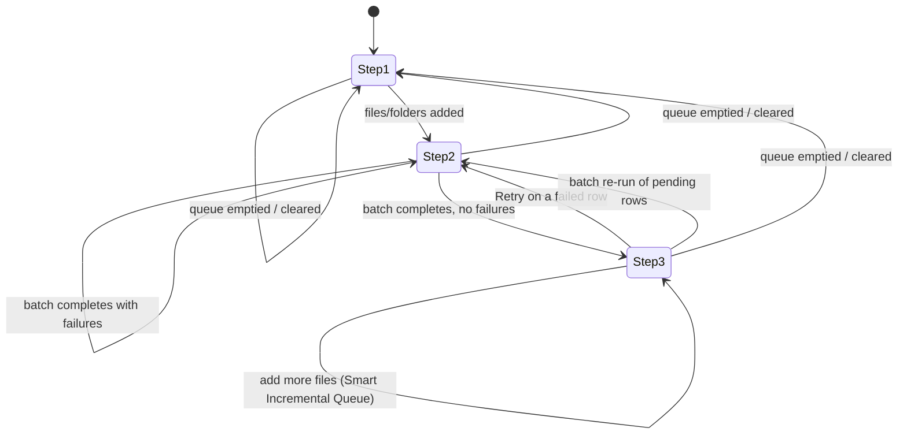

# OzemPDF — Technical Specification

| Field | Value |
| --- | --- |
| Document ID | OZEM-TS-001 |
| Product | OzemPDF |
| Specification version | 1.0 |
| Application version described | **0.2.0** (`src/ozempdf/_version.py`) |
| Document status | Current-state specification (descriptive + normative for invariants) |
| Last updated | 2026-11-24 |
| Audience | Maintainers, integrators, reviewers, AI coding agents |
| Related documents | [`README.md`](../README.md), [`AGENTS.md`](../AGENTS.md), [`CHANGELOG.md`](../CHANGELOG.md), [`pyproject.toml`](../pyproject.toml) |

> **Architecture note (v0.3.0).** The PySide6 presentation layer described in §7, and the Qt
> module references throughout this document, were replaced by an HTML/CSS/JavaScript interface
> served by the Python engine and wrapped by Electron on Windows, macOS and Linux. The engine
> chapters (§3–§6, §8–§11, §15) remain normative; §7 describes the superseded Qt implementation
> and is retained for history. [`README.md`](../README.md) documents the current architecture, and
> [`docs/DISCREPANCIES.md`](DISCREPANCIES.md) records how every defect in §16 was resolved.

> **Authority.** This document describes the implementation as it exists in source at version
> 0.2.0. Where prose in the README or locale catalog disagrees with observable behaviour, the
> behaviour of `src/ozempdf/**` is authoritative and the disagreement is recorded in
> [§16 Known limitations and discrepancies](#16-known-limitations-and-discrepancies).
> Normative project rules live in [`AGENTS.md`](../AGENTS.md); this specification restates them
> and adds precision, it does not relax them.

---

## Table of contents

1. [Introduction](#1-introduction)
2. [System overview](#2-system-overview)
3. [Domain model and configuration](#3-domain-model-and-configuration)
4. [Compression pipeline specification](#4-compression-pipeline-specification)
5. [Batch engine](#5-batch-engine)
6. [Command-line interface](#6-command-line-interface)
7. [Desktop GUI](#7-desktop-gui)
8. [Localization subsystem](#8-localization-subsystem)
9. [Non-functional requirements](#9-non-functional-requirements)
10. [Security and safety analysis](#10-security-and-safety-analysis)
11. [Error handling and diagnostics](#11-error-handling-and-diagnostics)
12. [Test specification](#12-test-specification)
13. [Build, packaging and release](#13-build-packaging-and-release)
14. [Extensibility guide](#14-extensibility-guide)
15. [Interface reference](#15-interface-reference)
16. [Known limitations and discrepancies](#16-known-limitations-and-discrepancies)
17. [Future work](#17-future-work)
- [Appendix A — File inventory](#appendix-a--file-inventory)
- [Appendix B — JSON schemas](#appendix-b--json-schemas)
- [Appendix C — Localization key groups](#appendix-c--localization-key-groups)
- [Appendix D — Glossary](#appendix-d--glossary)

---

## 1. Introduction

### 1.1 Purpose

OzemPDF is a cross-platform desktop and command-line application that reduces the file size of
PDF documents **without re-distilling pages**. It never rasterizes pages and never rewrites page
content streams (vector operators `m`, `l`, `c`, `re`, `S`, `f`, … or text operators `BT`, `ET`,
`Tj`, `TJ`). Instead it performs object-level surgery on embedded raster images, embedded font
programs, deflate streams, metadata and cross-reference structures.

The distinguishing claim of the product is the combination of:

- **100 % vector and text preservation** by construction, and
- a **strict never-grow guardrail** that guarantees an output file is never larger than its input
  (except for the explicitly opted-in unlock/flatten exception, see [§4.8](#48-never-grow-guardrail)).

### 1.2 Scope

**In scope**

- Single-file and recursive-directory PDF compression.
- Image re-encoding (lossless and perceptual), `/SMask` handling, palette packing.
- Content-hash deduplication of images, ICC profiles and fonts.
- Embedded font subsetting and table compaction.
- Structural bloat removal (`/PieceInfo`, `/Thumb`, optional XMP/`/Info`).
- Deflate recompression (Zopfli) and PDF 1.5+ object-stream packing.
- Owner-encryption unlock, digital-signature appearance flattening, `/Perms` removal.
- Four-category byte accounting and reporting.
- A three-step PySide6 desktop GUI, a batch CLI, JSON reporting, and JSON localization.

**Out of scope**

- OCR, text extraction, content editing, page manipulation (rotate/crop/merge/split).
- Cryptographic signature **preservation** (signature flattening intentionally invalidates the
  signature; see [§10.3](#103-digital-signatures)).
- PDF/A or PDF/X conformance conversion and validation.
- Encryption of output (outputs are always unencrypted).
- Network services, telemetry, or cloud processing.

### 1.3 Conventions

- **MUST / MUST NOT / SHOULD / MAY** carry RFC 2119 meaning.
- Requirement identifiers: `INV-*` (invariants), `FR-<area>-<n>` (functional),
  `NFR-<n>` (non-functional), `CON-<n>` (project/engineering constraints).
- Paths are repository-relative POSIX paths unless stated otherwise.
- Byte sizes are binary (`KiB`) but formatted as `KB`/`MB`/`GB` in the UI.
- `pdf` always denotes an open `pikepdf.Pdf` instance.

### 1.4 References

| Ref | Subject |
| --- | --- |
| ISO 32000-1 | PDF 1.7 specification (graphics state, CTM, XObjects, fonts, signatures) |
| ISO/IEC 15948 | PNG specification (scanline filters, Paeth predictor) |
| RFC 1950 | zlib compressed data format (`/FlateDecode`) |
| RFC 3161 / PKCS#7 | Detached signature byte-range digests (invalidated by flattening) |
| Keep a Changelog 1.1.0 / SemVer 2.0.0 | Release and versioning conventions |
| pikepdf / libqpdf docs | Object model, `parse_content_stream`, `ObjectStreamMode` |
| fontTools.subset docs | `retain_gids`, table dropping, subsetter options |

---

## 2. System overview

### 2.1 Product surface

| Surface | Entry point | Consumer |
| --- | --- | --- |
| Console script `ozempdf` | `ozempdf.__main__:main` → `ozempdf.cli:run_cli` | Shell, CI, scripts |
| GUI script `ozempdf-gui` | `ozempdf.gui:launch_gui` | Desktop, start menu |
| Module execution | `python -m ozempdf` | Development |
| Frozen binary | PyInstaller `dist/OzemPDF[.exe|.app]` | End users |

Invoking `ozempdf` with **no arguments** launches the GUI. This is an intentional product
decision: the desktop experience is the default.

### 2.2 Goals

- `G1` — Reduce embedded-raster and stream bloat by a large factor while keeping text and vectors
  pixel-identical.
- `G2` — Never produce a larger file than the input (see `INV-2`).
- `G3` — Work identically on Windows, macOS and Linux with no external binaries
  (no Ghostscript, no Poppler, no qpdf CLI).
- `G4` — Give the user a comprehensible, progressive, theme-capable desktop workflow.
- `G5` — Be scriptable: stable CLI flags, deterministic exit codes, machine-readable JSON.

### 2.3 Non-goals

- `NG1` — Maximum-ratio compression at any perceptual cost. Even "Max Slim" is bounded to
  `110 DPI` and JPEG `Q=75`.
- `NG2` — Re-distillation or rendering of pages.
- `NG3` — Being a general PDF library; the public API is small and pipeline-oriented.

### 2.4 Quality invariants

These are normative and are enforced by review, tests, or code structure.

| ID | Invariant | Enforcement |
| --- | --- | --- |
| `INV-1` | Pages are never rasterized. Page `/Contents` streams are never regenerated. Vector and text operators are never rewritten. | No code path writes page content except signature flattening, which **appends** a `q … cm /Name Do Q` sequence. |
| `INV-2` | An individual image stream is replaced only if the replacement payload is strictly smaller. | `if len(new) < orig_len` at every `_apply_stream_update` call site. |
| `INV-3` | The final output PDF is never larger than the input. | Post-save size check in `pipeline.py`; original is copied instead. |
| `INV-4` | Cross-platform: no OS-specific paths, shell-outs, or native-code paths. | `pathlib`, Qt abstractions, `QStandardPaths`, `sys._MEIPASS` handling. |
| `INV-5` | All user-facing strings in GUI and CLI go through `ozempdf.i18n.t`. | `AGENTS.md` §2; violations are defects (see `D-11`). |
| `INV-6` | Every module/class/public function carries type annotations and Google-style docstrings. | `AGENTS.md` §4. |

### 2.5 Layered architecture



**Dependency rule.** `engine/*` MUST NOT import `gui/*` or `cli.py`. `gui/*` MAY import `engine`
and `i18n`. `batch.py` MAY import `pipeline`; `pipeline.py` MUST NOT import `batch.py`.

### 2.6 Runtime modes

| Mode | Process model | Notes |
| --- | --- | --- |
| GUI single file | UI thread + `ThumbnailLoaderThread`; compression in `BatchCompressionWorker` (QThread) that itself runs in-process for one file | UI thread never blocks |
| GUI batch | `BatchCompressionWorker` → `ProcessPoolExecutor` | One OS process per file, up to `max_workers` |
| CLI batch | `ProcessPoolExecutor` from the main process | Bypassed for a single file |
| Frozen app | Same as above, plus `multiprocessing.freeze_support()` | Required for `--onefile --windowed` on Windows |

### 2.7 Technology stack

| Dependency | Version floor | Role |
| --- | --- | --- |
| `pikepdf` | `>=8.0.0` | PDF object model, content-stream parsing, save, object streams |
| `Pillow` | `>=10.0.0` | Raster decode, Lanczos resize, quantization, JPEG encode |
| `zopfli` | `>=0.2.2` | High-density deflate (zlib-wrapped) |
| `fonttools` | `>=4.40.0` | SFNT parsing and subsetting |
| `pypdfium2` | `>=4.20.0` | Page rasterization for thumbnails and the inspector |
| `PySide6` | `>=6.5.0` | Qt 6 GUI, `QtSvg` icon rendering |
| `pytest` (dev) | `>=7.4.0` | Test suite |
| `pyinstaller` (dev) | `>=6.0.0` | Standalone packaging |

Python floor: **3.10** (`requires-python = ">=3.10"`); CI/reference interpreter: 3.14.

---

## 3. Domain model and configuration

### 3.1 Enumerations

```python
class PresetMode(str, Enum):   # config.py
    LOSSLESS = "lossless"      # Strict Lossless
    BALANCED = "balanced"      # Visually Lossless (default)
    MAX_SLIM = "max"           # Max Slim
    CUSTOM = "custom"          # any advanced-knob edit

class OutputMode(str, Enum):
    SUFFIX = "suffix"          # alongside original, stem + suffix
    CUSTOM_FOLDER = "folder"   # mirror relative tree into output_dir
    OVERWRITE = "overwrite"    # atomic in-place replacement
```

### 3.2 `CompressionConfig`

A `@dataclass(slots=True)` carrying every knob that affects the pipeline. Defaults equal the
**Balanced** preset.

| Field | Type | Default | Range / domain | Pipeline effect |
| --- | --- | --- | --- | --- |
| `preset` | `PresetMode` | `BALANCED` | enum | informational + UI state |
| `strict_lossless` | `bool` | `False` | — | selects image-optimizer Mode A vs Mode B |
| `enable_downsampling` | `bool` | `True` | — | gates Lanczos downsampling |
| `target_dpi` | `int` | `150` | 72–600 (CLI); 72–300 (GUI slider) | downsampling target |
| `downsample_threshold_dpi` | `int` | `220` | `round(target_dpi * 1.45)` | only downsample above this effective DPI |
| `jpeg_quality` | `int` | `85` | 50–98 (CLI); 50–95 (GUI) | progressive JPEG quality |
| `quantize_ui_screenshots` | `bool` | `True` | — | enables perceptual `/Indexed` candidate |
| `ui_palette_colors` | `int` | `256` | 64–256 | palette size for UI raster candidate |
| `zopfli_iterations` | `int` | `15` | 5–50 | Zopfli passes for every deflate site |
| `strip_opaque_smask` | `bool` | `True` | — | delete 100 %-opaque `/SMask` streams |
| `deduplicate_resources` | `bool` | `True` | — | run Stage 3 |
| `use_object_streams` | `bool` | `True` | — | `ObjectStreamMode.generate` vs `preserve` |
| `subset_fonts` | `bool` | `True` | — | run Stage 5a |
| `strip_bloat` | `bool` | `True` | — | remove `/PieceInfo`, `/Thumb` |
| `unlock_and_flatten_signatures` | `bool` | `True` | — | run Stage 1 signature pass |
| `strip_metadata` | `bool` | `False` | — | remove XMP + `/Info` |
| `output_mode` | `OutputMode` | `SUFFIX` | enum | destination strategy |
| `output_suffix` | `str` | `"_compressed"` | non-empty after strip | suffix used by `OutputMode.SUFFIX` |
| `output_dir` | `Path \| None` | `None` | existing dir | root for `OutputMode.CUSTOM_FOLDER` |
| `max_workers` | `int \| None` | `None` | ≥1 | `None` → `min(total, cpu_count)` |
| `password` | `str` | `""` | — | user open-password, tried first |

`copy_with(**overrides)` is a thin `dataclasses.replace` wrapper used to freeze a snapshot for
workers and to rebuild configs from settings.

### 3.3 Built-in presets

| Knob | Strict Lossless | Visually Lossless (Balanced) | Max Slim |
| --- | --- | --- | --- |
| `strict_lossless` | **True** | False | False |
| `enable_downsampling` | **False** | True | True |
| `target_dpi` | 600 | 150 | 110 |
| `downsample_threshold_dpi` | 900 | 220 | 150 |
| `jpeg_quality` | 98 | 85 | 75 |
| `quantize_ui_screenshots` | **False** | True | True |
| `ui_palette_colors` | 256 | 256 | **128** |
| `zopfli_iterations` | 15 | 15 | **25** |
| `strip_opaque_smask` | True | True | True |
| `deduplicate_resources` | True | True | True |
| `use_object_streams` | True | True | True |
| `subset_fonts` | True | True | True |
| `strip_bloat` | True | True | True |
| `unlock_and_flatten_signatures` | True | True | True |
| `strip_metadata` | False | False | **True** |

Notes:

- `from_preset("custom")` is **not** a distinct branch; it falls through to the Balanced branch.
  Custom mode is produced only by editing an advanced knob at runtime.
- Any advanced-knob edit in the GUI forces `preset = CUSTOM` and `strict_lossless = False`
  (`_on_advanced_Option_changed`). Touching a knob therefore leaves Strict Lossless; the user must
  re-select the preset to return to it.

### 3.4 Byte accounting: `CategoryBreakdown`

Five counters representing the four user-facing categories plus the total.

| Field | Classification rule |
| --- | --- |
| `images_bytes` | `/Subtype /Image` streams, their `/SMask` and `/Mask` streams (a `/Thumb` that is itself an `/Subtype /Image` stream is counted here too) |
| `fonts_bytes` | `/FontDescriptor` `/FontFile`, `/FontFile2`, `/FontFile3`; `/ToUnicode` CMaps; streams with `/Subtype /Font1`, `/Type1C`, `/CIDFontType0C`, `/OpenType`; streams carrying `/Length1`–`/Length3` |
| `vectors_bytes` | page `/Contents` streams (direct or array) and `/Subtype /Form` XObjects |
| `metadata_bytes` | `/Type /Metadata` and `/Subtype /XML` streams, **plus every unclassified stream**, **plus** `file_size - sum(streams)` (xref/dictionary overhead) |
| `total_bytes` | `file_size` when supplied, else the maximum of the stream sum |

Aggregation helpers: `__add__` and `add_inplace` (used by `BatchSummary`).

### 3.5 Stage statistics

| Type | Fields |
| --- | --- |
| `UnlockStats` | `was_encrypted`, `signatures_flattened`, `perms_removed` |
| `DeduplicationStats` | `duplicate_images_merged`, `duplicate_icc_merged`, `duplicate_fonts_merged`, `bytes_saved_estimate` |
| `ImageOptimizationStats` | `images_inspected`, `images_optimized`, `opaque_smasks_stripped`, `images_downsampled`, `images_indexed`, `bytes_saved` |
| `FontOptimizationStats` | `font_streams_inspected`, `font_streams_optimized`, `bytes_saved`, property alias `fonts_subsetted` |
| `StreamOptimizationStats` | `pieceinfo_removed`, `thumbnails_removed`, `metadata_removed`, `streams_recompressed`, `bytes_saved`, property alias `piece_info_removed` |

### 3.6 `FileCompressionResult`

The unit of reporting for one file. Derived properties: `bytes_saved = max(0, original -
compressed)`, `reduction_percent`. `to_dict()` yields the schema in
[Appendix B.1](#b1-filecompressionresult).

### 3.7 `BatchJobItem` and `BatchSummary`

`BatchJobItem` is GUI/batch state: `input_path`, `base_folder`, `relative_label`, `page_count`,
`original_bytes`, `status`, `result`, `thumbnail_png`.

`status` domain: `"queued"`, `"new_queued"`, `"processing"`, `"done"`, `"error"`.

`BatchSummary` aggregates `results` plus `elapsed_seconds` and exposes `total_files`,
`succeeded_count`, `failed_count`, `total_original_bytes`, `total_compressed_bytes`,
`total_bytes_saved`, `total_reduction_percent`, `aggregate_before_breakdown`,
`aggregate_after_breakdown`. Byte totals count **successful files only**; `total_files` counts all.

### 3.8 Output path resolution

`resolve_output_path(input_path, config, base_folder)`:

| `output_mode` | Result |
| --- | --- |
| `OVERWRITE` | `input_path.resolve()` |
| `CUSTOM_FOLDER` with `output_dir` and `base_folder` | `output_dir / relative_to(base_folder)` — nested tree preserved |
| `CUSTOM_FOLDER` with `output_dir`, no `base_folder` | `output_dir / input_path.name` |
| `SUFFIX` (default) | `parent / f"{stem}{suffix}{ext}"`; suffix falls back to `_compressed` |

Collisions are **not** detected: two identical inputs from different roots can map to the same
output name when `base_folder` is absent.

---

## 4. Compression pipeline specification

### 4.1 Orchestration

`compress_pdf_file(input_path, output_path, config)` is the single entry point. Sequence:

```text
0. Resolve paths, stat input, mkdir output parent
1. Stage 1  open_and_unlock_pdf()          -> pdf, UnlockStats
2. Stage 2  audit_pdf_bytes(pdf, file_size) -> before_breakdown
            calculate_effective_image_dpis(pdf) -> {objgen: dpi}
3. Stage 3  deduplicate_resources(pdf)      [if deduplicate_resources]
4. Stage 4  optimize_all_images(pdf, dpis, cfg)
5. Stage 5a optimize_fonts(pdf, cfg)
6. Stage 5b strip_structural_bloat(pdf, cfg, stats)
7. Stage 6  recompress_content_streams(pdf, cfg, stats)
8. pdf.remove_unreferenced_resources()      [best effort, exceptions swallowed]
9. Save to temp file in destination dir, close pdf
10. Guardrail check on temp size vs original
11. Audit output PDF (after_breakdown)
12. os.replace(temp, output) atomically
```

**FR-PIPE-1** Stages MUST execute in the order above; Stage 3 precedes Stage 4 so duplicate images
are collapsed before expensive re-encoding.

**FR-PIPE-2** A non-file input path returns `success=False` with `error_message` and no exception.

**FR-PIPE-3** Any unhandled exception MUST be converted into `FileCompressionResult(success=False,
error_message=str(exc))`; the CLI and GUI never see an exception.

**FR-PIPE-4** The temporary file MUST live in the destination directory (same volume) so the final
`os.replace` is atomic. Naming: `.ozempdf_<random>.tmp.pdf`.

### 4.2 Save parameters

```python
pdf.save(
    tmp_path,
    object_stream_mode=(pikepdf.ObjectStreamMode.generate
                        if cfg.use_object_streams
                        else pikepdf.ObjectStreamMode.preserve),
    compress_streams=True,
    stream_decode_level=pikepdf.StreamDecodeLevel.generalized,
    recompress_flate=False,   # preserve higher-density Zopfli streams
)
```

`recompress_flate=False` is load-bearing: letting qpdf re-deflate would replace Zopfli output with
plain zlib and can grow the file.

### 4.3 Stage 1 — Unlock and digital-signature flattening (`engine/unlock.py`)

**FR-UNL-1** Open the PDF by trying the **empty user password first**, then the caller-supplied
password when one was given. The empty password opens owner-restricted documents (printing/copying/
editing restrictions), which is the permission-only case; no password dictionary is ever tried
(D-15). If none opens the document, raise `PasswordRequiredError`; if the encryption scheme is
certificate-based or otherwise unsupported, raise `UnsupportedProtectionError`. The stage reports
`protection_kind` (`none` / `permissions` / `password` / `unsupported`) and `protection_removed`.

- Empty user password decrypts owner-restricted documents (`no_modify`, `no_extract`, `no_print`).
- `pikepdf.open(..., allow_overwriting_input=True)` so in-place overwrite is permitted.

**FR-UNL-2** Record `was_encrypted = bool(pdf.is_encrypted)` **before** any modification.

**FR-UNL-3** When `flatten_signatures` is true, call `flatten_and_strip_signatures(pdf)`:

1. For each page `/Annots` array, classify each annotation with `_is_signature_object`
   (`/FT /Sig`, `/Type /Sig`, `/V` being `/Type /Sig`, or `/Parent /FT /Sig`).
2. For a signature widget with a visible appearance, call
   `_flatten_widget_appearance_to_page`:
   - Requires `/AP /N` stream and a `/Rect` with non-zero area.
   - Registers the appearance stream as a page `/Resources /XObject` member named
     `/OzSigFlat<n>` (made indirect).
   - Computes scale from `/BBox` (`sx = width / bbox_width`, `sy = height / bbox_height`) and the
     placement offset `e = tx - bx*sx`, `f = ty - by*sy`.
   - Appends `q sx 0 0 sy e f cm /OzSigFlat<n> Do Q` to the page contents (`prepend=False`).
   - Sets `/Subtype /Form` on the appearance if missing. Any failure is swallowed — unlocking must
     never fail because of a malformed appearance.
3. Remove signature annotations from `/Annots` (delete the key if the array becomes empty).
4. Remove signature fields from `/AcroForm /Fields`; delete `/SigFlags` from `/AcroForm`.
5. Delete `/Perms` from `/Root` (DocMDP / UR3 locks).
6. Count distinct signature objects by `objgen` (objects with `objgen == (0, 0)` always count).

**FR-UNL-4** Output is always written unencrypted.

**Non-guarantee.** Flattening preserves the *visual stamp*, not the cryptographic signature. See
[§10.3](#103-digital-signatures).

### 4.4 Stage 2 — Byte audit and effective-DPI analysis (`engine/analyzer.py`)

#### 4.4.1 `audit_pdf_bytes(pdf, file_size)`

Three passes:

1. **Role discovery from pages** — page `/Contents` (direct stream or array) → vector set; page
   `/Thumb` → metadata set.
2. **Object classification** — over `pdf.objects`:
   - `/FontDescriptor` → its `/FontFile*` streams → fonts.
   - `/Font` → `/ToUnicode`, and `/FontDescriptor /FontFile*` → fonts.
   - Stream `/Subtype /Image` → images, plus its `/SMask` and `/Mask` streams.
   - Stream `/Subtype` in font subtypes **or** carrying `/Length1|2|3` → fonts.
   - Stream `/Subtype /Form` → vectors.
   - `/Type /Metadata` or `/Subtype /XML` → metadata.
3. **Summation** — sum `len(stream.read_raw_bytes())` per category (fallback to decoded length,
   then 0 on failure). Unclassified streams fall into metadata. If `file_size > stream_sum`, the
   difference is added to `metadata_bytes` so categories sum exactly to the file size.

**FR-AUD-1** Categories MUST sum to `total_bytes` when `file_size` is supplied.

#### 4.4.2 `calculate_effective_image_dpis(pdf)`

For each page, walk the content stream with a CTM stack:

- `q` push CTM; `Q` pop (never below the initial matrix).
- `cm [a b c d e f]` → `CTM = M_cm × CTM` using the standard PDF row-vector product:

  ```text
  [a1 b1 0]   [a2 b2 0]   [a1a2+b1c2  a1b2+b1d2  0]
  [c1 d1 0] × [c2 d2 0] = [c1a2+d1c2  c1b2+d1d2  0]
  [e1 f1 1]   [e2 f2 1]   [e1a2+f1c2+e2  e1b2+f1d2+f2  1]
  ```

- `Do /Name` resolving to an image in `/Resources /XObject`:
  - `w_px = /Width`, `h_px = /Height`; skip if either ≤ 0.
  - Rendered size in points: `w_pt = hypot(a, b)`, `h_pt = hypot(c, d)`; skip if either ≤ 0.5 pt.
  - `dpi_x = w_px / (w_pt / 72)`, `dpi_y = h_px / (h_pt / 72)`; effective DPI is the **maximum**.
  - Keep the maximum effective DPI per image `objgen` across all pages.
- `Do /Name` resolving to a Form XObject: compute `form_ctm = /Matrix × ctm` when `/Matrix`
  present, recurse with `/Resources` (falling back to the parent resources), guarding against
  cycles with a per-page `visited_forms` set.

**FR-AUD-2** DPI MUST be computed from the actual CTM, not from image dimensions alone.

Limitations: text state (`Tf`, font size) is irrelevant to images and ignored; `cm` inside a `TJ`
array is impossible; images drawn via inline images (`BI … ID … EI`) are not analysed.

### 4.5 Stage 3 — Resource deduplication (`engine/deduplicator.py`)

**FR-DED-1** Images: signature = SHA-256 over the metadata string
`W|H|BPC|CS|IM|D` plus decoded payload (raw bytes fallback) plus, when present, the `/SMask`
decoded payload. Signatures are canonicalised in a `dict[str, Stream]`; a later duplicate has its
dictionary entry re-pointed at the canonical stream object.

**FR-DED-2** Traversal covers every page `/Resources /XObject`, recursing into `/Subtype /Form`
resources with cycle protection.

**FR-DED-3** ICC profiles: arrays of the form `[/ICCBased <stream>]` are hashed and re-pointed at
the canonical profile.

**FR-DED-4** Fonts: `/FontDescriptor` `/FontFile|2|3` streams are hashed and re-pointed.

**FR-DED-5** Nothing is deleted here; orphaned duplicates are reclaimed by the save-time garbage
collection and `remove_unreferenced_resources()`. `bytes_saved_estimate` is an estimate from
`read_raw_bytes()` of the duplicates that were displaced.

### 4.6 Stage 4 — Image optimizer (`engine/image_optimizer.py`)

Entry point `optimize_all_images(pdf, effective_dpis, config)` iterates unique
`/Subtype /Image` streams and calls `optimize_single_image` once per `objgen`.

#### 4.6.1 Common prelude (both modes)

1. `images_inspected += 1`.
2. Skip if `/ImageMask` is true (stencil masks are not raster images).
3. If `/SMask` present → `_optimize_smask_stream`:
   - Fully opaque test: `BitsPerComponent == 8`, `len(decoded) == w*h`, and
     `decoded.count(0xFF) == len(decoded)` → delete `/SMask`, `opaque_smasks_stripped += 1`,
     add the removed raw length to `bytes_saved`, and mark "no active smask".
   - Otherwise, if 8-bit and correctly sized: build raw-Zopfli vs `Predictor 15` Zopfli
     candidates, write the smaller one when strictly smaller, set/clear `/DecodeParms`
     (`Predictor 15, Colors 1, BPC 8, Columns width`) accordingly.
4. Any `/Mask` present ⇒ `has_active_smask = True` (used to gate mask downsampling).
5. Read `read_raw_bytes()`; abort if < 64 bytes.
6. Detect `/DCTDecode` as a single name or a one-element array.

#### 4.6.2 Mode A — Strict Lossless (`config.strict_lossless`)

**Guarantee:** decoded pixels are bit-identical (`MSE == 0`).

| Input | Action |
| --- | --- |
| Any `/DCTDecode` JPEG | `strip_jpeg_bloat_lossless`; write back only if smaller. DCT coefficients untouched. |
| Non-JPEG, `PdfImage.mode` not in `{RGB, L, 1, P}` | **Return unchanged** (CMYK / ICCBased are preserved verbatim to avoid colour rounding). |
| `1`-bit | Zopfli raw 1-bit buffer, rewrite as `/DeviceGray`, `BPC 1`. |
| `P` (palette) | Convert to `RGB`, continue below. |
| `L` | Candidates: raw Zopfli vs `Predictor 15` + Zopfli; rewrite `/DeviceGray`, `BPC 8`. |
| `RGB` where `R == G == B` for every pixel | Take channel 0 → `/DeviceGray`, `BPC 8`, candidates as above. |
| `RGB` with ≤ 256 unique colours | Frequency-sorted palette; 1 byte/pixel; `/Indexed /DeviceRGB hival <lookup>`; cost = deflate + palette bytes. |
| Any other `RGB` | Raw Zopfli vs `Predictor 15` + Zopfli (stride `3*w`); rewrite `/DeviceRGB`, `BPC 8`. |

`_apply_stream_update` writes the payload and normalises `/Width`, `/Height`, `/ColorSpace`,
`/BitsPerComponent`, `/DecodeParms` (set or delete), and removes a stale `/Decode` array.

#### 4.6.3 Mode B — Visually Lossless / Max Slim

1. Decode with `pikepdf.PdfImage(...).as_pil_image()`; abort on failure.
2. `1`-bit: same 1-bit Zopfli path as Mode A.
3. Normalise: `P`, `CMYK`, and any other mode → `RGB`; a strictly grayscale `RGB` becomes `L`.
4. **Downsampling** — only when `enable_downsampling` **and** `target_dpi < 600`:
   - `eff_dpi` from the DPI map. If `None` and `max(w, h) > 1600`, use the heuristic
     `eff_dpi = max(w, h) / 6.0`.
   - If `eff_dpi > downsample_threshold_dpi`: `scale = target_dpi / eff_dpi`,
     `new_w = max(16, round(w*scale))`, `new_h = max(16, round(h*scale))`; apply only when both
     dimensions strictly shrink; resize with `LANCZOS` (3-lobe).
   - If an active `/SMask` exists, re-render it, resize to the same dimensions with `LANCZOS`,
     Zopfli-compress, rewrite as `/DeviceGray` `BPC 8`.
5. **Classification** (`classify_pil_image`):
   - mode `"1"` → `MONOCHROME`;
   - thumbnail to ≤ 160×160 (`NEAREST`); if ≤ 256 distinct colours → `UI_GRAPHIC`;
   - else compute the horizontal flat-run ratio on the thumbnail; `≥ 0.38` → `UI_GRAPHIC`,
     otherwise `PHOTOGRAPH`.
6. **Candidate generation** (cost = payload bytes, plus palette bytes where relevant):

   | # | Condition | Encoding | Colour space |
   | --- | --- | --- | --- |
   | 1 | `UI_GRAPHIC` and `RGB` and `quantize_ui_screenshots` | `FASTOCTREE` quantize to `min(256, max(16, ui_palette_colors))`, no dither, palette trimmed to highest used index, `Predictor 15`+Zopfli or raw Zopfli | `/Indexed /DeviceRGB` |
   | 2 | `PHOTOGRAPH` **or** no candidate yet | progressive JPEG, `optimize=True`, `subsampling="4:2:0"` for RGB else `0`, then JPEG bloat strip | `/DeviceRGB` or `/DeviceGray` |
   | 3 | `width*height ≤ 1_500_000` | raw Zopfli vs `Predictor 15` + Zopfli | `/DeviceRGB` or `/DeviceGray` |

7. Sort candidates by cost and apply the smallest **only if** `best_cost < orig_len`.

**FR-IMG-1** Every image mutation MUST be gated by a strict decrease in encoded size.
**FR-IMG-2** Mode A MUST NOT alter any pixel value.
**FR-IMG-3** Mode B MUST re-encode `/SMask` consistently when the parent image is resized.
**FR-IMG-4** Images whose decoded mode is unsupported in Mode A MUST be left untouched rather
than colour-converted.

#### 4.6.4 `strip_jpeg_bloat_lossless`

Walks JPEG markers from `SOI`:

- Keeps `APP0` (JFIF), `APP2` (ICC_PROFILE), `APP14` (Adobe), and all tables
  (`DQT`, `DHT`, `SOF*`, `DRI`, `SOS`).
- Drops `COM` (`0xFE`), `APP1` (`0xE1`, EXIF/XMP), `APP3`–`APP13`, `APP15`.
- Copies the whole entropy-coded scan from `SOS` to `EOI` verbatim.
- Bails out and returns the original bytes on any structural anomaly, or when the result is not
  strictly smaller.

#### 4.6.5 `zopfli_compress(data, iterations)`

Returns the smaller of `zlib.compress(data, 9)` and `zopfli.zlib.compress(data, numiterations)`,
falling back to plain zlib when Zopfli is missing, empty input, or on exception. Output is a
zlib-wrapped deflate stream, i.e. `/FlateDecode` compatible.

#### 4.6.6 `apply_png_predictor_15`

Row-adaptive encoder producing `height` rows of `[filter_byte][stride bytes]`.

Implemented filters: `0` None, `1` Sub, `2` Up. Selection per row minimises the sum of absolute
signed residuals (`b if b < 128 else 256 - b`). `bpp` is 1 for Gray/Indexed, 3 for RGB.
`_paeth_predictor` exists but is **not used** (see `D-02`).

### 4.7 Stage 5 — Fonts and structural bloat

#### 4.7.1 `optimize_fonts` (`engine/font_optimizer.py`)

1. Collect referenced codes: start with `{0, 32}`, then for every `Tj`, `'`, `"` string add each
   byte, and if the string length is even also add each big-endian 16-bit value; same for every
   string inside a `TJ` array. Record `parsed_cleanly = False` if any page stream fails to parse.
2. For each `/FontDescriptor` stream in `/FontFile|2|3`:
   - Read raw and decoded bytes; skip empty.
   - `/FontFile2` and `/FontFile3` are passed through `_subset_and_compact_sfnt`.
   - Zopfli-compress the (possibly subsetted) decoded bytes.
   - Write only if strictly smaller; for `/FontFile2` also update `/Length1` to the new decoded
     length.
3. For each `/Font` with a `/ToUnicode` stream: Zopfli recompress, write only if smaller.
   (`bytes_saved` is credited; `font_streams_optimized` is not incremented for CMaps.)

`_subset_and_compact_sfnt` uses `fontTools.subset` with:

| Option | Value |
| --- | --- |
| `retain_gids` | **True** — existing GIDs in content streams stay valid |
| `notdef_outline` | True |
| `glyph_names` | False |
| `legacy_kern` | False |
| `layout_features` | `[]` |
| `name_IDs` | `[1, 2, 6]` |
| `name_legacy` | True |
| `name_languages` | `[0x0409]` |
| `drop_tables` | `DSIG, GPOS, GSUB, GDEF, kern, hdmx, VDMX, LTSH, PCLT, BASE, JSTF, MATH, SVG , CBDT, CBLC, COLR, CPAL, sbix` |

Glyph selection: if streams parsed cleanly **and** codes exist **and** `num_glyphs > 64`, populate
with `gids = used_codes ∩ [0, num_glyphs)` and `unicodes = used_codes`; otherwise populate **all**
GIDs (tables are still stripped). Returns the original bytes when the result is not smaller or on
any exception.

**FR-FNT-1** `retain_gids=True` MUST remain set. Content streams reference glyph indices directly
(`/CIDToGIDMap /Identity`), so dropping GIDs would corrupt text.

**FR-FNT-2** When fontTools is unavailable the pass degrades to Zopfli-only recompression.

#### 4.7.2 `strip_structural_bloat` (`engine/stream_optimizer.py`)

With `strip_bloat`:

- Delete `/Root /PieceInfo`, every page `/PieceInfo`, and `/PieceInfo` on any dictionary/stream.
- Delete page `/Thumb` (credit the raw bytes).

With `strip_metadata`:

- Delete `/Root /Metadata` (credit raw bytes).
- Delete every key of `pdf.docinfo`.

Bookmarks (`/Outlines`), link annotations and AcroForm fields are never touched.

#### 4.7.3 `recompress_content_streams`

For every stream object:

- skip `/Subtype /Image` (handled by Stage 4);
- skip any stream with `/DecodeParms` (predictor/params would be invalidated);
- process only uncompressed (`/Filter` absent) or exactly `/FlateDecode`;
- skip decoded payloads < 32 bytes;
- Zopfli-compress decoded bytes; write only if strictly smaller.

This is the mechanism that shrinks page `/Contents`, Form XObjects and ICC profile streams
without changing a single decoded byte of vector or text operators.

### 4.8 Never-grow guardrail

**FR-GRD-1** After saving to the temp file, read `new_size`.

**FR-GRD-2** Let `was_unlocked = was_encrypted or signatures_flattened > 0`.

- If `new_size >= orig_size` **and not** `was_unlocked`: delete the temp file, copy the original
  to `output_path` when the paths differ, and return a successful result with
  `compressed_bytes = original_bytes`, `after_breakdown = before_breakdown`,
  `kept_original_guardrail = True`.
- Otherwise: audit the temp PDF, `os.replace` it onto `output_path`, and return
  `kept_original_guardrail = False`.

**Rationale for the exception:** decrypting an encrypted document or removing signature byte-range
locks necessarily changes the byte layout and can increase size; the user explicitly requested that
transformation.

**FR-GRD-3** The guardrail message must remain observable to the caller through
`kept_original_guardrail` (JSON does not currently expose it — see `D-12`).

### 4.9 Cleanup

A `finally` block deletes the temp file if it still exists, on both success and failure paths.

---

## 5. Batch engine

### 5.1 Discovery (`discover_pdf_files`)

**FR-BAT-1** Inputs may be files or directories, in any mix.

**FR-BAT-2** Files are accepted only when the suffix is `.pdf` (case-insensitive) and the name does
not start with `.ozempdf_`. Results are de-duplicated by resolved absolute path, preserving the
first occurrence order.

**FR-BAT-3** Directories are walked recursively with `os.walk`; `dirs` and `files` are sorted so
enumeration is deterministic. Files are returned as `(resolved_path, base_folder)` where
`base_folder` is the directory that was passed in (used to mirror the tree).

**FR-BAT-4** During directory scans, files whose stem already ends with `exclude_suffix`
(the configured output suffix) are skipped, so re-running a folder does not re-queue previous
outputs. The filter applies to scans only, never to explicit files.

### 5.2 Path mapping and inspection

- `resolve_output_path` — see [§3.8](#38-output-path-resolution).
- `inspect_pdf_quick_metadata(path, password)` → `(page_count, size)`. On open failure returns
  `(1, size)`; on stat failure `(0, 0)`.
- `render_page_thumbnail_png(path, page_index=0, max_dimension=112)`:
  `scale = clamp(max_dimension / max(page_w_pt, page_h_pt), 0.15, 2.0)`, render with pypdfium2,
  encode PNG. Returns `None` on any failure. The GUI requests `max_dimension=110`.

### 5.3 Execution (`run_batch_compression`)

**FR-BAT-5** Build `(input, output, config)` tasks for every item before starting.

**FR-BAT-6** `max_workers = config.max_workers or min(total, os.cpu_count() or 1)`.

**FR-BAT-7** If `total == 1` or `max_workers <= 1`, run sequentially **in the calling process**;
otherwise use `ProcessPoolExecutor`.

**FR-BAT-8** Worker function `_worker_compress_task` MUST be module-level and picklable.

**FR-BAT-9** Per-task exceptions become a failed `FileCompressionResult` carrying the original
size; they never abort the batch.

**FR-BAT-10** The progress callback is invoked as
`progress_callback(completed_count, total_count, result)` exactly once per completed file, with
`completed_count` running 1..N. Ordering of callbacks is completion order, not input order.

**FR-BAT-11** `results` in the returned summary MUST be ordered by input index regardless of
completion order.

**FR-BAT-12** An empty task list returns an empty summary with zero elapsed time.

### 5.4 Concurrency and cancellation

- The GUI's `BatchCompressionWorker` raises `BatchCancelledError` from inside the progress callback
  after emitting the finished file. That aborts dispatch of the remaining tasks.
- Processes already running are **not** killable from the GUI; the stop takes effect at the next
  file boundary. A single file inside Zopfli cannot be interrupted.
- Files already completed keep their results; files whose status was `"processing"` are reset to
  `"queued"` with `result = None`.

### 5.5 Aggregation

`BatchSummary` byte aggregates exclude failed files; a failure contributes to `failed_count` only.
`aggregate_before_breakdown` / `aggregate_after_breakdown` sum successful results.

---

## 6. Command-line interface

### 6.1 Invocation

```text
ozempdf                                   # launch GUI
ozempdf --gui a.pdf dir/                  # launch GUI pre-loaded
ozempdf a.pdf                             # Balanced on one file
ozempdf dir/ -o out/ -w 8                 # recursive, custom folder, 8 workers
ozempdf a.pdf --json-report -              # machine-readable stdout only
```

`run_cli` pre-scans `--lang` (both `--lang X` and `--lang=X`) before building the parser so that
`--help` and error text are localized.

### 6.2 Options

| Flag | Type | Default | Behaviour |
| --- | --- | --- | --- |
| `inputs` (positional) | paths | `[]` | files and/or folders; empty ⇒ GUI |
| `--gui` | flag | off | force GUI, optionally pre-loading inputs |
| `-p`, `--preset` | `lossless` / `balanced` / `max` | `balanced` | base config |
| `--max-dpi` | int | preset | clamped 72–600; sets `enable_downsampling=True` and `strict_lossless=False` |
| `--jpeg-quality` | int | preset | clamped 50–98; sets `strict_lossless=False` |
| `--zopfli-iterations` | int | preset | clamped 5–50 |
| `--no-subset-fonts` | flag | off | `subset_fonts=False` |
| `--strip-metadata` | flag | off | `strip_metadata=True` |
| `--no-unlock-signatures` | flag | off | `unlock_and_flatten_signatures=False` |
| `-o`, `--output-dir` | path | `None` | `CUSTOM_FOLDER`, resolved |
| `--suffix` | str | `_compressed` | `SUFFIX`, empty falls back to `_compressed` |
| `--overwrite` | flag | off | `OVERWRITE`; takes precedence over `--output-dir` |
| `-w`, `--workers` | int | `None` | `max_workers` |
| `--password` | str | `""` | user open-password |
| `--json-report` | path or `-` | `None` | write JSON report; `-` means stdout |
| `--lang` | str | OS locale | sets locale before parsing |
| `-v`, `--version` | flag | — | prints `OzemPDF v0.2.0` |

**FR-CLI-1** `--max-dpi`, `--jpeg-quality` MUST clear `strict_lossless` (they are meaningless in
Strict Lossless).

**FR-CLI-2** When `--overwrite` and `--output-dir` are both given, `OVERWRITE` wins.

**FR-CLI-3** With `--json-report -`, the human-readable per-file and summary lines are suppressed
so stdout is pure JSON.

### 6.3 Exit codes

| Code | Condition |
| --- | --- |
| `0` | all processed files succeeded, or the GUI returned 0 |
| `1` | no PDF files discovered in the given paths |
| `2` | at least one file failed |
| GUI result | `run_cli` returns `launch_gui()`'s integer when delegating |

### 6.4 Console output

Per file (success):

```text
[i/N] OK   report.pdf: 14.2 MB -> 2.1 MB (-85.2%) -> report_compressed.pdf
```

Per file (failure, stderr):

```text
[i/N] ERR  broken.pdf: <error message>
```

Summary block after the run:

```text
------------------------------------------------------------------------
OzemPDF v0.2.0 Batch Summary
Processed 3/3 files in 12.34s | 40.00 MB -> 6.00 MB | Saved 34.00 MB (-85.0%)
Savings Breakdown: Images -30.00 MB | Fonts -1.20 MB | Vectors/Streams -2.10 MB | Metadata/Bloat -0.70 MB
```

All lines are produced through `t(...)` keys `cli.*`. The `--help` strings, by contrast, are
English literals inside `build_arg_parser` (see `D-11`).

---

## 7. Desktop GUI

### 7.1 Launch and window

`launch_gui(initial_paths)`:

1. `QApplication.setHighDpiScaleFactorRoundingPolicy(PassThrough)`.
2. Create/reuse `QApplication`; `setApplicationName("OzemPDF")`.
3. `install_bundled_fonts()`; base font `Inter` at 13 px, `Medium` weight.
4. Show `OzemPDFMainWindow`; start the event loop.

Window: title `OzemPDF v<version>`, initial `1080 × 740`, minimum `912 × 620`
(measured against Inter metrics for the Step 2 top bar). Accepts drops at window level.

### 7.2 Three-step state machine



Transition table:

| Trigger | Guard | Effect |
| --- | --- | --- |
| Add paths (Step 1) | new files discovered | append rows, `_set_step(2)` |
| Add paths (Step 2) | new files discovered | append rows, stay |
| Add paths (Step 3) | any row `done` | append rows with status `new_queued`, stay |
| Stepper click 2 | queue non-empty and not processing | `_set_step(2)` |
| Stepper click 3 | any row `done` and not processing | `_set_step(3)` |
| Batch complete, 0 failures | — | `_set_step(3)`, selection reset to aggregate |
| Batch complete, ≥1 failure | — | stay on the current step and refresh (rows show Retry) |
| Stop requested | — | `processing` rows → `queued`, stay on current step |
| Remove last row / Clear All | not processing | `_set_step(1)`, footer hidden |

Stepper buttons are disabled when their destination is empty (step 2 needs a queue, step 3 needs a
completed file) or while a batch runs. The connector lines turn success-coloured once passed.

### 7.3 Layout: header

`QFrame#HeaderBar`, fixed height 58 px, three zones:

- **Brand**: 32 px rounded accent tile holding the `brand` icon, `OzemPDF` in Inter Black 16 px with
  0.3 px tracking, and a monospace version badge.
- **Stepper** (`QFrame#StepperContainer`): three flat pill buttons `1. Add PDFs`,
  `2. Configure & Queue`, `3. Slimmed Results`, separated by 18×2 px lines. Active step is a
  surface pill with a strong border; completed steps are success-coloured text.
- **Controls**: a language button (menu of available catalogs, label = current code uppercased) and
  a theme button whose label names the mode that clicking **will produce**.

### 7.4 Step 1 — Add PDFs

Only the hero drop zone is rendered: a 72×72 accent-tinted icon tile, a 20 px ExtraBold headline,
a wrapped 13 px subtitle capped at 500 px, and the primary `Select PDF Files` plus secondary
`Select Folder` buttons. No presets, no queue, no footer. Rationale: progressive disclosure —
no compression knobs before there is something to compress.

### 7.5 Step 2 — Configure and queue

Vertical order (top to bottom):

1. **Queue top bar** — heading `Queued Documents (N)`, summary `• P pages • S total`, and buttons
   `Add More PDFs`, `Add Folder`, `Clear All`.
2. **Queue card** (`QFrame#QueueCard`, drop target) — sticky 32 px header row, then a
   `QScrollArea` of rows. Card height cap: `2 + 32 + min(rows, 5) * 60`, so at most five rows are
   visible before the list scrolls. Column minimum widths (shared by header and rows):
   Document stretch, Pages 64, Original 92, Status 150, Savings 82, Action 104.
3. **Compression Mode card** (`QFrame#SurfaceCard`) — title, active-preset description, the
   three-pill segmented control, `Reset to Preset Defaults`, and `Advanced` toggle, followed by the
   collapsible drawer.
4. **Footer dock** — see [§7.8](#78-footer-dock).

Row widget (`FileQueueRowWidget`, fixed 60 px):

| Column | Content |
| --- | --- |
| Document | 34×44 thumbnail button (page 1 or vector placeholder) + name (bold 12 px, elided) + relative path (monospace 10 px, elided); tooltips carry full path/name |
| Pages | `Np`, or `…` until inspection completes |
| Original | `format_bytes`, or `…` |
| Status | `Slimmed = <size>` in success colour; `● New — Queued`; `Slimming…` plus a 4 px indeterminate bar; `Error: <elided>` with full-message tooltip; `● Queued — Ready to Slim` |
| Savings | `-P%` success pill; `Pending`; `Failed` danger pill; `—` |
| Action | `Inspect` (done), `Retry` + `Remove` (error), `Remove` (queued), nothing (processing) |

Rows elide name and path against the live document-column width on `resizeEvent`/`showEvent`.
Clicking a row in Step 3 toggles aggregate ↔ single-file breakdown.

### 7.6 Compression mode card and advanced drawer

Segmented pills: `Strict Lossless`, `Visually Lossless`, `Max Slim`. Selecting one replaces the
whole config via `from_preset` while preserving output mode, suffix and directory.

The drawer animates `maximumHeight` from 0 to `layout().activate(); sizeHint().height()` over
260 ms with `OutCubic`, or 0 ms when reduced motion is requested. Three equal-width sub-cards:

| Card | Controls |
| --- | --- |
| 1. Raster Images | DPI slider 72–300 (`> round(dpi*1.45) DPI` trigger shown), JPEG slider 50–95, `Screenshots → palette` checkbox |
| 2. Stream & Deflate Engine | Zopfli slider 5–50 passes, `Strip redundant /SMask`, `Deduplicate images & ICCs`, `Pack 1.5+ object streams` |
| 3. Fonts, Metadata & Locks | `Subset embedded fonts`, `Strip app bloat`, `Flatten locks & signatures`, `Strip XMP & Doc Info` |

Every label is word-wrapped and every knob has a tooltip. Any change sets `preset = CUSTOM`,
`strict_lossless = False`, and recomputes `downsample_threshold_dpi`.

### 7.7 Step 3 — Slimmed results

- **Savings banner** (`QFrame#SavingsBanner`) appears when at least one file is done. Title and
  subtitle come from `step3.banner_title*`/`banner_subtitle*`; the icon and colour switch from
  success to warning when `_last_summary.failed_count > 0`.
- **Queue card** relisted as `Processed Documents (N)`, or
  `Batch Queue (D Slimmed, P New Pending)` when new files were added.
- **Breakdown card** (`SavingsBreakdownWidget`) defaults to the **aggregate across all completed
  files** with badge `All N Completed Files (orig → slim)`; clicking a completed row switches to
  `name (orig → slim)` and shows a `Show Total` affordance; clicking the selected row again
  returns to the aggregate.
- **Footer dock** swaps to `Start New Batch` + `Open Output` when nothing is pending; with pending
  files it keeps the output selector and changes the CTA to `Slim N New PDFs (size)`.

Each of the four category sub-cards shows a label, `-P%`, a monospace `before → after` line, and an
8 px animated bar whose fill equals the **fraction of that category removed**
(`(b-a)/b`, clamped to ≥ 0.04). The fill is animated via a `Property(float)` over 360 ms unless
reduced motion is requested.

### 7.8 Footer dock

`QFrame#FooterDock`, fixed 62 px, left→right:

- Output group: `Save Output To:` label, the custom upward popover trigger, a 108 px suffix
  `QLineEdit` and a `.pdf` caption (suffix widgets visible only in `SUFFIX` mode).
- Step 3 group: `Start New Batch`.
- Stretch.
- `Open Output`, `Stop` (visible only while processing), and the primary CTA.

Output popover (`OutputPopoverPopup`, a `Qt.Popup` frame 340 px wide, positioned above the
trigger): three option cards with vector icon tiles — `Same folder with suffix`,
`Custom output folder…` (opens a directory picker immediately when no folder is set), and
`Overwrite original files` with an `Atomic` badge. Selecting *Overwrite* later requires a
confirmation dialog whose default button is **No**.

Primary CTA labels:

| State | Text |
| --- | --- |
| Step 2, single pending | `Slim 1 PDF (size)` |
| Step 2, several | `Slim N PDFs (size)` |
| Running | `Slimming (done/total)…` (disabled) |
| Step 3 with 1 new | `Slim 1 New PDF (size)` |
| Step 3 with N new | `Slim N New PDFs (size)` |

### 7.9 Quality Inspector dialog

`PreviewInspectorDialog`, modal, `940 × 640` (minimum `720 × 480`).

Toolbar: badge `Wipe-Slider Inspector`, wrapping file name and subtitle (`compare` when a slimmed
file exists, otherwise `preview only` and the wipe is disabled), `Page` caption, prev/next chevron
buttons, a `Page k / N` spin box, four zoom pills (`100 %`, `200 %`, `400 %`, `800 %`; default
`200`), `Reset`, and a close button.

Canvas (`WipeCompareCanvas`, minimum 420×300):

- Backdrop follows the palette; the page is drawn with a drop shadow over white paper.
- Right half paints the slimmed page, left half the original, clipped at `wipe_x = width * ratio`
  (`ratio ∈ [0.02, 0.98]`, default `0.5`).
- A 2.5 px accent divider plus a 20 px radius draggable handle painted with two chevrons.
- Corner badges: `ORIGINAL (size)` top-left; `SLIMMED (size • -pct% • Vectors 100% Crisp)`
  top-right, or `PREVIEW (...)` when no output exists.
- Drag near the divider ⇒ wipe; drag elsewhere ⇒ pan. Wheel ⇒ zoom step. Keys: `←`/`→` page,
  `+`/`=`/`-` zoom, `R` reset.
- Rendering: `scale = clamp(1.15 * (zoom/200), 0.5, 3400/max_page_pt)`; the bitmap is capped so a
  huge page cannot stall the dialog. At 800 % the canvas additionally scales the bitmap by 1.6 for
  legibility.
- Footer: `Original`, wipe `QSlider` 2–98 (180 px), `Slimmed`, percentage readout, pan hint,
  `Open File` (system viewer), `Done`.

### 7.10 Drag and drop

Window-level `dragEnterEvent` accepts any URL list and lights up **all** drop targets
(`hero_drop_card`, `table_card`, `rows_container`) through the `dragActive` property.
`dragLeaveEvent` clears the feedback. `dropEvent` clears feedback, converts local URLs to paths
and calls `add_paths_to_queue`.

### 7.11 Keyboard shortcuts

| Shortcut | Action | Guard |
| --- | --- | --- |
| `Ctrl+O` | Select PDF files | not processing |
| `Ctrl+Shift+F` | Select folder | not processing |
| `Return` / keypad `Enter` | Start batch | focus not in a `QLineEdit` |
| `Ctrl+I` | Inspect first completed file | — |
| `←` / `→` | Inspector page step | inspector focused |
| `+` / `=` / `-` | Inspector zoom step | inspector focused |
| `R` | Inspector reset view | inspector focused |

`Help → About` and `Help → Keyboard Shortcuts` open message boxes; both strings are localized.

### 7.12 Settings persistence

- Location: `QStandardPaths.AppConfigLocation / "OzemPDF" / "settings.json"`
  (fallback `~/.config/OzemPDF` when the base path has no parent).
- Write: JSON to `settings.json.tmp` then `Path.replace` (atomic); failure is non-fatal.
- Read: corrupt or missing file ⇒ `{}`.
- Persisted today: `dark_mode`, `preset`, `advanced_open`, and the advanced knob subset plus output
  destination under `config`.
- **Not** persisted today: the language code. `_choose_language` calls `_persist_settings()`, but
  that payload omits `language`, and nothing restores it at launch, so the OS locale wins on every
  start (`D-07`, `D-21`).
- Restored config is rebuilt from the preset first, then overlaid with stored values whose keys
  exist on the dataclass; invalid enum strings are ignored.
- Theme on first run follows the OS colour scheme (`styleHints().colorScheme()`), not a hard-coded
  default.

### 7.13 Theme engine

`ThemePalette` is a frozen slots dataclass with 22 colour tokens plus `is_dark`:
`bg_app`, `bg_surface`, `bg_elevated`, `bg_card`, `bg_hover`, `bg_selected`, `border`,
`border_strong`, `text_primary`, `text_secondary`, `text_muted`, `accent`, `accent_hover`,
`accent_soft`, `success`, `success_soft`, `warning`, `warning_soft`, `danger`, `danger_soft`,
`scrollbar_thumb`, `scrollbar_thumb_hover`.

Two literal palettes (`DARK_PALETTE`, `LIGHT_PALETTE`) and one QSS generator
(`build_stylesheet(dark_mode)`). The stylesheet is applied **both** to the main window and to the
`QApplication`, because dialogs, popovers, menus and file pickers are outside the window's
stylesheet scope. Muted text is chosen for WCAG AA at 10–11 px (`#8FA0B8` ≈ 6.7:1 on
`#111827`; `#475569` ≈ 8.1:1 on white).

Theming also re-tints every vector icon, the inspector canvas, the breakdown bars, the programmer
monospace readouts, and the window icon.

### 7.14 Icons and typography

- `gui/icons.py` defines **37** hand-authored stroke glyphs on a 24×24 viewBox, rendered by
  `QSvgRenderer` into pixmaps at 1× and 2× for 16/20/24 px QIcons. Emoji is never used as UI icon
  language. `play` is the only filled glyph (`__FILL__` substitution).
- `gui/fonts.py` registers nine bundled OFL faces: Inter Regular/Medium/SemiBold/Bold/ExtraBold/
  Italic and JetBrains Mono Regular/Medium/Bold. Registration is idempotent and skips missing
  files. Font directory resolution honours `sys._MEIPASS`.
- Real tracking is applied through `QFont.setLetterSpacing` (QSS `letter-spacing` is ignored by
  Qt), via `tracked_font(px, weight, spacing_px)`.

### 7.15 Threading

| Thread | Class | Signals | Purpose |
| --- | --- | --- | --- |
| `ThumbnailLoaderThread` | `QThread` | `item_inspected(path:str, pages:int, size:int, png:bytes)` | page count + page-1 thumbnail, sequential |
| `BatchCompressionWorker` | `QThread` | `file_completed(done, total, result)`, `batch_completed(summary)`, `batch_cancelled()` | drives `run_batch_compression`, emits per file |

Rules:

- A new thumbnail load cancels and joins the previous thread (`cancel()`, `wait(300)`).
- `closeEvent` cancels and joins the thumbnail thread (`wait(500)`), then waits up to 1000 ms for
  the batch thread. The batch is **not** cancelled on close.
- The GUI never calls the compression engine on the UI thread.

### 7.16 Reduced motion

`OZEMPDF_REDUCED_MOTION` (truthy: `1`, `true`, `yes`, `on`) disables drawer and breakdown-bar
animation by setting duration 0. `main_window._prefers_reduced_motion` additionally probes
`styleHints().businessProperties()` and accepts `REDUCE_MOTION`; the Qt probe targets an API that
`QStyleHints` does not expose, so in practice the environment variables are the effective switch
(`D-13`).

### 7.17 Live retranslation

`register_language_listener(self._on_language_changed)` is installed at construction.
`_on_language_changed` re-renders the window title, header, Step 1 copy, workspace copy
(presets, advanced labels, column headers, queue buttons, output label, breakdown card),
footer, and workspace state. The menu check marks are repopulated from `available_languages()`.
The choice is **not** currently written to or restored from the settings file (`D-21`); the
catalog reselected at launch is the OS locale (or `OZEMPDF_LANG`).

---

## 8. Localization subsystem

### 8.1 Catalog format

UTF-8 JSON, one file per locale: `src/ozempdf/locales/<code>.json`.

- Reserved `_meta` object: `code`, `name`, `native_name`.
- Arbitrary nesting; lookups use dot paths (`step3.cat_images`).
- Values are strings; placeholders use `str.format` syntax (`{count}`, `{size}`).
- Fallback catalog is always `en.json`.

### 8.2 Resolution algorithm

`t(key, **kwargs)`:

1. Resolve the dotted path in the active catalog; if absent, resolve in the English fallback;
   if still absent, use the raw key.
2. If kwargs are given, `template.format(**kwargs)`; on `KeyError`, `ValueError` or `IndexError`
   return the unformatted template (never raise into UI code).

### 8.3 Language selection

Precedence: `OZEMPDF_LANG` → `locale.getlocale()` → `en`. A full code (`pt_BR`) is tried, then its
short form (`pt`). Only catalogs that actually exist are selected. `set_language` returns `False`
for unknown codes and leaves the current language unchanged.

### 8.4 Discovery

`available_languages()` globs `*.json`, sorts by code, and reads `_meta` for display names.
The GUI language menu is built from this list, so dropping a new JSON file in the directory is the
entire integration cost — no compilation, no registration.

### 8.5 Rules

**FR-I18N-1** No user-facing literal in `gui/**` or `cli.py`; use `t()`. (`AGENTS.md` §2.)
**FR-I18N-2** Any new or changed string MUST be added to `en.json` in the same change.
**FR-I18N-3** Locale files MUST remain valid JSON with unique keys.

---

## 9. Non-functional requirements

### 9.1 Performance

| ID | Requirement | Current behaviour |
| --- | --- | --- |
| `NFR-1` | UI must stay responsive during batches | compression always off the UI thread |
| `NFR-2` | Image predictor work must be bounded | predictor loop capped at 4 MP (Mode A) and only offered for ≤ 1.5 MP (Mode B candidate 3) |
| `NFR-3` | Zopfli cost must be explicit | 15 passes default, 25 in Max Slim; `zopfli_compress` always keeps the cheaper of Zopfli vs zlib-9 |
| `NFR-4` | Batch throughput should scale with cores | one process per file up to `cpu_count()` |
| `NFR-5` | Repeated analysis must be linear | each stage walks `pdf.objects` once; dedup and DPI walks are cycle-guarded |

Hot paths, in cost order: PNG predictor Python loop → Zopfli passes → full-image decode/encode →
font subsetting. The per-row predictor loop is the dominant pure-Python cost and the reason for the
pixel caps.

### 9.2 Memory

- One decoded raster is held in RAM at a time per image (`PIL` image + raw bytes + encoded
  candidate). Very large images (hundreds of MP) can therefore be expensive; there is no streaming
  tiler.
- `ProcessPoolExecutor` multiplies that by the worker count. `max_workers` defaults to
  `min(files, cpu_count)`, which can be aggressive on 8k-photo-heavy folders; `-w` exists for that.
- `bytes_saved_estimate` in dedup and `read_raw_bytes()` calls copy stream payloads.

### 9.3 Reliability and data safety

| ID | Requirement |
| --- | --- |
| `NFR-6` | Output writes MUST be atomic (temp file in the destination directory + `os.replace`) |
| `NFR-7` | The output MUST never be larger than the input, except after an explicit unlock/flatten |
| `NFR-8` | A single bad file MUST NOT abort a batch |
| `NFR-9` | Overwrite mode MUST require explicit confirmation in the GUI, defaulting to No |
| `NFR-10` | Temp files MUST be cleaned up on every exit path |

### 9.4 Cross-platform

`NFR-11` No platform branches: `pathlib`, `QStandardPaths`, `sys._MEIPASS`, and `os.name` only in
the packaging script for the `--add-data` separator. `NFR-12` `multiprocessing.freeze_support()`
must remain the first statement of `main()` for frozen Windows builds.

### 9.5 Accessibility and UX

- `NFR-13` Text contrast: muted body text meets WCAG AA at the rendered sizes.
- `NFR-14` Every icon-only control has a tooltip; row truncation is elided, never silently clipped.
- `NFR-15` Column layout uses minimum widths, not fixed widths, so longer translations grow rather
  than clip.
- `NFR-16` Animation is skippable via reduced-motion environment variables.
- `NFR-17` Keyboard-only operation is possible for file add, run, inspect, and every inspector
  action.

### 9.6 Portability of data

`NFR-18` Outputs are plain unencrypted PDF; no proprietary wrapper, no sidecar files.
`NFR-19` Settings are a single small JSON file; deleting it resets the application.

---

## 10. Security and safety analysis

### 10.1 Trust boundary

All input is untrusted: PDFs are arbitrary binary and may be malformed, adversarially constructed,
encrypted, or enormous. The process runs with the user's privileges and writes next to the user's
files.

### 10.2 Attack surface and mitigations

| Surface | Risk | Current handling |
| --- | --- | --- |
| Parser (`pikepdf`/qpdf) | memory corruption, pathological recursion | delegated to the C++ library; Python-side loops are cycle-guarded (`visited_forms`) |
| Huge images | memory exhaustion | no explicit cap; predictor caps reduce CPU, not RAM |
| Huge page counts | slow DPI/audit walks | linear per object |
| Crafted `/Annots`, `/AP`, `/BBox` | malformed geometry writes | every flatten helper is wrapped in `try/except: pass` |
| Crafted font binaries | fontTools crash | subsetting failures return the original stream |
| Malformed JPEG | marker-walk desync | `strip_jpeg_bloat_lossless` returns the original bytes on any anomaly |
| Path traversal via output mapping | writing outside the chosen directory | mapping is built from `relative_to(base_folder)`; a `ValueError` falls back to `output_dir / name` |
| Symlinks | overwriting an unintended target | `Path.resolve()` is applied consistently; `os.replace` targets the resolved path |
| Temp files | leftover or predictable names | `tempfile.mkstemp` with a random middle component in the destination directory |
| Concurrent runs | clobbering the same output | not protected beyond atomic replace; last writer wins |

### 10.3 Digital signatures

Flattening is **not** signature preservation. Removing `/Sig`, `/SigFlags` and `/Perms` invalidates
the PKCS#7 byte-range digest by design. The visual appearance is stamped onto the page so the
document still *looks* signed, but no reader can validate it. This behaviour is:

- opt-in by config (`unlock_and_flatten_signatures`), enabled by default in all presets;
- documented in the README and the About dialog;
- recorded per run in `signatures_flattened`.

A future revision should surface this as an explicit consent, not a default-on behaviour, because
it silently changes a legal-evidence artefact. Flagged as `D-14`.

### 10.4 Encryption handling

- Owner restrictions (empty user password) are bypassed, which is the intended feature for the
  user's **own** files. The empty password is tried first; a supplied open password is used only
  when the empty one does not open the document.
- No password dictionary is attempted (D-15 superseded the earlier convenience list): only the
  caller's password is used, so "wrong password" has exactly one meaning.
- Output is always decrypted. Users handling regulated documents must be told this explicitly.

### 10.5 Privacy

- No network access anywhere in the codebase.
- No telemetry, no crash reporting, no analytics.
- Stripping XMP (optional, off by default outside Max Slim) removes authoring metadata; when off,
  document metadata survives.
- Settings contain only UI preferences and output locations.

### 10.6 Dependency provenance

Six runtime dependencies, all widely used and permissively licensed; bundled Inter and JetBrains
Mono are OFL with license texts shipped in `resources/fonts/OFL-*.txt`. `OFL` notices must be kept
in packaged builds.

---

## 11. Error handling and diagnostics

### 11.1 Exception taxonomy

| Exception | Raised by | Handling |
| --- | --- | --- |
| `pikepdf.PasswordError` | `pikepdf.open` | converted to `PasswordRequiredError` after exhausting candidates |
| `PasswordRequiredError` | `unlock.open_and_unlock_pdf` | surfaces as a failed file result |
| `BatchCancelledError` | `gui.worker` progress callback | caught by the worker; emits `batch_cancelled` |
| `OSError` (stat, mkdir, replace) | pipeline / settings | propagates to the per-file catch-all, or is swallowed for settings |
| Any other `Exception` | any stage | caught by `compress_pdf_file`; becomes `success=False` |
| `BaseException` | — | never caught (a hard kill leaves no temp file because of the `finally`) |

### 11.2 Failure matrix

| Failure | Result | User-visible effect |
| --- | --- | --- |
| Input missing | `success=False`, "Input file does not exist" | row error + Retry |
| Password protected, no matching candidate | `success=False`, "protected by a user open-password" | row error + Retry |
| Corrupt PDF | `success=False` with pikepdf message | row error + Retry |
| Image decode failure | image skipped, file still succeeds | smaller savings |
| Font subsetting failure | original font kept | smaller savings |
| Output not smaller | original copied, `kept_original_guardrail=True` | `-0.0%` savings row |
| Disk full during save | `success=False` | row error + Retry |
| Settings unwritable | silently ignored | preferences not remembered |

### 11.3 Diagnostics available today

Only `FileCompressionResult.error_message` and the per-stage stats. There is **no** logging
framework, no log file, no debug switch, and no correlation id. This is `D-10`.

### 11.4 Recommended diagnostic contract

`NFR-20` (proposed): a `--verbose` flag and a `OZEMPDF_LOG` environment variable that emit
per-stage timings and counts to stderr without changing exit codes.

---

## 12. Test specification

### 12.1 Strategy

Black-box integration tests over synthetic fixtures generated at test time, verifying observable
PDF properties rather than internal calls: decoded pixels, operator sequences, encryption state,
`/Perms`, `/PieceInfo`, `/Thumb`, font stream size, path mapping, CLI exit codes, and headless GUI
state.

### 12.2 Configuration

`pyproject.toml`:

```toml
[tool.pytest.ini_options]
testpaths = ["tests"]
pythonpath = ["src", "."]
```

Run with `pytest -v`. GUI tests force `QT_QPA_PLATFORM=offscreen`.

### 12.3 Inventory

| Test | File | Verifies |
| --- | --- | --- |
| `test_strict_lossless_bit_identical_pixels_and_savings` | `test_lossless.py` | Mode A yields > 50 % reduction with identical RGB bytes and identical operator sequences; opaque `/SMask` stripped; duplicate images merged; `/PieceInfo` and `/Thumb` removed |
| `test_never_grow_guardrail_preserves_tiny_pdf` | `test_lossless.py` | A tiny already-compact PDF is not enlarged; guardrail flag set |
| `test_effective_dpi_calculation_from_ctm` | `test_visually_lossless.py` | 1800×1200 in a 3×2 in box → 600 DPI (±5); 1200×900 in 4×3 in → 300 DPI (±5) |
| `test_visually_lossless_balanced_mode_compression` | `test_visually_lossless.py` | High-DPI photo downsampled, UI screenshot indexed, 70–90 %+ total reduction, vectors preserved |
| `test_max_slim_mode_extra_reduction` | `test_visually_lossless.py` | Max Slim reduces at least as much as Balanced |
| `test_unlock_flatten_signatures_and_subset_fonts` | `test_security_and_fonts.py` | Encrypted input decrypted; 1 signature flattened; `/Perms` gone; `/Annots` emptied; font subset; output smaller |
| `test_recursive_discovery_and_custom_folder_hierarchy` | `test_batch.py` | Recursive discovery, nested output mapping, parallel batch success |
| `test_page_thumbnail_renderer` | `test_batch.py` | PNG bytes returned for page 1 |
| `test_cli_execution_and_json_report` | `test_batch.py` | CLI runs, writes a JSON report, exit code 0 |
| `test_i18n_translation_and_fallback` | `test_batch.py` | Dotted lookup, interpolation, English fallback, language discovery |
| `test_gui_three_step_workflow_and_smart_incremental_queue` | `test_gui.py` | Step transitions, preset switching, theme toggle, aggregate breakdown default, single-file selection, incremental queue |
| `test_preview_inspector_dialog_headless` | `test_gui.py` | Inspector constructs offscreen, renders pages, wipe slider works |

Twelve tests across five modules; fixtures are built by `tests/generate_test_pdfs.py`
(447 lines) covering flat-UI rasters, grayscale RGB, high-DPI photos, opaque `/SMask`s,
duplicate images, `/PieceInfo`/`/Thumb` bloat, an embedded TrueType font, an owner-encrypted PDF
with a visible signature widget.

### 12.4 Coverage gaps

- No fuzz or malformed-PDF corpus (truncated xref, corrupt JBIG2, zero-page PDFs).
- No performance or memory regression test.
- No test for `CUSTOM_FOLDER` collisions, unwritable destinations, or full disks.
- No test for `--overwrite` atomicity.
- No test for cancellation semantics.
- No CI workflow exists in the repository (`.github/` absent), so the suite is developer-run only.
- No test asserts `CONTRIBUTING`-style invariants (i18n coverage, docstrings, types).

---

## 13. Build, packaging and release

### 13.1 Packaging metadata (`pyproject.toml`)

| Key | Value |
| --- | --- |
| Build backend | `setuptools.build_meta`, `setuptools>=68` |
| Distribution name | `ozempdf` |
| Version | dynamic from `ozempdf._version.__version__` |
| Python | `>=3.10` |
| Runtime deps | pikepdf, Pillow, zopfli, fonttools, pypdfium2, PySide6 |
| Dev extras | pytest, pyinstaller |
| Console script | `ozempdf = ozempdf.__main__:main` |
| GUI script | `ozempdf-gui = ozempdf.gui:launch_gui` |
| Package data | `locales/*.json`, `resources/fonts/*.ttf`, `resources/fonts/*.txt` |
| Package discovery | `src/` layout |

Package data is load-bearing: without it a wheel lacks strings and fonts and the UI falls back to
raw keys and system typography.

### 13.2 Install from source

```bash
python -m venv .venv
# Windows: .venv\Scripts\activate
# POSIX:   source .venv/bin/activate
pip install -e ".[dev]"
```

### 13.3 Standalone builds

`build_cross_platform.py` performs a pre-flight import check for the seven modules and runs
`pip install -e ".[dev]"` if any is missing, then invokes PyInstaller with:

- `--onefile --windowed --noconfirm --clean --name OzemPDF`
- `--paths src`
- `--add-data <locales>{os-sep}ozempdf/locales`
- `--collect-all pikepdf pypdfium2 pypdfium2_raw zopfli`
- `--collect-submodules fontTools ozempdf`
- explicit hidden imports for `pikepdf._core`, `pikepdf.models`, `lxml.*`, `zopfli.zlib`,
  `fontTools.ttLib`, `fontTools.subset`, `PIL`, `PIL.Image`, `pypdfium2`, and the three Qt modules.

`build_windows.bat` wraps it: it selects `.venv\Scripts\python.exe`, else `.venv_win\Scripts\python.exe`,
else creates `.venv_win`, verifies imports, installs dependencies, and delegates.

**Note:** only `locales/` is passed via `--add-data`. The bundled fonts directory is **not**
declared to PyInstaller, and PyInstaller does not copy arbitrary package data on its own —
`--collect-submodules ozempdf` registers *modules*, not data files. A frozen build can therefore
ship without the Inter / JetBrains Mono TTFs; `install_bundled_fonts` skips missing files silently
and the UI falls back to system typography. Add
`--add-data <fonts>{os-sep}ozempdf/resources/fonts` (`D-05`).

### 13.4 Versioning and changelog

- Single source of truth: `src/ozempdf/_version.py` (`__version__`, `__version_info__`).
- `CHANGELOG.md` follows Keep a Changelog, with `Added` / `Changed` / `Fixed` sections per version.
- **CON-1** Every milestone or behaviour change MUST update both files (`AGENTS.md` §4).
- **CON-2** Commits MUST be atomic and use conventional-commit messages.

### 13.5 Release checklist

1. Tests green on Windows, macOS, Linux.
2. `_version.py` and `CHANGELOG.md` updated.
3. README feature list reviewed against behaviour (see the discrepancies in §16).
4. `en.json` key coverage complete; no orphan keys.
5. Build the frozen binary on each target and smoke-test: open, add a PDF, slim, inspect, open
   output.
6. Verify the wheel includes `locales/*.json` and `resources/fonts/*`.

---

## 14. Extensibility guide

### 14.1 Add a compression knob

1. Add the field to `CompressionConfig` with a docstring entry and a default.
2. Set it explicitly in **all three** `from_preset` branches.
3. Consume it in exactly one pipeline stage; gate the call with the flag.
4. Expose it in the GUI advanced drawer (control + tooltip) and in `_sync_controls_from_config`,
   `_on_advanced_Option_changed`, `_persist_settings`, `_config_from_settings`.
5. Add the CLI flag and map it in `build_config_from_args`.
6. Add `advanced.*` keys to `en.json` (label + tip) and retranslate in `_retranslate_workspace`.
7. Extend the JSON result if the knob has observable output counters.
8. Add a test that toggles it and asserts a PDF property.

### 14.2 Add a pipeline stage

1. New module under `engine/` with a stats dataclass, exported from `engine/__init__.py`.
2. Wire it into `compress_pdf_file` **after** analysis and **before** save, respecting
   `INV-1`/`INV-2`.
3. Add the stats object to `FileCompressionResult` and its `to_dict`.
4. Decide whether it needs a config flag; if so follow §14.1.
5. Add a test with a purpose-built fixture.

### 14.3 Add a locale

Copy `locales/en.json` to `<code>.json`, translate values (leave `_meta.code` consistent), run the
app. No registration needed; the GUI menu and `OZEMPDF_LANG` discover it. Verify with
`pytest tests/test_batch.py::test_i18n_translation_and_fallback` style lookups.

### 14.4 Add an icon

Add the inner SVG markup for a 24×24 viewBox to `ICONS`, using stroke-only paths (the wrapper
applies `fill="none"` and the stroke colour). Use `make_icon("name", color)` for buttons and
`icon_pixmap("name", px, color)` for label pixmaps. Update the icon count in
`CHANGELOG.md` if it changes a stated number.

### 14.5 Add a preset

Add an enum member, a `from_preset` branch, a GUI pill (or hide it from the pills and treat it as
programmatic), locale copy for name/description/tooltip, and a CLI `choices` entry if user-facing.

### 14.6 Engineering constraints (`CON`)

| ID | Constraint |
| --- | --- |
| `CON-1` | Version + changelog updated per milestone |
| `CON-2` | Atomic conventional commits |
| `CON-3` | Full type annotations and Google-style docstrings on every module/class/function |
| `CON-4` | Inline comments explain PDF-spec mechanics (CTM math, `/SMask`, `/Indexed`, Predictor 15, Zopfli, `/Sig`) |
| `CON-5` | No hard-coded user-facing strings (see `INV-5`) |
| `CON-6` | No platform-specific hacks (see `INV-4`) |
| `CON-7` | Every stage optimisation is guarded by a strict-size check |

---

## 15. Interface reference

### 15.1 Engine API

```python
def compress_pdf_file(
    input_path: Path | str,
    output_path: Path | str,
    config: CompressionConfig | None = None,
) -> FileCompressionResult
```

Single-file entry point. `output_path` may equal `input_path` for atomic in-place overwrite.

```python
def run_batch_compression(
    items: Sequence[tuple[Path, Path | None] | Path],
    config: CompressionConfig,
    progress_callback: Callable[[int, int, FileCompressionResult], None] | None = None,
) -> BatchSummary
```

Batch entry point. Each item may be a bare path or `(path, base_folder)`.

```python
def discover_pdf_files(
    paths: Iterable[Path | str], *, exclude_suffix: str = ""
) -> list[tuple[Path, Path | None]]

def resolve_output_path(
    input_path: Path, config: CompressionConfig, base_folder: Path | None = None
) -> Path

def inspect_pdf_quick_metadata(path: Path, password: str = "") -> tuple[int, int]

def render_page_thumbnail_png(
    path: Path, page_index: int = 0, max_dimension: int = 112
) -> bytes | None
```

### 15.2 Stage API

| Function | Contract |
| --- | --- |
| `open_and_unlock_pdf(path, password="", flatten_signatures=True)` | returns `(pdf, UnlockStats)`; raises `PasswordRequiredError` |
| `flatten_and_strip_signatures(pdf)` | mutates; returns `(count, perms_removed)` |
| `audit_pdf_bytes(pdf, file_size=None)` | returns `CategoryBreakdown` |
| `calculate_effective_image_dpis(pdf)` | returns `{objgen: max_dpi}` |
| `deduplicate_resources(pdf)` | mutates; returns `DeduplicationStats` |
| `optimize_all_images(pdf, effective_dpis, config)` | mutates; returns `ImageOptimizationStats` |
| `optimize_fonts(pdf, config)` | mutates; returns `FontOptimizationStats` |
| `strip_structural_bloat(pdf, config, stats)` | mutates `stats` |
| `recompress_content_streams(pdf, config, stats)` | mutates `stats` |
| `zopfli_compress(data, iterations=15)` | returns zlib-wrapped deflate bytes |
| `format_bytes(n)` | human-readable string |
| `t(key, **kwargs)`, `set_language(code)`, `available_languages()`, `register_language_listener(cb)` | localization facade |
| `launch_gui(initial_paths=None)` | returns process exit code |

`engine/__init__.py` re-exports the public surface; imports should use that facade where possible.

### 15.3 GUI classes

| Class | Module | Role |
| --- | --- | --- |
| `OzemPDFMainWindow` | `gui/main_window.py` | application window, state machine |
| `OutputPopoverPopup` | `gui/main_window.py` | output destination popover |
| `FileQueueRowWidget` | `gui/main_window.py` | queue row |
| `SavingsBreakdownWidget`, `_CategorySubCard`, `AnimatedMiniBar` | `gui/breakdown_widget.py` | Step 3 breakdown |
| `PreviewInspectorDialog`, `WipeCompareCanvas` | `gui/preview_dialog.py` | quality inspector |
| `ThumbnailLoaderThread`, `BatchCompressionWorker`, `BatchCancelledError` | `gui/worker.py` | background work |
| `ThemePalette`, `DARK_PALETTE`, `LIGHT_PALETTE`, `build_stylesheet` | `gui/theme.py` | theming |
| `icon_pixmap`, `make_icon`, `icon_svg`, `ICONS` | `gui/icons.py` | icon set |
| `install_bundled_fonts` | `gui/fonts.py` | typography |
| `settings_path`, `load_settings`, `save_settings` | `gui/settings.py` | persistence |

---

## 16. Known limitations and discrepancies

Defects and documentation drift observed at the time of writing. Each is either an accuracy problem
or a small correctness/UX issue; none invalidates the core invariants.

| ID | Where | Observation | Impact | Recommendation |
| --- | --- | --- | --- | --- |
| `D-01` | `README.md`, `locales/en.json` | Copy claims **MozJPEG**; the implementation uses Pillow's JPEG encoder (libjpeg-turbo) with `quality`, `optimize=True`, `progressive=True`, `subsampling="4:2:0"` | Marketing/copy inaccurate; tuning advice may not transfer | Re-word to "progressive JPEG (Pillow/libjpeg-turbo)" or adopt mozjpeg |
| `D-02` | `image_optimizer.py` | Predictor docstrings and README claim adaptive None/Sub/Up/**Average**/**Paeth**; implementation supports 0/1/2 only and `_paeth_predictor` is dead code | Lower compression on some images than advertised; dead code | Implement Average/Paeth selection or correct the docs and delete the helper |
| `D-03` | `main_window.py` vs `config.py`/`cli.py` | GUI DPI slider is 72–300; config/CLI allow 72–600 | GUI cannot request a 600 DPI target; Strict Lossless is represented by a display hack (`slider >= 300` ⇒ "No Downsampling") | Widen the slider or use a log scale; replace the display hack with a real mode |
| `D-04` | `main_window.py` vs `cli.py` | GUI JPEG slider max 95; CLI clamps to 98 | Minor capability mismatch between surfaces | Align ranges |
| `D-05` | `OzemPDF.spec`, `build_cross_platform.py` | The spec hard-codes `D:/dev/pdf-compress/...`; `*.spec` is git-ignored yet the file is tracked; the fonts directory is not passed via `--add-data` (only `locales/` is) | A committed spec build fails from any other checkout; frozen builds likely ship without the bundled fonts and fall back to system typography | Delete the generated spec, rely on `build_cross_platform.py`, and add an explicit `--add-data` for `resources/fonts` |
| `D-06` | `CHANGELOG.md` | States "32 vector SVG glyphs"; `ICONS` has 37 | Stale count | Update the entry |
| `D-07` | `gui/settings.py` | `PERSISTED_KEYS` is defined but never referenced, and it advertises `language`, which is never written (see `D-21`) | Dead constant that looks authoritative and masks the language bug | Drive the payload from it, or remove it |
| `D-08` | `locales/en.json` | Unused keys: `header.language_tooltip`, `footer.btn_add_more`, `inspector.page_indicator`, `inspector.zoom_label`, `inspector.btn_zoom_in`, `inspector.btn_zoom_out`, `step2.row_tip_error` | Translation surface larger than necessary; untranslated dead copy can rot | Add a key-usage test or prune |
| `D-09` | `README.md` | Title says `v0.1.0` while the package is `0.2.0`; still describes emoji glyph buttons and Ghostscript/MozJPEG comparisons | First impression contradicts the product | Refresh README against 0.2.0 |
| `D-10` | whole codebase | No logging, no log file, no `--verbose`, no timings beyond per-file elapsed | Hard to diagnose user reports | Introduce `logging` + `OZEMPDF_LOG` |
| `D-11` | `cli.py` | `argparse` `help=` strings are English literals while `description`/`epilog` use `t()` | Violates `INV-5`; `--help` is not localizable | Move help text into `en.json` |
| `D-12` | `pipeline.py` | `kept_original_guardrail` is absent from `to_dict()` | JSON consumers cannot tell "already compact" from "no reduction" | Add the flag to the JSON schema |
| `D-13` | `main_window.py` | `_prefers_reduced_motion` probes `styleHints().businessProperties()`, which is not a `QStyleHints` API, so the lookup is dead; only `OZEMPDF_REDUCED_MOTION` / `REDUCE_MOTION` actually disable motion | Users who set the OS "reduce motion" preference still get animation | Query the platform signal available in the target Qt version, or document the env vars as the only switch |
| `D-14` | `unlock.py`, presets | Signature flattening is on by default and silently invalidates signatures | Legal/evidentiary surprise | Require explicit consent, or default off and document |
| `D-15` | `unlock.py` | Automatically tries `" "`, `"1234"`, `"password"`, `"admin"` | Convenience with an obvious misuse angle; also makes "wrong password" ambiguous | Keep only user-supplied passwords, or gate behind a flag |
| `D-16` | `analyzer.py` | `/Thumb` is first added to the metadata set but images are counted by `/Subtype /Image`, so a thumbnail carrying `/Subtype /Image` lands in images | Category attribution for thumbnails is ambiguous between before/after runs | Classify `/Thumb` by role before subtype |
| `D-17` | `font_optimizer.py` | `/ToUnicode` savings contribute `bytes_saved` but not `font_streams_optimized` | Reported font counts understate activity | Add a separate counter |
| `D-18` | `batch.py`, `cli.py` | No collision detection for output paths; `CUSTOM_FOLDER` without a base folder can map two inputs to one output | Silent overwrite of a slimmed output | Detect and suffix on collision |
| `D-19` | repository | No CI, no linter/formatter config, no `CONTRIBUTING.md`, no license file | Quality gates are manual; license status unclear | Add `.github/workflows`, ruff/mypy config, LICENSE |
| `D-20` | `pipeline.py` | The `pdf` argument to `optimize_single_image` is unused by the helpers | Dead parameter threaded through the API | Drop it or use it for `make_indirect` |
| `D-21` | `main_window.py`, `settings.py`, `CHANGELOG.md` | Language choice is not persisted despite the 0.2.0 changelog entry and `PERSISTED_KEYS` listing `language`; `_persist_settings` omits the key and launch never restores it | UI language resets to the OS locale on every start | Add `language` to the payload and call `set_language` during window construction |

---

## 17. Future work

Prioritised candidates, consistent with the invariants:

1. **Observability** (`D-10`) — structured logging and a `--verbose` timing report.
2. **Signature consent** (`D-14`) — explicit per-run consent plus a clear "no longer signed" note in
   the output metadata.
3. **Predictor completion** (`D-02`) — Average/Paeth selection for images where it wins.
4. **Streaming image pipeline** — decode/encode tiles for very large rasters to bound memory.
5. **Output collision handling** (`D-18`).
6. **Locale expansion** — ship at least one non-English catalog to exercise the fallback paths.
7. **CI** (`D-19`) — matrix test runs plus a frozen-build smoke test per platform.
8. **Progress granularity** — per-stage progress for very large single files.
9. **PDF/A preservation mode** — refuse operations that would break conformance.
10. **Inspector fidelity** — optional pixel-difference overlay and a numeric MSE/PSNR readout,
    which would make "visually lossless" measurable in-product.

---

## Appendix A — File inventory

| Path | Lines | Responsibility |
| --- | --- | --- |
| `docs/TECHNICAL_SPECIFICATION.md` | 1796 | this specification |
| `src/ozempdf/_version.py` | 10 | version source of truth |
| `src/ozempdf/__init__.py` | 21 | public package facade |
| `src/ozempdf/__main__.py` | 23 | entry point, `freeze_support` |
| `src/ozempdf/config.py` | 181 | enums, `CompressionConfig`, presets |
| `src/ozempdf/i18n.py` | 268 | JSON catalog manager, `t()` |
| `src/ozempdf/cli.py` | 298 | argparse, config mapping, run loop, JSON report |
| `src/ozempdf/engine/__init__.py` | 67 | engine facade |
| `src/ozempdf/engine/pipeline.py` | 284 | 6-stage orchestration, save, guardrail |
| `src/ozempdf/engine/unlock.py` | 260 | decryption, signature flattening |
| `src/ozempdf/engine/analyzer.py` | 367 | byte audit, CTM/DPI analysis |
| `src/ozempdf/engine/deduplicator.py` | 205 | SHA-256 resource dedup |
| `src/ozempdf/engine/image_optimizer.py` | 989 | image modes A/B, JPEG stripping, predictor |
| `src/ozempdf/engine/font_optimizer.py` | 261 | font subsetting, CMap recompression |
| `src/ozempdf/engine/stream_optimizer.py` | 173 | bloat stripping, Zopfli streams |
| `src/ozempdf/engine/batch.py` | 387 | discovery, mapping, thumbnails, parallel run |
| `src/ozempdf/gui/__init__.py` | 47 | `launch_gui` |
| `src/ozempdf/gui/main_window.py` | 2556 | window, steps, presets, dock, state machine |
| `src/ozempdf/gui/theme.py` | 543 | palettes + QSS |
| `src/ozempdf/gui/icons.py` | 196 | 37 SVG icons, renderers |
| `src/ozempdf/gui/fonts.py` | 75 | bundled font registration |
| `src/ozempdf/gui/settings.py` | 81 | JSON settings store |
| `src/ozempdf/gui/worker.py` | 115 | thumbnail + batch threads |
| `src/ozempdf/gui/breakdown_widget.py` | 364 | animated savings breakdown |
| `src/ozempdf/gui/preview_dialog.py` | 807 | wipe-slider inspector |
| `src/ozempdf/locales/en.json` | 219 | English catalog, 13 groups |
| `src/ozempdf/resources/fonts/` | 9 TTF + 2 OFL | bundled Inter / JetBrains Mono |
| `tests/generate_test_pdfs.py` | 447 | synthetic PDF fixtures |
| `tests/test_lossless.py` | 106 | Mode A tests |
| `tests/test_visually_lossless.py` | 86 | DPI + Mode B tests |
| `tests/test_security_and_fonts.py` | 55 | unlock/signature/font test |
| `tests/test_batch.py` | 105 | batch, thumbnails, CLI, i18n |
| `tests/test_gui.py` | 117 | headless GUI tests |
| `pyproject.toml` | 59 | packaging |
| `build_cross_platform.py` | 150 | PyInstaller driver |
| `build_windows.bat` | 51 | Windows build wrapper |
| `OzemPDF.spec` | 54 | generated PyInstaller spec (stale paths) |
| `README.md` / `CHANGELOG.md` / `AGENTS.md` | 148 / 79 / 25 | product docs, history, agent rules |

## Appendix B — JSON schemas

### B.1 `FileCompressionResult`

```json
{
  "input_path": "string",
  "output_path": "string",
  "success": true,
  "error_message": "string",
  "page_count": 0,
  "original_bytes": 0,
  "compressed_bytes": 0,
  "bytes_saved": 0,
  "reduction_percent": 0.0,
  "before_breakdown": {
    "images_bytes": 0,
    "fonts_bytes": 0,
    "vectors_bytes": 0,
    "metadata_bytes": 0,
    "total_bytes": 0
  },
  "after_breakdown": { "…": "same shape as before_breakdown" },
  "images_inspected": 0,
  "images_optimized": 0,
  "opaque_smasks_stripped": 0,
  "duplicate_images_merged": 0,
  "fonts_optimized": 0,
  "signatures_flattened": 0,
  "elapsed_seconds": 0.0
}
```

Rounding: `reduction_percent` to 2 decimals, `elapsed_seconds` to 3.

### B.2 `BatchSummary`

```json
{
  "total_files": 0,
  "succeeded_count": 0,
  "failed_count": 0,
  "total_original_bytes": 0,
  "total_compressed_bytes": 0,
  "total_bytes_saved": 0,
  "total_reduction_percent": 0.0,
  "aggregate_before_breakdown": { "…": "CategoryBreakdown" },
  "aggregate_after_breakdown": { "…": "CategoryBreakdown" },
  "elapsed_seconds": 0.0,
  "files": [ { "…": "FileCompressionResult" } ]
}
```

### B.3 GUI settings file

```json
{
  "dark_mode": true,
  "language": "en",
  "preset": "balanced",
  "advanced_open": false,
  "config": {
    "output_mode": "suffix",
    "output_suffix": "_compressed",
    "output_dir": "",
    "target_dpi": 150,
    "enable_downsampling": true,
    "jpeg_quality": 85,
    "quantize_ui_screenshots": true,
    "zopfli_iterations": 15,
    "strip_opaque_smask": true,
    "deduplicate_resources": true,
    "use_object_streams": true,
    "subset_fonts": true,
    "strip_bloat": true,
    "unlock_and_flatten_signatures": true,
    "strip_metadata": false
  }
}
```

## Appendix C — Localization key groups

| Group | Purpose | Representative keys |
| --- | --- | --- |
| `_meta` | catalog metadata | `code`, `name`, `native_name` |
| `app` | product identity | `name`, `window_title` |
| `header` | stepper + theme/language controls | `step1..3`, `theme_tip`, `tip_step1..3` |
| `menu` | Help menu + About + shortcut reference | `about*`, `shortcuts*`, `sc_*` |
| `confirm` | destructive-action confirmation | `overwrite_title`, `overwrite_body` |
| `step1` | drop zone | `drop_title`, `btn_select_files` |
| `step2` | queue, columns, statuses, row actions | `queued_heading`, `col_*`, `status_*`, `btn_*` |
| `presets` | compression mode card | `lossless_name/desc`, `balanced_*`, `max_*`, `custom_desc` |
| `advanced` | drawer sections + tooltips | `sec1..3_title`, `tip_*` |
| `output` | destination popover | `label`, `suffix_*`, `folder_*`, `overwrite_*` |
| `footer` | action dock | `btn_slim_*`, `btn_open_output`, `btn_stop*` |
| `step3` | banner + breakdown | `banner_*`, `cat_*`, `breakdown_*` |
| `inspector` | wipe-slider dialog | `badge*`, `subtitle_*`, `tip_*` |
| `cli` | terminal copy | `description`, `file_ok`, `summary_*` |

## Appendix D — Glossary

| Term | Definition |
| --- | --- |
| **CTM** | Current Transformation Matrix: the 2D affine matrix mapping user space to device space; updated by `cm`, saved by `q`, restored by `Q`. |
| **XObject** | Reusable PDF object drawn with `Do`; `/Subtype /Image` (raster) or `/Subtype /Form` (nested content). |
| **`/SMask`** | Soft mask: an 8-bit grayscale alpha channel attached to an image. |
| **`/ImageMask`** | Stencil mask image painted through the current fill colour; not a raster photo. |
| **`/FlateDecode`** | zlib/deflate stream filter (RFC 1950). |
| **`/DCTDecode`** | JPEG-encoded stream filter. |
| **Predictor 15** | PDF `/DecodeParms` option that applies PNG row filters before deflate, improving ratios on raster data. |
| **`/Indexed`** | Palette colour space: 1 byte per pixel plus a lookup table string. |
| **`/PieceInfo`** | Application-private data (Illustrator/InDesign/Office) embedded in a PDF; usually megabytes of non-rendering bloat. |
| **`/Thumb`** | Embedded page thumbnail image. |
| **`/ObjStm`** | PDF 1.5+ object stream: packs non-stream objects into a compressed stream. |
| **`/Sig`, `/Perms`** | Signature dictionary and DocMDP/UR3 permission block; removed when flattening. |
| **Zopfli** | Google's deflate encoder producing 3–8 % smaller output than zlib at high CPU cost. |
| **GID** | Glyph ID inside an embedded font; content streams may reference glyphs by GID. |
| **`retain_gids`** | fontTools subset option that preserves original glyph numbering. |
| **Never-grow guardrail** | The project rule that no output (image stream or whole file) may be larger than its input. |
| **Progressive disclosure** | The 3-step GUI model: show only what the current stage needs. |
| **Smart Incremental Queue** | Adding files while in Step 3 queues only the new ones, leaving completed results on screen. |
