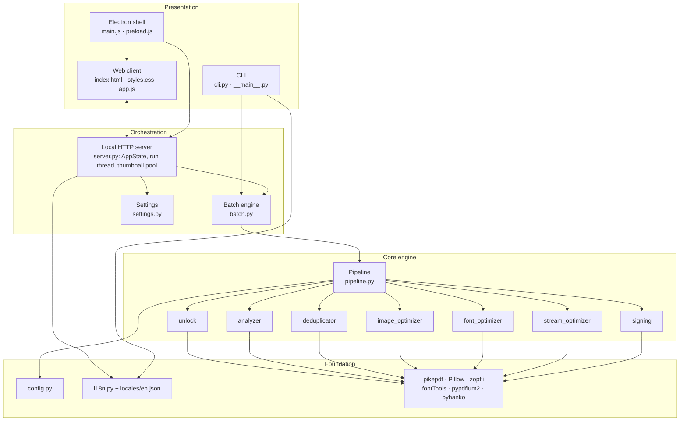
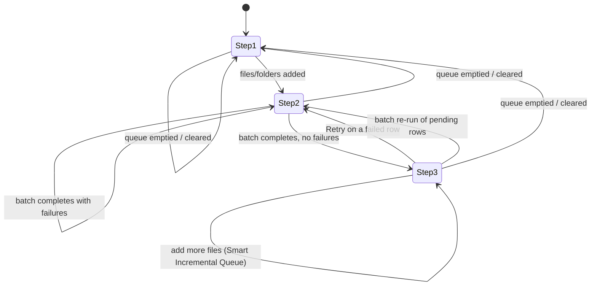

# OzemPDF — Technical Specification

| Field | Value |
| --- | --- |
| Document ID | OZEM-TS-001 |
| Product | OzemPDF |
| Specification version | 2.0 |
| Application version described | **0.3.3** (`python/src/ozempdf/_version.py`) |
| Document status | Current-state specification (descriptive + normative for invariants) |
| Last updated | 2026-11-24 |
| Audience | Maintainers, integrators, reviewers, AI coding agents |
| Related documents | [`README.md`](../README.md), [`AGENTS.md`](../AGENTS.md), [`CHANGELOG.md`](CHANGELOG.md), [`DESIGN.md`](DESIGN.md), [`PRODUCT.md`](PRODUCT.md), [`DISCREPANCIES.md`](DISCREPANCIES.md), [`DEPENDENCIES.md`](DEPENDENCIES.md), [`pyproject.toml`](../pyproject.toml) |

> **Architecture history.** Versions up to 0.2.0 shipped a PySide6 desktop GUI. From 0.3.0 the
> presentation layer is plain HTML/CSS/JavaScript served by the Python engine over a loopback HTTP
> API, wrapped by an Electron shell on the desktop. The Qt chapters of the 1.0 specification were
> replaced, not annotated: §7 now describes the shipped interface and §15.3 the HTTP API. The engine
> chapters (§3–§6, §8–§11, §15.1–§15.2) keep their original intent with the behaviour updated to the
> current tree.

> **Authority.** This document describes the implementation as it exists in source at version 0.3.3.
> Where prose in the README or a locale catalog disagrees with observable behaviour, the behaviour of
> `python/src/ozempdf/**` is authoritative and the disagreement is recorded in
> [§16](#16-defect-ledger-and-known-limitations). Normative project rules live in
> [`AGENTS.md`](../AGENTS.md); this specification restates them and adds precision, it does not relax
> them.

---

## Table of contents

1. [Introduction](#1-introduction)
2. [System overview](#2-system-overview)
3. [Domain model and configuration](#3-domain-model-and-configuration)
4. [Compression pipeline specification](#4-compression-pipeline-specification)
5. [Batch engine](#5-batch-engine)
6. [Command-line interface](#6-command-line-interface)
7. [Web interface and desktop shell](#7-web-interface-and-desktop-shell)
8. [Localization subsystem](#8-localization-subsystem)
9. [Non-functional requirements](#9-non-functional-requirements)
10. [Security and safety analysis](#10-security-and-safety-analysis)
11. [Error handling and diagnostics](#11-error-handling-and-diagnostics)
12. [Test specification](#12-test-specification)
13. [Build, packaging and release](#13-build-packaging-and-release)
14. [Extensibility guide](#14-extensibility-guide)
15. [Interface reference](#15-interface-reference)
16. [Defect ledger and known limitations](#16-defect-ledger-and-known-limitations)
17. [Future work](#17-future-work)
- [Appendix A — File inventory](#appendix-a--file-inventory)
- [Appendix B — JSON schemas](#appendix-b--json-schemas)
- [Appendix C — Localization key groups](#appendix-c--localization-key-groups)
- [Appendix D — Glossary](#appendix-d--glossary)

---

## 1. Introduction

### 1.1 Purpose

OzemPDF is a cross-platform application that reduces the file size of PDF documents without
touching what they say. It is deliberately narrow: it shrinks embedded raster images, redundant
resources, bloated stream encoding, embedded font subsets and application-private junk, and it
refuses every transformation that would rewrite a page. Two invariants carry the product's promise —
pages are never rasterized or regenerated, and no output is ever larger than its input.

It is used by three kinds of people: someone who needs to e-mail a scanned document under a portal
limit, an operations team that slims a folder of invoices every month from a script, and a designer
who needs to prove the result still looks right before handing it over.

### 1.2 Scope

In scope:

- A local interface (desktop window or browser) for adding files, choosing a preset, running a
  batch, reading the savings breakdown, and comparing pages before and after.
- A command-line interface with the same engine, deterministic exit codes and a JSON report.
- Object-level PDF optimisation with a never-grow guardrail and atomic output writes.
- Deliberate handling of encrypted and signed documents, including re-signing with a PKCS#12
  certificate.
- English UI copy through a catalog system that accepts new languages without a rebuild.

Out of scope:

- Editing, merging, splitting, OCR, or rendering new documents.
- Password recovery. Owner restrictions are removed because the document is already readable with
  the empty user password; an open password or a private key must be supplied by the owner.
- Preserving digital signatures through compression. A signature covers the bytes it was made over,
  so a compressed document is by definition unsigned; the app either flattens the signature
  (with consent) or re-signs the result.
- Cloud storage, accounts, telemetry, or any network access.

### 1.3 Conventions

- `MUST`, `MUST NOT`, `SHOULD` are normative. Invariants are `INV-n`, functional requirements
  `FR-<area>-n`, non-functional requirements `NFR-n`, constraints `CON-n`, defects `D-nn`.
- Paths are repository-relative POSIX paths. Line counts are indicative, not contractual.
- "Effective DPI" means image pixels divided by the size the image occupies on the page, after the
  page's transformation matrix — not the image's nominal resolution.

### 1.4 References

- PDF 1.7 / ISO 32000-1:2008 — object model, filters, `/DecodeParms` predictor 15, encryption,
  signatures.
- `pikepdf` documentation — object model, `save` parameters, encryption handling.
- `fontTools.subset` documentation — `retain_gids` and table selection.
- PKCS#12 / RFC 7292; RFC 3161 for timestamping.
- WCAG 2.2 AA — contrast and focus requirements for the interface.

---

## 2. System overview

### 2.1 Product surface

| Surface | Entry point | Consumer |
| --- | --- | --- |
| Desktop app | `OzemPDF.exe` (Electron 38) → spawns the engine → loads its local URL | End users |
| Console script `ozempdf` | `ozempdf.__main__:main` → `ozempdf.cli:run_cli` | Shell, CI, scripts |
| Local server | `ozempdf --serve [--port N] [--no-browser]` | Browser fallback, development, tests |
| Module execution | `python -m ozempdf` | Development |
| Frozen engine | PyInstaller `artifacts/dist/engine/ozempdf-engine/ozempdf-engine.exe` | Bundled inside the desktop app |

Invoking `ozempdf` with **no arguments** launches the interface. In a checkout that means starting
the local server and opening the default browser; in the packaged app the Electron shell does it. The
desktop experience is the default; the CLI is one flag away.

### 2.2 Goals

- `G1` — Reduce embedded-raster and stream bloat by a large factor while keeping text and vectors
  pixel-identical.
- `G2` — Never produce a larger file than the input (see `INV-2`).
- `G3` — Work identically on Windows, macOS and Linux with no external binaries (no Ghostscript, no
  Poppler, no qpdf CLI).
- `G4` — Give the user a comprehensible, progressive, theme-capable interface that runs in a normal
  browser and in a native window from the same source.
- `G5` — Be scriptable: stable CLI flags, deterministic exit codes, machine-readable JSON.

### 2.3 Non-goals

- `NG1` — Maximum-ratio compression at any perceptual cost. Even "Max Slim" is bounded to `110 DPI`
  and JPEG `Q=75`.
- `NG2` — Re-distillation or rendering of pages.
- `NG3` — Being a general PDF library; the public API is small and pipeline-oriented.
- `NG4` — Being a web service. The server binds loopback only and has no accounts, uploads to a
  remote host, or persistence beyond the settings file.

### 2.4 Quality invariants

These are normative and are enforced by review, tests, or code structure.

| ID | Invariant | Enforcement |
| --- | --- | --- |
| `INV-1` | Pages are never rasterized. Page `/Contents` streams are never regenerated. Vector and text operators are never rewritten. | No code path writes page content except signature flattening, which **appends** a `q … cm /Name Do Q` sequence. |
| `INV-2` | An individual image stream is replaced only if the replacement payload is strictly smaller. | `if len(new) < orig_len` at every `_apply_stream_update` call site. |
| `INV-3` | The final output PDF is never larger than the input. | Post-save size check in `pipeline.py`; the original is copied instead. |
| `INV-4` | Cross-platform: no OS-specific paths, shell-outs or native-code paths outside the two documented modules. | `pathlib`, `sys._MEIPASS` handling in `resources.py`; `os.name` branches only in `settings.py` (data locations) and `server.py` (`_open_in_os`). |
| `INV-5` | All user-facing strings go through `ozempdf.i18n.t` in Python and `data-i18n`/`t()` in the UI. | `AGENTS.md`; tests assert key coverage and zero orphans. |
| `INV-6` | Every module, class and public function carries type annotations and a Google-style docstring. | `AGENTS.md`. |
| `INV-7` | Inputs are opened **read-only**; every output write is atomic (temp file in the destination directory, then `os.replace`). | `unlock._open_pdf` has no `allow_overwriting_input`; a test asserts it; the pipeline never writes to the source path. |

### 2.5 Layered architecture



**Dependency rule.** `engine/*` MUST NOT import `server`, `cli` or `web`. `server.py` MAY import
`engine` and `i18n`. `batch.py` MAY import `pipeline`; `pipeline.py` MUST NOT import `batch.py`.
The web client has no build step and no imports at all: it is three static files plus the bundled
fonts.

### 2.6 Runtime modes

| Mode | Process model | Notes |
| --- | --- | --- |
| Desktop app | Electron main process + one engine child (`--serve`); compression in a `ProcessPoolExecutor` inside the engine | The window is a browser view onto the local server; the shell never compresses |
| Browser | One engine process serving the UI and the API | Same UI, same API; drops are staged because a browser cannot reveal real paths |
| CLI single file | In-process, no pool | Fast path for one document |
| CLI batch | `ProcessPoolExecutor` from the main process | Bypassed for a single file |
| Frozen engine | Same as above plus `multiprocessing.freeze_support()` | Required for the PyInstaller build on Windows |

### 2.7 Technology stack

| Dependency | Version floor | Role |
| --- | --- | --- |
| `pikepdf` | `>=8.0.0` | PDF object model, content-stream parsing, save, object streams |
| `Pillow` | `>=10.0.0` | Raster decode, Lanczos resize, quantization, JPEG encode |
| `zopfli` | `>=0.2.2` | High-density deflate (zlib-wrapped) |
| `fonttools` | `>=4.40.0` | SFNT parsing and subsetting |
| `pypdfium2` | `>=4.20.0` | Page rasterization for thumbnails and the inspector |
| `pyhanko` | `>=0.25.0` | PKCS#12 signing and RFC 3161 timestamps |
| `Electron` | `^38.0.0` (desktop shell only) | Native window, file pickers, close guard |
| `pytest`, `ruff`, `pyinstaller` (dev) | `>=7.4`, latest, `>=6.0` | Tests, lint, frozen engine |

The interface itself uses no runtime library: plain ES2020 modules in the browser, plain CSS with
custom properties, no bundler and no transpiler. The Python side uses only the standard library for
the server (`http.server`, `json`, `threading`).

Python floor: **3.10** (`requires-python = ">=3.10"`); CI/reference interpreter: 3.14.

---

## 3. Domain model and configuration

### 3.1 Enumerations

```python
class PresetMode(str, Enum):   # config.py
    LOSSLESS = "lossless"      # Strict Lossless
    BALANCED = "balanced"      # Visually Lossless (default)
    MAX_SLIM = "max"           # Max Slim
    CUSTOM = "custom"          # any advanced-knob edit

class OutputMode(str, Enum):
    SUFFIX = "suffix"          # alongside original, stem + suffix
    CUSTOM_FOLDER = "folder"   # mirror relative tree into output_dir
    OVERWRITE = "overwrite"    # atomic in-place replacement
```

`from_preset` accepts either a string or a `PresetMode` member. An unknown string resolves to
Balanced; `custom` has no stored definition and is produced only by editing a knob at runtime. A
typed caller passing the enum gets that enum's configuration — `str()` of a `str`-Enum is not its
value on Python 3.11+, which is why the branch exists and why
`python/tests/test_settings.py::test_from_preset_accepts_an_enum_member` covers it.

### 3.2 `CompressionConfig`

A `@dataclass(slots=True)` carrying every knob that affects the pipeline. Defaults equal the
**Balanced** preset.

| Field | Type | Default | Range / domain | Pipeline effect |
| --- | --- | --- | --- | --- |
| `preset` | `PresetMode` | `BALANCED` | enum | informational + UI state |
| `strict_lossless` | `bool` | `False` | — | selects image-optimizer Mode A vs Mode B |
| `enable_downsampling` | `bool` | `True` | — | gates Lanczos downsampling |
| `target_dpi` | `int` | `150` | 72–600 (one range everywhere) | downsampling target |
| `downsample_threshold_dpi` | `int` | `218` | `max(target_dpi + 1, round(target_dpi * 1.45))` | only downsample above this effective DPI |
| `jpeg_quality` | `int` | `85` | 50–98 (one range everywhere) | progressive JPEG quality |
| `quantize_ui_screenshots` | `bool` | `True` | — | enables the perceptual `/Indexed` candidate |
| `ui_palette_colors` | `int` | `256` | 64–256 | palette size for the UI raster candidate |
| `zopfli_iterations` | `int` | `15` | 5–50 | Zopfli passes for every deflate site |
| `strip_opaque_smask` | `bool` | `True` | — | delete 100 %-opaque `/SMask` streams |
| `deduplicate_resources` | `bool` | `True` | — | run Stage 3 |
| `use_object_streams` | `bool` | `True` | — | `ObjectStreamMode.generate` vs `preserve` |
| `subset_fonts` | `bool` | `True` | — | run Stage 5a |
| `strip_bloat` | `bool` | `True` | — | remove `/PieceInfo`, `/Thumb` |
| `unlock_and_flatten_signatures` | `bool` | **`False`** | — | run the signature-flattening pass (consent required in the UI) |
| `strip_metadata` | `bool` | `False` | — | remove XMP + `/Info` |
| `output_mode` | `OutputMode` | `SUFFIX` | enum | destination strategy |
| `output_suffix` | `str` | `"_compressed"` | non-empty after strip | suffix used by `OutputMode.SUFFIX` |
| `output_dir` | `str` | `""` | existing dir | root for `OutputMode.CUSTOM_FOLDER` |
| `max_workers` | `int` | `0` | 0 = auto | `0` → `min(total, cpu_count)` |
| `password` | `str` | `""` | — | caller-supplied open password; never persisted |
| `sign_after_slimming` | `bool` | `False` | — | re-sign the output with the configured PKCS#12 |
| `sign_pkcs12_path` | `str` | `""` | readable file | certificate bundle |
| `sign_pkcs12_password` | `str` | `""` | — | never persisted, never reported |
| `sign_field_name` | `str` | `"OzemPDF Signature"` | non-empty | signature field name |
| `sign_reason` | `str` | `"Slimmed with OzemPDF"` | — | `/Reason` |
| `sign_location` | `str` | `""` | — | `/Location` |
| `sign_tsa_url` | `str` | `""` | http(s) URL | RFC 3161 timestamp authority |

`copy_with(**overrides)` returns a clamped copy (`dataclasses.replace` + `clamped()`), used to freeze
a snapshot for workers and to rebuild configurations from settings. `to_dict(public=True)` omits
secrets, and `from_dict` ignores unknown keys, so the JSON contract is forwards compatible.

`clamped()` enforces every range and fixes derived values: a strict-lossless configuration forces
`enable_downsampling = False` (the mode is a real flag, not a slider position), and the threshold is
recomputed as `max(target_dpi + 1, round(target_dpi * 1.45))`.

### 3.3 Built-in presets

| Knob | Strict Lossless | Visually Lossless (Balanced) | Max Slim |
| --- | --- | --- | --- |
| `strict_lossless` | **True** | False | False |
| `enable_downsampling` | **False** | True | True |
| `target_dpi` | 600 | 150 | 110 |
| `downsample_threshold_dpi` | 900 | 218 | 160 |
| `jpeg_quality` | 98 | 85 | 75 |
| `quantize_ui_screenshots` | **False** | True | True |
| `ui_palette_colors` | 256 | 256 | **128** |
| `zopfli_iterations` | 15 | 15 | **25** |
| `strip_opaque_smask` | True | True | True |
| `deduplicate_resources` | True | True | True |
| `use_object_streams` | True | True | True |
| `subset_fonts` | True | True | True |
| `strip_bloat` | True | True | True |
| `unlock_and_flatten_signatures` | **False** | **False** | **False** |
| `strip_metadata` | False | False | **True** |
| `sign_after_slimming` | False | False | False |

Notes:

- Signature flattening is **off in every preset** (D-14). Turning it on — in the drawer or with
  `--flatten-signatures` — is an explicit act with a stated consequence.
- Any advanced-knob edit in the interface forces `preset = CUSTOM` and `strict_lossless = False`.
  The user must re-select Strict Lossless to return to it.
- Re-signing is never part of a preset: it needs a certificate the preset cannot know about.

### 3.4 Byte accounting: `CategoryBreakdown`

Five counters representing the four user-facing categories plus the total.

| Field | Classification rule |
| --- | --- |
| `images_bytes` | `/Subtype /Image` streams and their `/SMask`/`/Mask` streams — **unless** the object is a page `/Thumb`, which is classified by role first (D-16) |
| `fonts_bytes` | `/FontDescriptor` `/FontFile`, `/FontFile2`, `/FontFile3`; `/ToUnicode` CMaps; streams with `/Subtype /Font1`, `/Type1C`, `/CIDFontType0C`, `/OpenType`; streams carrying `/Length1`–`/Length3` |
| `vectors_bytes` | page `/Contents` streams (direct or array) and `/Subtype /Form` XObjects |
| `metadata_bytes` | `/Type /Metadata` and `/Subtype /XML` streams, page `/Thumb` images, **plus every unclassified stream**, **plus** `file_size - sum(streams)` (xref/dictionary overhead) |
| `total_bytes` | `file_size` when supplied, else the maximum of the stream sum |

The audit sums to the file size by construction: unclassified bytes are counted in
`metadata_bytes`, so `images + fonts + vectors + metadata == total`. Objects are de-duplicated by
`(objgen)` because `pdf.objects` yields the same object more than once for shared resources.
Aggregation helpers: `__add__` and `add_inplace` (used by `BatchSummary`).

### 3.5 Stage statistics

| Type | Fields |
| --- | --- |
| `UnlockStats` | `was_encrypted`, `signatures_flattened`, `perms_removed`, `protection_kind` |
| `DeduplicationStats` | `duplicate_images_merged`, `duplicate_icc_merged`, `duplicate_fonts_merged`, `bytes_saved_estimate` |
| `ImageOptimizationStats` | `images_inspected`, `images_optimized`, `opaque_smasks_stripped`, `images_downsampled`, `images_indexed`, `bytes_saved` |
| `FontOptimizationStats` | `font_streams_inspected`, `font_streams_optimized`, `cmaps_optimized`, `bytes_saved`, alias `fonts_subsetted` |
| `StreamOptimizationStats` | `pieceinfo_removed`, `thumbnails_removed`, `metadata_removed`, `streams_recompressed`, `bytes_saved`, alias `piece_info_removed` |

### 3.6 `FileCompressionResult`

The unit of reporting for one file. Derived properties: `bytes_saved = max(0, original -
compressed)` and `reduction_percent`. `to_dict()` yields the schema in
[Appendix B.1](#b1-filecompressionresult). Fields, in order: `input_path`, `output_path`, `success`,
`error_message`, `page_count`, `original_bytes`, `compressed_bytes`, `before_breakdown`,
`after_breakdown`, `images_inspected`, `images_optimized`, `opaque_smasks_stripped`,
`images_downsampled`, `images_indexed`, `duplicate_images_merged`, `font_streams_optimized`,
`cmaps_optimized`, `signatures_flattened`, `was_encrypted`, `protection_kind`,
`protection_removed`, `required_password`, `kept_original_guardrail`, `already_optimal`, `signed`,
`output_mode`, `elapsed_seconds`.

### 3.7 Queue items and `BatchSummary`

`BatchJobItem` is interface/batch state: `id`, `input_path`, `base_folder`, `relative_label`,
`page_count`, `original_bytes`, `status`, `result`, `thumbnail_png`, `protection_kind`,
`required_password`.

`status` domain: `"queued"`, `"new_queued"`, `"processing"`, `"done"`, `"error"`.

`BatchSummary` holds `results` and `elapsed_seconds` and exposes `total_files`,
`succeeded_count`, `failed_count`, `total_original_bytes`, `total_compressed_bytes`,
`total_bytes_saved`, `total_reduction_percent`, `protection_removed_count`,
`aggregate_before_breakdown`, `aggregate_after_breakdown`. Byte totals count **successful files
only**; `total_files` counts all.

### 3.8 Output path resolution

`resolve_output_path(input_path, config, base_folder)`:

| `output_mode` | Result |
| --- | --- |
| `OVERWRITE` | `input_path.resolve()` |
| `CUSTOM_FOLDER` with `output_dir` and `base_folder` | `output_dir / relative_to(base_folder)` — nested tree preserved |
| `CUSTOM_FOLDER` with `output_dir`, no `base_folder` | `output_dir / input_path.name` |
| `SUFFIX` (default) | `parent / f"{stem}{suffix}{ext}"`; suffix falls back to `_compressed` |

Collisions are detected before the run: `_unique_outputs` appends `-2`, `-3`, … to the stem until
every target is distinct (D-18). Two same-named inputs from different roots therefore both survive.

---

## 4. Compression pipeline specification

### 4.1 Orchestration

`compress_pdf_file(input_path, output_path, config)` is the single entry point. Sequence:

```text
0.  Resolve paths, stat input, mkdir output parent
1.  Stage 1  open read-only, unlock, classify protection   -> pdf, UnlockStats
    Stage 1b flatten signatures                            [only with consent]
2.  Stage 2  audit_pdf_bytes(pdf, file_size)               -> before_breakdown
             calculate_effective_image_dpis(pdf)           -> {objgen: dpi}
3.  Stage 3  deduplicate_resources(pdf)                    [if deduplicate_resources]
4.  Stage 4  optimize_all_images(pdf, dpis, cfg)
5.  Stage 5a optimize_fonts(pdf, cfg)
6.  Stage 5b strip_structural_bloat(pdf, cfg, stats)
7.  Stage 6  recompress_content_streams(pdf, cfg, stats)
8.  pdf.remove_unreferenced_resources()                    [best effort, exceptions swallowed]
9.  Save to a temp file in the destination directory, close pdf
10. Guardrail check on temp size vs original
11. Audit output PDF (after_breakdown)
12. Stage 7  sign the temp file                             [if sign_after_slimming]
13. os.replace(temp, output) atomically
```

**FR-PIPE-1** Stages MUST execute in the order above; Stage 3 precedes Stage 4 so duplicate images
are collapsed before expensive re-encoding.

**FR-PIPE-2** A non-file input path returns `success=False` with `error_message` and no exception.

**FR-PIPE-3** Any unhandled exception MUST become `FileCompressionResult(success=False,
error_message=…)`; the CLI and the interface never see an exception.

**FR-PIPE-4** The temporary file MUST live in the destination directory (same volume) so the final
`os.replace` is atomic. Naming: `.ozempdf_<random>.tmp.pdf`.

**FR-PIPE-5** The input MUST be opened read-only. The pipeline never writes to the source path, so
cloud placeholders, read-only media and files held open by another application work. A
`PermissionError` becomes an actionable message that names the blocked path and suggests closing the
application that holds it or downloading the cloud copy; it is never a bare `[Errno 13]`.

### 4.2 Save parameters

```python
pdf.save(
    tmp_path,
    object_stream_mode=(pikepdf.ObjectStreamMode.generate
                        if cfg.use_object_streams
                        else pikepdf.ObjectStreamMode.preserve),
    compress_streams=True,
    stream_decode_level=pikepdf.StreamDecodeLevel.generalized,
    recompress_flate=False,   # preserve higher-density Zopfli streams
    encryption=False,         # output is always a plain PDF
)
```

`recompress_flate=False` is load-bearing: letting qpdf re-deflate would replace Zopfli output with
plain zlib and can grow the file. `encryption=False` is deliberate — an unlocked document stays
unlocked, and users handling regulated material are told so in the interface and the docs.

### 4.3 Stage 1 — Open, unlock, classify protection (`engine/unlock.py`)

**FR-UNL-1** Open with the **empty user password first**, then the caller-supplied password when one
was given. The empty password opens owner-restricted documents, which is the permission case; no
dictionary or brute force is ever attempted (D-15).

**FR-UNL-2** If neither opens the document, raise `PasswordRequiredError`. If the encryption scheme
is certificate-based or otherwise unsupported, raise `UnsupportedProtectionError`.

| Input | `protection_kind` | Behaviour |
| --- | --- | --- |
| Not encrypted | `none` | Normal compression |
| Opens with the empty user password | `permissions` | Decrypted, restrictions removed, plain output. **No password needed.** |
| Opens only with an open password | `password` | The password is required; `required_password = True`. Supplied once per run, never persisted. |
| Certificate / public-key, or unsupported filter | `unsupported` | Reported, never guessed at |

The stage reports `protection_kind` and `protection_removed`; the result carries both, and the batch
counts unlocked documents.

**FR-UNL-3** Signature flattening appends a `q … cm /Name Do Q` sequence that paints an `OzSigFlat`
appearance, then removes `/Sig`, `/SigFields` and `/Perms`. It is off by default and requires explicit
consent in the interface. Flattening is **not** signature preservation: the byte-range digest cannot
survive, and the document is unsigned afterwards. Re-signing with a PKCS#12 certificate is the way to
end up signed again (Stage 7).

### 4.4 Stage 2 — Analysis (`engine/analyzer.py`)

- `audit_pdf_bytes(pdf, file_size)` → `CategoryBreakdown` that sums exactly to the file size (see
  §3.4). Objects are de-duplicated by `objgen`, and a page `/Thumb` is classified by role before
  subtype.
- `calculate_effective_image_dpis(pdf)` → `{objgen: effective_dpi}`. Walks each page's resources and
  the transformation matrix stack (`cm`/`q`/`Q`, recursing into Form XObjects with a visited set) to
  get the size an image actually occupies, then divides image pixels by that size. An image drawn
  small therefore has a high effective DPI and is a downsampling candidate.

### 4.5 Stage 3 — Deduplication (`engine/deduplicator.py`)

Hashes decoded payloads with SHA-256 per class — images, ICC profiles, font files — and points
duplicate streams at a single object. Original payloads are never modified here; the saving is
structural. Opaque `/SMask` streams (all-255 alpha) are deleted in this stage under
`strip_opaque_smask`: an alpha channel that is entirely opaque is by definition redundant.

### 4.6 Stage 4 — Images (`engine/image_optimizer.py`)

#### 4.6.1 Modes

| Mode | Trigger | Rule |
| --- | --- | --- |
| A — strict lossless | `config.strict_lossless` | Pixels are bit-identical after decode; no resampling, no JPEG re-encode, no lossy palette. Only lossless re-encoding, JPEG bloat stripping and exact-index palettes for images that already use ≤ 256 colours. |
| B — perceptual | everything else | Downsampling above the threshold, progressive JPEG at `jpeg_quality`, palette candidate for UI graphics. Bounded by `ng1`: Max Slim is 110 DPI / Q75. |

#### 4.6.2 Classification

A 160 px thumbnail is analysed: the ratio of flat runs (adjacent identical pixels) above **0.38**
with a small colour count means `UI_GRAPHIC`; a large palette with few flat runs means `PHOTOGRAPH`;
a single channel means `MONOCHROME`. This decides whether the `/Indexed` palette candidate is worth
trying — a photo must not be quantised into 256 colours.

#### 4.6.3 Candidate selection

For each eligible image the stage builds `_Candidate(cost, payload, filter, colorspace,
decode_parms)` options and applies the cheapest **only if** it is strictly smaller than the original
payload:

| # | Condition | Encoding | Colour space |
| --- | --- | --- | --- |
| 1 | `UI_GRAPHIC` + RGB + `quantize_ui_screenshots` | `FASTOCTREE` quantise to `min(256, max(16, ui_palette_colors))`, no dither, palette trimmed to the highest used index, `Predictor 15`+Zopfli or raw Zopfli | `/Indexed /DeviceRGB` |
| 2 | `PHOTOGRAPH`, or no candidate yet | progressive JPEG, `optimize=True`, `subsampling="4:2:0"` for RGB else `0`, then JPEG bloat strip | `/DeviceRGB` or `/DeviceGray` |
| 3 | `width*height ≤ 1_500_000` | raw Zopfli vs `Predictor 15` + Zopfli | `/DeviceRGB` or `/DeviceGray` |

Mode A adds one candidate the perceptual path does not need: `_exact_palette_candidate`, used only
when `getcolors(maxcolors=257)` returns at most 256 colours, so the index map is exact and the decode
is bit-identical. Without it, lossless mode quantised gradients (mean pixel difference 28.6); with
it, gradients keep their stream untouched.

**FR-IMG-1** Every image mutation MUST be gated by a strict decrease in encoded size.
**FR-IMG-2** Mode A MUST NOT alter any pixel value.
**FR-IMG-3** Mode B MUST re-encode `/SMask` consistently when the parent image is resized.
**FR-IMG-4** Images whose decoded mode is unsupported in Mode A MUST be left untouched rather than
colour-converted.
**FR-IMG-5** A stream's `/ColorSpace` MUST be written as `pikepdf.Name`, never a Python `str`: a
string becomes a PDF *string* and renders as a blank page. `/Indexed` is
`Array([Name("/Indexed"), Name(base), hival, String(palette)])`.
**FR-IMG-6** A 1-bit `/DeviceGray` raster MUST be recompressed from its *decoded* bytes
(`read_bytes()`), whose length MUST equal `ceil(width/8) × height`. Compressing the encoded stream
and declaring `FlateDecode` makes it decode to a deflate blob, and Word draws some text runs as
exactly this construct (colour image + 1-bit `/SMask`), so that mistake erases text (N-12). Streams
with `/Decode`, and 1-bit images whose colour space is not `/DeviceGray`, MUST be left untouched.

#### 4.6.4 `strip_jpeg_bloat_lossless`

Walks JPEG markers from `SOI`:

- Keeps `APP0` (JFIF), `APP2` (ICC_PROFILE), `APP14` (Adobe) and every table (`DQT`, `DHT`, `SOF*`,
  `DRI`, `SOS`).
- Drops `COM` (`0xFE`), `APP1` (`0xE1`, EXIF/XMP) and `APP3`–`APP13`, `APP15`.
- Copies the entropy-coded scan from `SOS` to `EOI` verbatim.
- Returns the original bytes on any structural anomaly, or when the result is not strictly smaller.

#### 4.6.5 `zopfli_compress(data, iterations)`

Returns the smaller of `zlib.compress(data, 9)` and `zopfli.zlib.compress(data, iterations)`, falling
back to plain zlib when Zopfli is missing, on empty input, or on an exception. Output is a
zlib-wrapped deflate stream, i.e. `/FlateDecode` compatible.

#### 4.6.6 `apply_png_predictor_15`

Row-adaptive encoder producing `height` rows of `[filter_byte][stride bytes]` from **all five** PNG
filters — None, Sub, Up, Average, Paeth — selected per row by the libpng heuristic (minimum sum of
absolute signed residuals, `b if b < 128 else 256 - b`). `bpp` is 1 for Gray/Indexed and 3 for RGB.
Round-trip and reference-value tests live in `python/tests/test_visually_lossless.py` (D-02).

Work is bounded so a pathological scan cannot stall a batch: the predictor loop is capped at 4 MP in
Mode A, and candidate 3 is offered only at ≤ 1.5 MP.

### 4.7 Stage 5 — Fonts, structural bloat, streams

#### 4.7.1 `optimize_fonts` (`engine/font_optimizer.py`)

1. Collect referenced codes: start with `{0, 32}`, then for every `Tj`, `'`, `"` string add each
   byte, and if the string length is even also add each big-endian 16-bit value; the same for every
   string inside a `TJ` array. Record `parsed_cleanly = False` if any page stream fails to parse.
2. For each `/FontDescriptor` stream in `/FontFile|2|3`: read raw and decoded bytes, skip empty,
   pass `/FontFile2` and `/FontFile3` through `_subset_and_compact_sfnt`, Zopfli-compress the result,
   and write it only if strictly smaller (for `/FontFile2` also update `/Length1`).
3. For each `/Font` with a `/ToUnicode` stream: Zopfli recompress and write only if smaller,
   crediting `cmaps_optimized` (D-17).

`_subset_and_compact_sfnt` uses `fontTools.subset` with:

| Option | Value |
| --- | --- |
| `retain_gids` | **True** — existing GIDs in content streams stay valid |
| `notdef_outline` | True |
| `glyph_names` | False |
| `legacy_kern` | False |
| `layout_features` | `[]` |
| `name_IDs` | `[1, 2, 6]` |
| `name_legacy` | True |
| `name_languages` | `[0x0409]` |
| `drop_tables` | `DSIG, GPOS, GSUB, GDEF, kern, hdmx, VDMX, LTSH, PCLT, BASE, JSTF, MATH, SVG, CBDT, CBLC, COLR, CPAL, sbix` |

Glyph selection: if the streams parsed cleanly **and** codes exist **and** `num_glyphs > 64`,
populate with `gids = used_codes ∩ [0, num_glyphs)` and `unicodes = used_codes`; otherwise populate
**all** GIDs (tables are still stripped). Return the original bytes when the result is not smaller or
on any exception.

**FR-FNT-1** `retain_gids=True` MUST remain set. Content streams reference glyph indices directly
(`/CIDToGIDMap /Identity`), so dropping GIDs corrupts text.
**FR-FNT-2** When fontTools is unavailable the pass degrades to Zopfli-only recompression.

#### 4.7.2 `strip_structural_bloat` (`engine/stream_optimizer.py`)

With `strip_bloat`: delete `/Root /PieceInfo`, every page `/PieceInfo`, and `/PieceInfo` on any
dictionary or stream; delete page `/Thumb` and credit its raw bytes.

With `strip_metadata`: delete `/Root /Metadata` and every key of `pdf.docinfo`.

Bookmarks (`/Outlines`), link annotations and AcroForm fields are never touched.

#### 4.7.3 `recompress_content_streams`

For every stream object: skip `/Subtype /Image` (Stage 4 owns it); skip any stream with
`/DecodeParms` (predictor parameters would be invalidated); process only uncompressed or exactly
`/FlateDecode` streams; skip decoded payloads under 32 bytes; Zopfli-compress and write only if
strictly smaller.

This is what shrinks page `/Contents`, Form XObjects and ICC profiles without changing a single
decoded byte of vector or text operators.

### 4.8 Never-grow guardrail

**FR-GRD-1** After saving to the temp file, compare `new_size` with `orig_size`.

**FR-GRD-2** Let `was_unlocked = was_encrypted or signatures_flattened > 0`.

- If `new_size >= orig_size` **and not** `was_unlocked`: delete the temp file, copy the original to
  `output_path` when the paths differ, and return a successful result with
  `compressed_bytes = original_bytes`, `after_breakdown = before_breakdown`,
  `kept_original_guardrail = True`.
- Otherwise audit the temp PDF, `os.replace` it onto `output_path`, and return
  `kept_original_guardrail = False`.

**Rationale for the exception:** decrypting or removing signature locks necessarily changes the byte
layout and can increase size; the user explicitly requested that transformation.

**FR-GRD-3** The guardrail MUST stay observable: `kept_original_guardrail` and `already_optimal` are
in the JSON, the row status, the results band, the inspector and a CLI summary line (D-12).

### 4.9 Stage 7 — Re-signing (`engine/signing.py`)

Runs after the guardrail and before the atomic promote, only when `sign_after_slimming` is set.

1. `SimpleSigner.load_pkcs12(path, passphrase)`; a wrong passphrase is a clean `SigningError`.
2. `PdfSignatureMetadata(field_name=…, md_algorithm="sha256", reason=…, location=…)`, with
   `HTTPTimeStamper` when `sign_tsa_url` is set.
3. Sign a temp copy, verify that `/AcroForm /Fields` now contains the field, then `os.replace`.

A failure leaves the input and the compressed output untouched: the run reports the error instead of
producing an unsigned file that claimed to be signed.

### 4.10 Cleanup

A `finally` block deletes the temp file if it still exists, on both the success and the failure path.
A hard kill therefore leaves no `.ozempdf_*.tmp.pdf` behind on the normal paths, and any leftover is
ignored by discovery.

---

## 5. Batch engine

### 5.1 Discovery (`discover_pdf_files`)

**FR-BAT-1** Inputs may be files or directories, in any mix.

**FR-BAT-2** A file is accepted only when its suffix is `.pdf` (case-insensitive) and its name does
not start with `.ozempdf_`. Results are de-duplicated by resolved absolute path, preserving first
occurrence order.

**FR-BAT-3** Directories are walked recursively; `dirs` and `files` are sorted so enumeration is
deterministic. Results are `(resolved_path, base_folder)` where `base_folder` is the directory that
was passed in, used to mirror the tree.

**FR-BAT-4** During directory scans, files whose stem already ends with `exclude_suffix` (the
configured output suffix) are skipped, so re-running a folder does not re-queue previous outputs. The
filter applies to scans only, never to explicit files.

### 5.2 Path mapping and inspection

- `resolve_output_path` — see §3.8.
- `_unique_outputs` — see §3.8 (collision suffixing).
- `inspect_pdf_quick_metadata(path, password)` → `(page_count, size)`. On open failure returns
  `(1, size)`; on stat failure `(0, 0)`; on a permission error the item carries the actionable
  message instead of failing the whole add.
- `render_page_png(path, page_index, zoom_percent…)` — renders through pypdfium2 with the zoom
  clamped so `longest_side * zoom ≤ 3400`, encodes PNG, and returns `None` on any failure. The
  interface requests a thumbnail for the queue and a larger render for the inspector. PDFium is
  **not thread-safe**, so every call (open, page, render, close) runs under one module lock; the
  inspector asks for both halves at once and the thumbnail pool runs in parallel, and overlapping
  calls corrupt PDFium's global state, after which every later render fails. When PDFium refuses a
  document that qpdf can still reconstruct — a lost cross-reference table, for instance — the page
  is rendered from a repaired in-memory copy; no file on disk is touched. A document password
  supplied for the run is kept in the row (in memory only) and used for its previews.

### 5.3 Execution (`run_batch_compression`)

**FR-BAT-5** Build `(input, output, config)` tasks for every item before starting.
**FR-BAT-6** `workers = config.max_workers or min(total, os.cpu_count() or 1)`.
**FR-BAT-7** If `total == 1` or `workers <= 1`, run sequentially in the calling process; otherwise use
`ProcessPoolExecutor`.
**FR-BAT-8** The worker function MUST be module-level and picklable.
**FR-BAT-9** Per-task exceptions become a failed `FileCompressionResult` carrying the original size;
they never abort the batch.
**FR-BAT-10** The progress callback runs exactly once per completed file as
`progress_callback(completed, total, result)`, in completion order.
**FR-BAT-11** `results` MUST be ordered by input index regardless of completion order.
**FR-BAT-12** An empty task list returns an empty summary with zero elapsed time.
**FR-BAT-13** Dispatch is lazy, with `FIRST_COMPLETED`: tasks are submitted as slots free up, so a
cancel prevents unstarted files from ever running.

### 5.4 Concurrency and cancellation

- Cancellation is cooperative and takes effect at the next file boundary: work already in flight is
  not killed, because a single file inside Zopfli cannot be interrupted safely.
- Files already completed keep their results; a file whose status was `processing` returns to
  `queued` with `result = None`.
- The interface's Stop is the same contract as the CLI's interrupt: no partial output is promoted,
  because promotion is the last step of a file.

### 5.5 Aggregation

`BatchSummary` byte aggregates exclude failed files; a failure contributes to `failed_count` only.
`aggregate_before_breakdown` / `aggregate_after_breakdown` sum successful results, and
`protection_removed_count` counts documents whose restrictions were removed.

---

## 6. Command-line interface

### 6.1 Invocation

```text
ozempdf                                   # start the interface (browser)
ozempdf --serve --port 8080 --no-browser  # serve the UI on a known port
ozempdf a.pdf                             # Balanced on one file
ozempdf dir/ -o out/ -w 8                 # recursive, custom folder, 8 workers
ozempdf a.pdf --json-report -             # machine-readable stdout only
ozempdf scan.pdf --flatten-signatures --sign-p12 me.p12 --sign-password env:P12
```

`run_cli` pre-scans `--lang` (both `--lang X` and `--lang=X`) before building the parser, so `--help`
and error text are localized. A bare positional word `serve` is treated as `--serve` for muscle
memory.

### 6.2 Options

| Flag | Type | Default | Behaviour |
| --- | --- | --- | --- |
| `inputs` (positional) | paths | `[]` | files and/or folders; empty ⇒ start the interface |
| `--gui` | flag | off | alias for the interface path, optionally pre-loading inputs |
| `--serve` | flag | off | serve the UI without the Electron shell |
| `--port` | int | `0` (ephemeral) | loopback port for `--serve` |
| `--no-browser` | flag | off | do not open a browser window |
| `-p`, `--preset` | `lossless`/`balanced`/`max` | `balanced` | base configuration |
| `--max-dpi` | int | preset | clamped 72–600; sets `enable_downsampling=True`, `strict_lossless=False` |
| `--jpeg-quality` | int | preset | clamped 50–98; sets `strict_lossless=False` |
| `--zopfli-iterations` | int | preset | clamped 5–50 |
| `--no-subset-fonts` | flag | off | `subset_fonts=False` |
| `--strip-metadata` | flag | off | `strip_metadata=True` |
| `--flatten-signatures` | flag | off | enables signature flattening (the UI asks for consent; the flag is that consent) |
| `-o`, `--output-dir` | path | `None` | `CUSTOM_FOLDER`, resolved |
| `--suffix` | str | `_compressed` | `SUFFIX`; empty falls back to `_compressed` |
| `--overwrite` | flag | off | `OVERWRITE`; takes precedence over `--output-dir` |
| `-w`, `--workers` | int | auto | `max_workers` |
| `--password` | str | `""` | caller-supplied open password |
| `--json-report` | path or `-` | `None` | write the JSON report; `-` means stdout |
| `--sign-p12` | path | `None` | re-sign the output with this PKCS#12 file |
| `--sign-password` | str | `""` | PKCS#12 passphrase (never echoed or reported) |
| `--sign-reason` | str | preset | `/Reason` of the new signature |
| `--sign-tsa` | URL | `None` | RFC 3161 timestamp authority |
| `--lang` | str | OS locale | sets the locale before parsing |
| `--verbose` | flag | off | DEBUG logging with per-file timings |
| `-h`, `--help` | flag | — | localized help |
| `-v`, `--version` | flag | — | prints `OzemPDF v0.3.3` |

**FR-CLI-1** `--max-dpi` and `--jpeg-quality` MUST clear `strict_lossless` (they are meaningless in
Strict Lossless).
**FR-CLI-2** When `--overwrite` and `--output-dir` are both given, `OVERWRITE` wins.
**FR-CLI-3** With `--json-report -`, every human-readable line is suppressed so stdout is pure JSON.
**FR-CLI-4** Signing flags without `--sign-p12` are ignored, and a signing failure fails the file
rather than silently producing an unsigned output.

### 6.3 Exit codes

| Code | Condition |
| --- | --- |
| `0` | all processed files succeeded, or the interface returned 0 |
| `1` | no PDF files discovered in the given paths |
| `2` | at least one file failed |
| shell result | `run_cli` returns the interface process's integer when delegating |

### 6.4 Console output

Per file (success):

```text
[i/N] OK   report.pdf: 14.2 MB -> 2.1 MB (-85.2%) -> report_compressed.pdf
```

Per file (failure, stderr):

```text
[i/N] ERR  broken.pdf: <error message>
```

An unlocked document adds a line naming the protection that was removed. Summary block:

```text
------------------------------------------------------------------------
OzemPDF v0.3.3 Batch Summary
Processed 3/3 files in 12.34s | 40.00 MB -> 6.00 MB | Saved 34.00 MB (-85.0%)
Savings Breakdown: Images -30.00 MB | Fonts -1.20 MB | Vectors/Streams -2.10 MB | Metadata/Bloat -0.70 MB
```

All of it is produced through `t(...)` keys under `cli.*`, help strings included (D-11): there are no
English literals in the parser.

---

## 7. Web interface and desktop shell

The presentation layer is plain HTML, CSS and JavaScript served by the Python engine over a
loopback HTTP server. There is no framework, no build step and no bundler: the files in
`python/src/ozempdf/web/` are shipped verbatim and served as static assets. Two shells wrap the same UI:

| Shell | Entry point | Use |
| --- | --- | --- |
| Desktop app | `OzemPDF.exe` → `electron/main.js` → spawns the frozen engine → loads its URL in Electron | Normal use on Windows, macOS, Linux |
| Browser | `python -m ozempdf --serve` (or the packaged `Start OzemPDF in browser.cmd`) | Hosts that block the Electron sandbox; no Electron at all |

Because both shells talk to the same local API, there is exactly one implementation of every
interaction and one set of tests (`python/tests/test_web.py`) covering them.

### 7.1 Startup handshake

`ozempdf.server.serve()` binds `127.0.0.1` on the requested port (default `0` = ephemeral), prints
one line to stdout and then serves:

```text
OZEMPDF_READY {"port": 51234, "url": "http://127.0.0.1:51234/?token=…"}
```

`electron/main.js` waits for that line, extracts the URL and calls `loadURL`. The token is also set as an
`HttpOnly`-equivalent session cookie (`ozempdf_token`) by the first navigation, so the page can call
the API without embedding the secret in every request. A ready line that never arrives is a startup
failure and is reported in `data/main.log`.

### 7.2 Local server security model

The server is a local API, not a public one, and is treated as an attack surface:

| Control | Implementation |
| --- | --- |
| Binding | `127.0.0.1` only; never `0.0.0.0` |
| Authentication | Random per-session token, accepted from the `X-OzemPDF-Token` header or the `ozempdf_token` cookie; every `/api/*` route except `/api/bootstrap` requires it |
| Cross-origin writes | `Origin` is validated on every `POST`/`PUT`; a foreign origin is rejected with 403 |
| Content injection | `Content-Security-Policy: default-src 'self'`, no inline script, no remote fonts or images |
| Path traversal | `/api/fs/list`, `/api/upload` and static serving resolve and confine paths; `..` is rejected |
| Long-running work | One batch at a time; `/api/run/stop` is idempotent |

The server never opens an outbound socket, so the "works offline" promise (US-049) is a property of
the process, not a policy.

### 7.3 Three-step state machine



| Trigger | Guard | Effect |
| --- | --- | --- |
| Add paths (Step 1) | new files discovered | append rows, move to Step 2 |
| Add paths (Step 2) | new files discovered | append rows, stay |
| Add paths (Step 3) | any row `done` | append rows with status `new_queued`, stay |
| Stepper click 2 | queue non-empty and not processing | show Step 2 |
| Stepper click 3 | any row `done` and not processing | show Step 3 |
| Batch complete, 0 failures | — | Step 3, breakdown selection reset to the aggregate |
| Batch complete, ≥1 failure | — | stay on the current step, refresh rows (failed rows offer Retry) |
| Stop requested | — | `processing` rows → `queued`, stay on the current step |
| Remove last row / Clear All | not processing | Step 1, dock hidden |

Step buttons are disabled when their destination would be empty, or while a run is active. The
active step is marked with `aria-current="step"`; a completed step keeps a success-coloured tick.

### 7.4 Header

`<header class="app-header">`, one row, three zones:

- **Brand** — a 32 px accent tile with the document mark, the wordmark, and a version chip. The chip
  is rendered from `state.version` (`v0.3.3`) by `applyI18n()`, never hardcoded; a test asserts the
  static fallback in `index.html` matches `_version.py`.
- **Stepper** — three buttons (`1. Add PDFs`, `2. Configure & Queue`, `3. Slimmed Results`) with
  connector rules. The active step gets an accent underline and an accent badge; passed steps get a
  success tick.
- **Controls** — language (`select`, built from `/api/bootstrap`'s catalog list), theme toggle
  (light/dark, following the OS preference on first run) and Help.

### 7.5 Step 1 — Add PDFs

Only the hero drop mat is shown: an accent-tinted 72 px icon tile, a headline, a wrapped subtitle
capped at 500 px, and the primary `Select PDF files` plus secondary `Select folder` buttons. No
presets, no queue, no dock — progressive disclosure: no compression knobs before there is something
to compress.

Dropping something that is not a PDF produces one notice naming what was ignored and why (US-004);
`/api/queue/add` returns `skipped[]` with a localized reason per entry, including duplicates.

### 7.6 Step 2 — Configure and queue

Top to bottom: the queue panel, the compression-mode card, the advanced drawer, and the footer dock.

Queue table columns (shared header and rows, CSS grid so translations can widen cells):

| Column | Content |
| --- | --- |
| Document | 34×44 thumbnail (page 1, rendered by `/api/thumb`) + name (bold, ellipsized) + relative path (monospace, ellipsized); `title` carries the full path |
| Pages | `Np`, or `…` until inspection completes |
| Original | `format_bytes`, or `…` |
| Status | `Slimmed = <size>` (success); `● New — Queued`; `Slimming…` with an indeterminate bar; `Error: <message>` (danger, full message in `title`); a lock or open-lock badge for protected documents; `Open password required` for a password-locked file |
| Savings | `-P%` success pill; `Pending`; `Failed` danger pill; `—` |
| Action | `Inspect` (done), `Retry` + `Remove` (error), `Remove` (queued), nothing (processing) |

Below 700 px the table becomes two-line records (document + savings on the first line, pages,
original and action on the second) so nothing is clipped. Rows are reachable by keyboard, and the
row button opens the inspector.

### 7.7 Compression mode card and advanced drawer

The segmented control offers `Strict Lossless`, `Visually Lossless` and `Max Slim`. Selecting one
replaces the whole configuration through `POST /api/preset` while preserving the output mode, suffix
and directory — the same contract the CLI has.

`Advanced` reveals three fieldset cards, laid out as three equal columns on wide screens and one
column below 1080 px:

| Card | Controls |
| --- | --- |
| Raster images | Target DPI slider 72–600 (with the live `downsample above N DPI` threshold), JPEG quality 50–98, `Screenshots → palette`, palette size 64–256 |
| Stream & deflate engine | Zopfli passes 5–50, strip opaque `/SMask`, deduplicate images and ICC profiles, object streams |
| Fonts, metadata & locks | Subset fonts, strip app bloat, flatten locks and signatures, strip XMP and document info, and the re-signing block (PKCS#12 file, password, field name, reason, location, TSA URL) |

Every control has a tooltip and an accessible label. Any knob edit sets `preset = CUSTOM` and
`strict_lossless = false`; the change is debounced into `POST /api/config`, which clamps and echoes
the canonical value, so the UI never holds an out-of-range number.

Two edits require consent first, because they change what the document legally is: flattening
signatures and re-signing. Each opens a dialog that states the consequence; cancelling reverts the
checkbox.

### 7.8 Step 3 — Slimmed results

- **Results band** — the headline percentage, the byte totals and a note. The note switches between
  success and warning styling when any file failed, reports "already as small as it gets" files,
  and counts unlocked documents (`band_notes_unlocked_one` / `_many`).
- **Processed list** — the same table relisted as `Processed Documents (N)`, or
  `Batch Queue (D slimmed, P new pending)` when files were added after the run.
- **Breakdown** — four category rows (images, fonts, vectors/streams, metadata/bloat), each with a
  label, `-P%`, a monospace `before → after` line and a bar whose fill is the fraction of that
  category removed. The card defaults to the **aggregate across all completed files**; clicking a
  completed row switches to that file and offers `Show total`; clicking the selected row returns to
  the aggregate.
- **Dock** — swaps the primary action to `Start new batch` and shows `Open output` when nothing is
  pending; with pending files it keeps the destination selector and offers `Slim N new PDFs (size)`.

### 7.9 Footer dock

Fixed to the bottom of the step area:

- Output group — `Save output to:` trigger, a suffix field (only in suffix mode) and a `.pdf`
  caption.
- Step 3 group — `Start new batch`.
- Spacer.
- `Open output`, `Stop` (only while running) and the primary action.

The destination dialog is a native `<dialog>` with three option cards: *Same folder with suffix*,
*Custom output folder…* (opens the folder picker immediately when empty) and *Overwrite original
files*, which carries an `Atomic` badge and requires a confirmation whose default button is **No**.

Primary action labels: `Slim 1 PDF (size)`, `Slim N PDFs (size)`, `Slimming (done/total)…`
(disabled), `Slim 1 new PDF (size)`, `Slim N new PDFs (size)`.

### 7.10 Quality inspector

`<dialog class="inspector">`, opened per row. The toolbar carries a `Wipe-slider inspector` badge,
the file name and a subtitle (`compare` when a slimmed file exists, otherwise `preview only` with the
wipe disabled), page navigation, four zoom pills (`100 %`, `200 %`, `400 %`, `800 %`, default
`200`), `Reset` and close.

The canvas paints the slimmed page on the right and the original on the left, clipped at
`wipe_x = width * ratio` with `ratio ∈ [0.02, 0.98]` (default `0.5`). A 2 px accent divider and a
draggable handle sit on the seam; corner badges read `ORIGINAL (size)` and
`SLIMMED (size • -pct% • vectors 100% crisp)`, or `PREVIEW (…)` when no output exists yet.

Interaction: dragging near the divider wipes, dragging elsewhere pans, the wheel zooms, and the keys
`←`/`→` step pages, `+`/`=`/`-` zoom and `R` resets. Pages are rendered by `/api/page` with
`scale = clamp(1.15 * (zoom/200), 0.5, 3400/longest_side)` so a huge page cannot stall the dialog.
The footer holds the wipe slider (2–98), the percentage readout, a pan hint, `Open file` and `Done`.
A page the engine cannot rasterise shows a localized notice over the canvas instead of leaving a
silent dark stage; the file on disk is untouched.

### 7.11 Drag and drop

The drop mat, the queue panel and the window are all drop targets; dragging over any of them lights
up the shared `dragActive` state. In the desktop shell the dropped path comes from Electron's
`webUtils.getPathForFile`; in a browser, where a real path cannot be revealed, the file is staged
through `/api/upload` and compressed from that copy, so the browser build never silently loses files.

### 7.12 Keyboard shortcuts

| Shortcut | Action | Guard |
| --- | --- | --- |
| `Ctrl/Cmd+O` | Select PDF files | not processing |
| `Ctrl/Cmd+Shift+O` | Select folder | not processing |
| `Enter` | Start the batch | focus not in a field or on a button |
| `Ctrl/Cmd+I` | Inspect the first completed file | — |
| `←` / `→` | Inspector page step | inspector open |
| `+` / `=` / `-` | Inspector zoom step | inspector open |
| `R` | Inspector reset | inspector open |
| `Esc` | Close the topmost dialog | — |

Every control is a real `<button>` or `<input>`, so focus order, `Tab`, `Space` and screen readers
work without a custom key handler. The help dialog lists the same table.

### 7.13 Settings persistence

- Location: `data/settings.json` beside the executable for packaged builds (see
  [§13.3](#133-standalone-builds)); `%APPDATA%/OzemPDF` or `~/.config/OzemPDF` for a source install;
  `electron/.dev-data` for the dev checkout. `OZEMPDF_DATA_DIR` overrides all of it.
- Write: JSON to `settings.json.tmp`, then `os.replace`; failure is non-fatal.
- Read: a corrupt or missing file yields `{}`.
- Persisted: `dark_mode`, `language`, `preset`, `advanced_open`, and the advanced knob subset plus
  the output destination under `config`. Passwords (open password, PKCS#12 password) are never
  persisted — `PERSISTED_KEYS` excludes them and a test asserts it.
- Restored configuration is rebuilt from the preset first, then overlaid with stored values whose
  keys exist on the dataclass; invalid enum strings are ignored.
- Theme on first run follows `prefers-color-scheme`.

### 7.14 Theme engine

Themes are CSS custom properties on `:root` and `[data-theme="dark"]` in `styles.css`; there is no
stylesheet generator and no per-widget recolouring. The token set covers surfaces (`--bg`,
`--surface`, `--raised`, `--raised-2`), lines (`--line`, `--line-strong`), text (`--ink`, `--ink-2`,
`--ink-3`), the accent (`--accent`, `--accent-hover`, `--accent-ink`, `--accent-soft`) and the
semantic pairs (`--success`, `--warning`, `--danger`, each with a soft tint).

The accent is **ink blue**: `#1b4a80` light / `#63b3ed` dark. Green, amber and red keep their
semantic meaning for savings, partial runs and errors, so nothing that communicates state is
decorative. Measured contrast (WCAG): accent on surface 8.6:1 light / 7.8:1 dark; white on accent
9.0:1; accent on its soft tint 7.6:1 light / 6.3:1 dark; body text 16.5:1 / 14.9:1. `DESIGN.md`
carries the full table.

Theme switching is a `data-theme` attribute on `<html>`; the choice is stored and applied before
first paint to avoid a flash.

### 7.15 Typography and icons

- IBM Plex Sans (latin + latin-ext `woff2`) for prose and controls, JetBrains Mono for every
  measurement, path and size. Both are bundled under `web/fonts/` with their OFL texts, declared as
  package data and copied into the frozen engine, so a packaged build never falls back to system
  fonts.
- One inline SVG sprite (`<symbol>` per glyph) referenced with `<use href="#i-…">`, so icons inherit
  `currentColor` and the theme automatically. No emoji, no icon font, no per-theme icon files.

### 7.16 Threading

| Work | Where it runs | Why |
| --- | --- | --- |
| HTTP requests | `ThreadingHTTPServer` request threads | a slow request must not block the UI or a batch |
| Batch compression | one dedicated run thread per `/api/run/start`, which dispatches files to a `ProcessPoolExecutor` | the UI keeps answering `/api/run` polls while files compress |
| Thumbnails and page renders | `ThreadPoolExecutor(2)` in `AppState`, plus request threads for `/api/page` | bounded parallel rendering without competing with the batch; every PDFium call is serialized by one lock because PDFium is not thread-safe |
| Compression itself | worker processes, one file each | CPU-bound; the GIL would serialize threads |

The UI never blocks on a compression call: it polls `/api/run`, which returns the live queue,
progress and results. Closing the window mid-run is guarded (US-053): the shell asks, then stops at a
file boundary and waits for the in-flight file before quitting.

### 7.17 Reduced motion

`@media (prefers-reduced-motion: reduce)` disables the drawer reveal, breakdown-bar growth, toast
slides and inspector transitions. No JavaScript switch is needed, and no animation is load-bearing —
the reduced-motion path reaches the same states.

### 7.18 Live retranslation

`POST /api/ui` sets the language, persists it, and returns the full flattened catalog plus the
resolved language. The client re-renders every `data-i18n` node and every string it built in
JavaScript, so switching language does not reload the page or lose queue state. `document.documentElement.lang`
and `document.title` are updated too. The catalog list in the language `select` comes from
`available_languages()`, so dropping a new JSON file in `locales/` is the whole integration cost.

### 7.19 Desktop shell (Electron)

`electron/main.js`:

1. Resolves the engine: `resources/engine/ozempdf-engine/ozempdf-engine.exe` in a packaged build,
   `python -m ozempdf` in a checkout.
2. Points `userData`, `sessionData`, `crashDumps` and `TEMP`/`TMP`/`TMPDIR` at `data/` beside the
   executable, and passes `OZEMPDF_DATA_DIR` to the engine, so a portable copy writes nothing to
   `%APPDATA%` or the system temp directory.
3. Spawns the engine with `--serve --port 0 --no-browser`, waits for `OZEMPDF_READY`, then loads the
   URL. Startup, engine exit and renderer failures are appended to `data/main.log`.
4. Exposes only four capabilities through `electron/preload.js` with `contextIsolation`: `pickPaths`,
   `openPath`, `showItemInFolder`, `getPathForFile`. There is no `nodeIntegration`, and the renderer
   cannot read arbitrary files.
5. Intercepts `close` while a run is active, calls `window.__ozemCloseGuard()`, shows a native
   dialog, then `__ozemStopAndWait()` before quitting.

Electron is pinned to the **38.x** line: 45's Chromium sandbox aborts before `main.js` runs on the
reference Windows 11 host. The compatibility launcher (`--no-sandbox`) exists for hosts that still
block the sandbox; it is a host workaround, never the default.

### 7.20 Browser fallback

`python -m ozempdf --serve` prints the URL, opens the default browser unless `--no-browser` is given,
and serves the identical UI. Differences are deliberate and documented: a browser cannot reveal a
real file path, so drops are staged through `/api/upload`; `Open output` and `Show in folder` are
served by `/api/open`; the close guard uses `beforeunload`. Everything else — presets, drawer,
results, inspector, signing — behaves identically, which is what makes the browser build a real
fallback rather than a demo.

---

## 8. Localization subsystem

### 8.1 Catalog format

UTF-8 JSON, one file per locale: `python/src/ozempdf/locales/<code>.json`. 19 top-level groups, 282 leaf
strings at 0.3.3 (Appendix C).

- Reserved `_meta` object: `code`, `name`, `native_name`.
- Arbitrary nesting; lookups use dot paths (`step3.cat_images`).
- Values are strings; placeholders use `str.format` syntax (`{count}`, `{size}`).
- The fallback catalog is always `en.json`.

### 8.2 Resolution algorithm

`t(key, **kwargs)`:

1. Resolve the dotted path in the active catalog; if absent, resolve in the English fallback; if
   still absent, return the raw key.
2. If kwargs are given, `template.format(**kwargs)`; on `KeyError`, `ValueError` or `IndexError`
   return the unformatted template — never raise into UI or CLI code.

### 8.3 Language selection

Precedence: an explicit choice (a `--lang` flag or a stored preference restored at startup) →
`OZEMPDF_LANG` → `locale.getlocale()` → `en`. A full code (`pt_BR`) is tried, then its short form
(`pt`). Only catalogs that actually exist are selected. `set_language` returns `False` for an unknown
code and leaves the current language unchanged.

### 8.4 Discovery and switching

`available_languages()` globs `*.json`, sorts by code and reads `_meta` for display names. Both the
language `select` and the CLI `--lang` value come from that list, so dropping a new JSON file in the
directory is the whole integration cost — no compilation, no registration, no rebuild.

`POST /api/ui` switches the language, persists it and returns the flattened catalog. The client
re-renders every `data-i18n` node, so a switch keeps queue state and never reloads the page (D-21:
the choice also survives a restart).

### 8.5 Rules

**FR-I18N-1** No user-facing literal in `python/src/ozempdf/web/**`, `server.py`, `cli.py` or `engine/*`;
use `t()` in Python and `data-i18n`/`t()` in the UI.
**FR-I18N-2** Any new or changed string MUST be added to `en.json` in the same change.
**FR-I18N-3** Locale files MUST remain valid JSON with unique keys and no empty values; all three are
tested.

---

## 9. Non-functional requirements

### 9.1 Performance

| ID | Requirement | Current behaviour |
| --- | --- | --- |
| `NFR-1` | The interface must stay responsive during batches | compression runs in worker processes; the server keeps answering `/api/run` polls |
| `NFR-2` | Predictor work must be bounded | 4 MP cap in Mode A; candidate 3 offered only at ≤ 1.5 MP |
| `NFR-3` | Zopfli cost must be explicit | 15 passes default, 25 in Max Slim; `zopfli_compress` always keeps the cheaper of Zopfli vs zlib-9 |
| `NFR-4` | Batch throughput should scale with cores | one process per file up to `cpu_count()` |
| `NFR-5` | Repeated analysis must be linear | each stage walks `pdf.objects` once; dedup and DPI walks are cycle-guarded |

Hot paths, in cost order: PNG predictor loop → Zopfli passes → full-image decode/encode → font
subsetting. The per-row predictor loop is the dominant pure-Python cost and the reason for the pixel
caps.

### 9.2 Memory

- One decoded raster is resident per image (`PIL` image + raw bytes + encoded candidate). Very large
  images (hundreds of MP) are therefore expensive; there is no streaming tiler.
- `ProcessPoolExecutor` multiplies that by the worker count. `max_workers` defaults to
  `min(files, cpu_count)`, which is aggressive on photo-heavy folders; `-w` exists for that.
- `bytes_saved_estimate` in dedup and `read_raw_bytes()` calls copy stream payloads.

### 9.3 Reliability and data safety

| ID | Requirement |
| --- | --- |
| `NFR-6` | Output writes MUST be atomic (temp file in the destination directory + `os.replace`) |
| `NFR-7` | The output MUST never be larger than the input, except after an explicit unlock/flatten/re-sign |
| `NFR-8` | A single bad file MUST NOT abort a batch |
| `NFR-9` | Overwrite mode MUST require explicit confirmation in the interface, defaulting to No |
| `NFR-10` | Temp files MUST be cleaned up on every exit path |
| `NFR-11` | Inputs MUST be opened read-only, so cloud placeholders, read-only media and locked files work |

### 9.4 Cross-platform

`NFR-12` No platform branches outside `settings.py` (data locations) and `server.py`
(`_open_in_os`); everything else uses `pathlib`, `resources.resource_path` (`sys._MEIPASS`) and
`os.name` only where unavoidable. `NFR-13` `multiprocessing.freeze_support()` must remain the first
statement of the frozen entry point.

### 9.5 Accessibility and UX

- `NFR-14` Text contrast: every text/background pair meets WCAG AA at the rendered size; the accent
  pair is measured in `DESIGN.md`.
- `NFR-15` Every icon-only control has an accessible name and a tooltip; truncation is ellipsized,
  never silently clipped.
- `NFR-16` Column layout uses minimum widths / CSS grid, so longer translations grow rather than clip.
- `NFR-17` Animation is skippable through `prefers-reduced-motion`; no state is reachable only
  through animation.
- `NFR-18` Keyboard-only operation is possible for add, run, inspect and every inspector action;
  dialogs trap focus and close on `Esc`.

### 9.6 Portability of data

`NFR-19` Outputs are plain unencrypted PDF; no proprietary wrapper, no sidecar files.
`NFR-20` Settings are a single small JSON file; deleting it resets the application.
`NFR-21` A packaged build writes only inside `data/` beside the executable — no `%APPDATA%`, no system
temp directory.

---

## 10. Security and safety analysis

### 10.1 Trust boundary

All input is untrusted: PDFs are arbitrary binary and may be malformed, adversarially constructed,
encrypted or enormous. The process runs with the user's privileges and writes next to the user's
files. The local server is reachable by any process on the machine, so it authenticates requests and
validates origins.

### 10.2 Attack surface and mitigations

| Surface | Risk | Handling |
| --- | --- | --- |
| Parser (`pikepdf`/qpdf) | memory corruption, pathological recursion | delegated to the C++ library; Python-side walks are cycle-guarded (`visited_forms`) |
| Huge images | memory exhaustion | no explicit cap; predictor caps reduce CPU, not RAM (documented limitation) |
| Huge page counts | slow DPI/audit walks | linear per object |
| Crafted `/Annots`, `/AP`, `/BBox` | malformed geometry writes | every flatten helper is wrapped in `try/except: pass` |
| Crafted font binaries | fontTools crash | subsetting failures return the original stream |
| Malformed JPEG | marker-walk desync | `strip_jpeg_bloat_lossless` returns the original bytes on any anomaly |
| Path traversal via output mapping | writing outside the chosen directory | mapping is built from `relative_to(base_folder)`; `ValueError` falls back to `output_dir / name`; `/api/fs/list` and `/api/upload` reject `..` |
| Symlinks | overwriting an unintended target | `Path.resolve()` applied consistently; `os.replace` targets the resolved path |
| Temp files | leftover or predictable names | random `.ozempdf_<random>.tmp.pdf` in the destination directory, removed in `finally` |
| Local HTTP API | CSRF / unauthorised local calls | per-session token, `Origin` check on writes, `127.0.0.1` binding, CSP `default-src 'self'` |
| Uploaded paths (browser) | staging outside the app's data dir | uploads land in the app's temp directory and are removed after the run |
| Concurrent runs | clobbering the same output | one run at a time; collision-indexed output names; last writer wins only for an explicit overwrite |

### 10.3 Digital signatures

Flattening is **not** signature preservation. Removing `/Sig`, `/SigFlags` and `/Perms` invalidates
the PKCS#7 byte-range digest by design. The visual appearance is stamped onto the page so the
document still *looks* signed, but no reader can validate it. This is:

- opt-in (`unlock_and_flatten_signatures`), off in every preset (D-14);
- preceded by a consent dialog that states the consequence, and by `--flatten-signatures` on the CLI;
- recorded per run in `signatures_flattened`;
- remediable through re-signing: `sign_after_slimming` with a PKCS#12 certificate produces a new
  signature over the compressed bytes, and a failure fails the file instead of pretending.

### 10.4 Encryption handling

- Owner restrictions (empty user password) are removed, which is the intended feature for the user's
  **own** files. The empty password is tried first; a supplied open password is used only when the
  empty one does not open the document.
- No password dictionary, no brute force, no guessing (D-15): "wrong password" has exactly one
  meaning, and a password-locked document without a credential is reported, not attacked.
- Output is always decrypted. Users handling regulated documents are told this in the interface, the
  README and the results band.

### 10.5 Privacy

- No outbound network access anywhere in the product. The only network call that can exist is an
  explicitly configured RFC 3161 timestamp authority during re-signing.
- No telemetry, no crash reporting, no analytics.
- Stripping XMP (off outside Max Slim) removes authoring metadata; when off, document metadata
  survives.
- Settings contain only interface preferences and output locations; passwords and PKCS#12
  passphrases are never persisted.
- `data/main.log` stays inside the application folder and records startup/shutdown facts, not
  document contents or paths beyond what is needed to diagnose a launch failure.

### 10.6 Dependency provenance

Six runtime Python dependencies, all widely used and permissively licensed; the bundled IBM Plex Sans
and JetBrains Mono faces are OFL with their license texts shipped under `web/fonts/`. Electron is the
only Node dependency and ships its own licenses through the packaging step. `OFL` notices must be
kept in packaged builds.

---

## 11. Error handling and diagnostics

### 11.1 Exception taxonomy

| Exception | Raised by | Handling |
| --- | --- | --- |
| `pikepdf.PasswordError` | `pikepdf.open` | converted to `PasswordRequiredError` once the empty password and the caller's password have both failed |
| `PasswordRequiredError` | `unlock.open_and_unlock_pdf` | becomes a failed result carrying `required_password`; the interface offers one prompt and retries |
| `UnsupportedProtectionError` | `unlock.inspect_protection`/open | becomes a failed result with `protection_kind = "unsupported"` and an explanation |
| `PermissionError` | stat/open/save | becomes an actionable message naming the path, not a bare errno |
| `SigningError` | `signing.sign_pdf` | becomes a failed result; no unsigned output is claimed as signed |
| `BatchCancelledError` | the progress callback | caught by the batch; finished work is kept, unstarted work is not dispatched |
| `OSError` (stat, mkdir, replace) | pipeline / settings | per-file catch-all, or swallowed for settings |
| Any other `Exception` | any stage | caught by `compress_pdf_file`; becomes `success=False` |
| `BaseException` | — | never caught; the `finally` still removes the temp file on a normal kill |

### 11.2 Failure matrix

| Failure | Result | User-visible effect |
| --- | --- | --- |
| Input missing | `success=False`, "Input file does not exist" | row error + Retry |
| Permission denied on the input | `success=False`, message naming the path and the likely holder | row error + Retry |
| Open password, no credential | `success=False`, `required_password=True` | password prompt, retried once |
| Certificate encryption | `success=False`, `protection_kind="unsupported"` | open-lock badge and an explanatory error |
| Corrupt PDF | `success=False` with the pikepdf message | row error + Retry |
| Image decode failure | image skipped, file still succeeds | smaller savings |
| Font subsetting failure | original font kept | smaller savings |
| Output not smaller | original copied, `kept_original_guardrail=True` | "already as small as it gets" note |
| Disk full during save | `success=False` | row error + Retry |
| Signing failure | `success=False`, compressed output discarded | row error naming the certificate problem |
| Settings unwritable | silently ignored | preferences not remembered |

### 11.3 Diagnostics available today

- `logging_setup.py`: `--verbose` or `OZEMPDF_LOG=1` emits DEBUG lines with per-file timings to
  stderr; normal runs stay silent (D-10).
- `data/main.log`: the Electron shell appends startup, engine spawn/exit and renderer-crash lines, so
  a window that never opens leaves evidence. This is also how the Electron 45 sandbox abort was
  identified.
- `FileCompressionResult` and the per-stage stats: the structured record of what a run did.
- The JSON report (`--json-report`) and `/api/report`: the same facts in a form a script can read.

### 11.4 Server error contract

Every `/api/*` failure returns a JSON body with an HTTP status and a localized `error` string;
internal exceptions are logged and mapped to 500 without leaking a traceback to the client. A missing
output path in `/api/open` is reported, not raised (tested).

---

## 12. Test specification

### 12.1 Strategy

Black-box integration tests over synthetic fixtures generated at test time, verifying observable PDF
properties rather than internal calls: decoded pixels, operator sequences, encryption state,
`/Perms`, `/PieceInfo`, `/Thumb`, font stream size, path mapping, CLI exit codes, HTTP responses and
interface state. Fixtures are built, never committed, so a test can assert on the bytes it produced
in this run.

### 12.2 Configuration

`pyproject.toml`:

```toml
[tool.pytest.ini_options]
testpaths = ["tests"]
pythonpath = ["src"]
addopts = "-ra"
```

Run `python -m pytest -q` (~10 s, 76 tests) and `ruff check python/src python/tests`. Interface tests drive the real
server through `http.client`; no browser is required, and no Qt platform plugin is involved.

### 12.3 Inventory

| Module | Tests | Verifies |
| --- | --- | --- |
| `python/tests/test_lossless.py` | 9 | Bit-identical pixels *and* identical decoded content bytes in Strict Lossless; guardrail keeps a tiny file (`kept_original_guardrail`, `already_optimal`); duplicate images, opaque `/SMask`, `/PieceInfo` and `/Thumb` removed; Max Slim strips metadata but Lossless keeps it; an image stream is only replaced when strictly smaller; vector-only documents are not rasterised; every preset still renders a page |
| `python/tests/test_visually_lossless.py` | 12 | 600 effective DPI derived from the CTM; Balanced downsamples it and Max Slim is not larger; a screenshot becomes `/Indexed` rather than JPEG; a low-DPI image is left alone; a 1-bit mask keeps every decoded pixel; a `/Decode`-inverted mask is not re-encoded; the Word text-as-mask construct still renders; Predictor-15 round-trips all five filters for bpp 1 and 3; Paeth matches reference values |
| `python/tests/test_security_and_fonts.py` | 15 | Owner-encrypted signed document is decrypted and flattened; permission restrictions removed without a password; a supplied password does not break permission-only files; a mixed batch shares one password; an open password without a credential is reported, not guessed; `"1234"` fails; inputs open read-only; a permission error is actionable; protection is classified; unsupported encryption is reported; flatten-disabled keeps the signature; a subset font is still a valid sfnt; re-signing produces a real `/ByteRange` signature; a wrong certificate password fails cleanly and leaves no output |
| `python/tests/test_batch.py` | 15 | Sorted recursive discovery and previous-output exclusion; the three output modes; collision suffixing; empty suffix fallback; parallel ordering and progress; cancel stops dispatch but keeps finished work; thumbnails and page renders; a failed file leaves no temp and keeps the original; CLI single file with a JSON report; pure-JSON stdout; exit codes 1 and 2; localized help; flag mapping |
| `python/tests/test_settings.py` | 6 | Whitelist-only persistence and secrets never persisted; portable data-dir override; corrupt and unwritable settings fall back silently; language round-trips through `AppState`; `from_preset` accepts an enum member |
| `python/tests/test_i18n.py` | 7 | Translation and fallback; formatting errors return the template; unknown language keeps the current one; discovery and listeners; every static key exists; zero orphan keys; no empty values |
| `python/tests/test_web.py` | 15 | Index serves the UI and sets the session cookie; the version chip matches `_version.py`; the API refuses a token-less request; static traversal is blocked; add → run → images; `fs/list` filters and hides; certificate picker; upload staging; a preset change keeps the destination; opening a missing output is reported, not raised; incremental queue after a run; row removal; preload paths queue on first load; protection kind is reported; language switch |

Fixtures live in `python/tests/pdf_fixtures.py` (418 lines): flat and gradient rasters, an opaque `/SMask`,
duplicate images, `/PieceInfo`/`/Thumb`/XMP bloat, a synthetic TrueType font built with
`FontBuilder`, an owner-encrypted PDF with a visible signature widget, an open-password PDF, an
unsupported-encryption PDF, and a nested folder tree.

### 12.4 Coverage gaps

- No fuzz or malformed-PDF corpus (truncated xref, corrupt JBIG2, zero-page documents).
- No performance or memory regression test.
- No automated test of Electron itself; the packaged app is verified by launching it and checking
  `data/main.log`, the engine child and the window title.
- No browser-automation test of layout or focus order; visual review covers both themes at desktop
  and mobile widths.
- No test for a full disk.
- macOS and Linux builds are configured in CI but not exercised end to end.

---

## 13. Build, packaging and release

### 13.1 Packaging metadata (`pyproject.toml`)

| Key | Value |
| --- | --- |
| Build backend | `setuptools.build_meta`, `setuptools>=77` |
| Distribution name | `ozempdf` |
| Version | dynamic from `ozempdf._version.__version__` |
| Python | `>=3.10` |
| Runtime deps | pikepdf, Pillow, zopfli, fonttools, pypdfium2, pyhanko |
| Dev extras | pytest, pyinstaller |
| Console script | `ozempdf = ozempdf.__main__:main` |
| GUI script | `ozempdf-gui = ozempdf.gui:launch_gui` (starts the local server and opens the browser) |
| Package data | `locales/*.json`, `web/*.{html,css,js}`, `web/fonts/*` |
| Package discovery | `src/` layout |

Package data is load-bearing: without it a wheel lacks strings, styles, scripts and fonts, and the
interface falls back to raw keys and system typography.

### 13.2 Install from source

```bash
python -m venv .venv
# Windows: .venv\Scripts\activate
# POSIX:   source .venv/bin/activate
pip install -e ".[dev]"
ozempdf --serve          # interface in the browser
```

The Electron shell additionally needs `npm install` inside `electron/`.

### 13.3 Standalone builds

Two artefacts, in order:

1. **Frozen engine** — `python python/scripts/build_cross_platform.py` runs PyInstaller with
   `--onedir --console --name ozempdf-engine --paths python/src`, adds `locales/` and `web/` (fonts
   included) via `--add-data`, collects `pikepdf`, `pypdfium2` and `zopfli`, and declares the hidden
   imports the dynamic loaders need. Output: `artifacts/dist/engine/ozempdf-engine/ozempdf-engine.exe`.
   `--onefile` was rejected: it extracts to a temp directory at startup and failed with "Could not
   create temporary directory" on locked-down hosts, and a one-dir build also starts faster.
2. **Desktop app** — `cd electron && npm run dist` runs `electron-builder` with the `zip` target only,
   copying `artifacts/dist/engine` as `resources/engine` plus the two launchers and the icon. Output:
   `release/OzemPDF-0.3.3-win.zip` (~172 MB).

`electron-builder` is configured for `win`, `mac` and `linux` zip targets. NSIS and the
self-extracting portable exe were **removed**: the installer executes the generated installer to
extract its uninstaller, which the reference host blocks, and a portable app should not leave an
installer's traces. The ZIP is the deliverable.

`python/scripts/build_cross_platform.py` performs a pre-flight import check and installs missing dependencies
before building; it never edits the version.

### 13.4 Portable data

A packaged build owns exactly one writable directory: `data/` beside the executable.

- `settings.py` resolves it from `OZEMPDF_DATA_DIR`, else by walking up from the frozen engine to the
  folder containing `resources/` or `OzemPDF.exe`, and creates `data/` there.
- `electron/main.js` redirects `userData`, `sessionData`, `crashDumps` and `TEMP`/`TMP`/`TMPDIR` into the
  same folder and passes `OZEMPDF_DATA_DIR` to the engine, so Electron's caches, its log and the
  engine's temp files all stay inside the copy.
- A source install uses the platform location (`%APPDATA%/OzemPDF`, `~/.config/OzemPDF`); the dev
  checkout uses `electron/.dev-data`.

Verified by extracting the ZIP to a folder such as `D:\OzemPDF`, launching `OzemPDF.exe` with no
flags, and confirming that only `data/` appears next to it and `%APPDATA%\OzemPDF` is untouched
(`python/tests/test_settings.py::test_portable_data_dir_override` covers the resolution rule).

### 13.5 Versioning and changelog

- Single source of truth: `python/src/ozempdf/_version.py` (`__version__`, `__version_info__`).
- The version also appears in `electron/package.json`, `electron/package-lock.json`, the README header, the ZIP
  name and the interface's version chip (rendered from the API, not hardcoded).
- `docs/CHANGELOG.md` follows Keep a Changelog with `Added` / `Changed` / `Fixed` / `Removed` per version.
- **CON-1** Every behaviour change MUST update the changelog and, when the release changes, the
  version (`AGENTS.md`).
- **CON-2** Commits MUST be atomic, conventional, and GPG-signed.

### 13.6 Release checklist

1. `python -m pytest -q` and `ruff check python/src python/tests` green; `node --check` on the interface scripts.
2. `python/src/ozempdf/_version.py`, `electron/package.json`, README and `docs/CHANGELOG.md` agree.
3. `en.json` key coverage complete and no orphan keys (covered by tests).
4. Build the engine, then the ZIP; confirm it contains `OzemPDF.exe`, the two launchers and
   `resources/engine/`.
5. Extract outside the development workspace and launch with no flags: window title, version chip,
   `data/` created, `%APPDATA%` untouched.
6. Serve the UI from the browser launcher and request `/` and `/api/bootstrap`.
7. Review the README feature list against behaviour before announcing the version.

---

## 14. Extensibility guide

### 14.1 Add a compression knob

1. Add the field to `CompressionConfig` with a default and a docstring entry.
2. Set it explicitly in **all three** `from_preset` branches (or document why a preset ignores it).
3. Consume it in exactly one pipeline stage, gated by the flag.
4. Expose it in the drawer (`index.html`), read/write it in `app.js`, and add `advanced.*` keys for
   label and tooltip.
5. Add the CLI flag and map it in `build_config_from_args`.
6. Extend the JSON result if the knob has observable counters, and keep the schema backwards
   compatible.
7. Add a test that toggles it and asserts a PDF property (not an internal call).

### 14.2 Add a pipeline stage

1. New module under `engine/` with a stats dataclass, exported from `engine/__init__.py`.
2. Wire it into `compress_pdf_file` after analysis and before save, respecting `INV-1`/`INV-2`.
3. Add the stats to `FileCompressionResult` and its `to_dict`.
4. Decide whether it needs a config flag; if so, follow §14.1.
5. Add a purpose-built fixture and a test.

### 14.3 Add a locale

Copy `locales/en.json` to `<code>.json`, translate the values, keep `_meta.code` consistent, and run
the app — discovery is automatic for the `select`, the CLI and `OZEMPDF_LANG`. The i18n tests then
assert that the new catalog has no orphan keys and no empty values. A new key added only to `en.json`
is a test failure, which is deliberate.

### 14.4 Add an interface glyph or a surface

- Icons: add one `<symbol id="i-name" viewBox="0 0 24 24">` to the inline sprite in `index.html` and
  reference it with `<use href="#i-name">`; stroke-only, inherits `currentColor`.
- A new dialog: a native `<dialog>` with `aria-labelledby`, a focus trap, `Esc` to close, and strings
  in the catalog. Never a bespoke overlay — native dialogs give focus management and the backdrop for
  free.
- A new API route: add it to `server.py`, require the session token, validate the method and origin,
  return JSON, and cover it in `python/tests/test_web.py`.

### 14.5 Add a preset

Add the enum member, a `from_preset` branch, a pill in the drawer's segmented control, catalog copy
for name/description, and a CLI `choices` entry if it is user-facing.

### 14.6 Engineering constraints (`CON`)

| ID | Constraint |
| --- | --- |
| `CON-1` | Version and changelog updated per change |
| `CON-2` | Atomic conventional, GPG-signed commits |
| `CON-3` | Full type annotations and Google-style docstrings on every module, class and function |
| `CON-4` | Inline comments explain PDF mechanics (CTM math, `/SMask`, `/Indexed`, Predictor 15, Zopfli, `/Sig`) |
| `CON-5` | No hard-coded user-facing strings (see `INV-5`) |
| `CON-6` | No platform-specific hacks outside `settings.py` and `server.py` (see `INV-4`) |
| `CON-7` | Every optimisation is guarded by a strict-size check |
| `CON-8` | No dependency for something the standard library or an installed package already does |

---

## 15. Interface reference

### 15.1 Engine API

```python
def compress_pdf_file(
    input_path: Path | str,
    output_path: Path | str,
    config: CompressionConfig | None = None,
) -> FileCompressionResult
```

Single-file entry point. `output_path` may equal `input_path` for atomic in-place overwrite; the input
is only ever read.

```python
def run_batch_compression(
    items: Sequence[tuple[Path, Path | None] | Path],
    config: CompressionConfig,
    progress_callback: Callable[[int, int, FileCompressionResult], None] | None = None,
) -> BatchSummary
```

Batch entry point. Each item may be a bare path or `(path, base_folder)`; results come back ordered by
input index.

```python
def discover_pdf_files(
    paths: Iterable[Path | str], *, exclude_suffix: str = ""
) -> list[tuple[Path, Path | None]]

def resolve_output_path(
    input_path: Path, config: CompressionConfig, base_folder: Path | None = None
) -> Path

def inspect_pdf_quick_metadata(path: Path, password: str = "") -> tuple[int, int]

def render_page_png(path: Path, page: int = 0, zoom_percent: int = 200) -> bytes | None

def sign_pdf(path: Path, config: CompressionConfig) -> None
```

### 15.2 Stage API

| Function | Contract |
| --- | --- |
| `open_and_unlock_pdf(path, password="", flatten_signatures=False)` | returns `(pdf, UnlockStats)`; raises `PasswordRequiredError`, `UnsupportedProtectionError` |
| `inspect_protection(path, password="")` | returns `ProtectionInfo` |
| `flatten_and_strip_signatures(pdf)` | mutates; returns `(count, perms_removed)` |
| `audit_pdf_bytes(pdf, file_size=None)` | returns `CategoryBreakdown` |
| `calculate_effective_image_dpis(pdf)` | returns `{objgen: max_dpi}` |
| `deduplicate_resources(pdf)` | mutates; returns `DeduplicationStats` |
| `optimize_all_images(pdf, effective_dpis, config)` | mutates; returns `ImageOptimizationStats` |
| `optimize_fonts(pdf, config)` | mutates; returns `FontOptimizationStats` |
| `strip_structural_bloat(pdf, config, stats)` | mutates `stats` |
| `recompress_content_streams(pdf, config, stats)` | mutates `stats` |
| `zopfli_compress(data, iterations=15)` | returns zlib-wrapped deflate bytes |
| `format_bytes(n)`, `format_percent(p)` | human-readable strings |
| `t(key, **kwargs)`, `set_language(code)`, `available_languages()`, `register_language_listener(cb)` | localization facade |
| `launch_gui(initial_paths=None)` | starts the local server and opens the browser; returns an exit code |
| `serve(port=0, open_browser=True)` | blocks serving the interface and API |

`engine/__init__.py` re-exports the public engine surface; imports should use that facade.

### 15.3 Web client and HTTP API

The client is three static files (`index.html`, `styles.css`, `app.js`) plus bundled fonts. Every
route below requires the session token except `/api/bootstrap` and the static files.

| Route | Method | Purpose |
| --- | --- | --- |
| `/` | GET | the interface; sets the `ozempdf_token` cookie |
| `/static/*`, `/fonts/*` | GET | CSS, JS and font files |
| `/api/bootstrap` | GET | version, language, catalog list, presets, persisted config, queue |
| `/api/queue/add` | POST | add paths; returns accepted rows and `skipped[]` with localized reasons |
| `/api/queue/remove`, `/api/queue/clear`, `/api/queue/retry` | POST | queue edits |
| `/api/run/start`, `/api/run/stop` | POST | begin or cooperatively stop a batch |
| `/api/run` | GET | live state: rows, progress, results, summary |
| `/api/config` | POST | set knobs; the response echoes the clamped values |
| `/api/preset` | POST | apply a preset while preserving the output destination |
| `/api/ui` | POST | switch language/persistence; returns the flattened catalog |
| `/api/fs/list` | POST | folder browsing for the picker (hidden entries filtered, `..` rejected) |
| `/api/open` | POST | open a file or reveal it in the OS |
| `/api/upload` | POST | stage a browser drop and return its local path |
| `/api/thumb` | GET | page-1 thumbnail for a queue row |
| `/api/page` | GET | page render at a chosen zoom for the inspector |
| `/api/report` | GET | the JSON report of the current batch |

The API is the contract between the two shells and the tests: no UI behaviour is implemented twice,
and the browser build is a real fallback rather than a demo.

---

## 16. Defect ledger and known limitations

### 16.1 The 21 recorded defects

Every defect in the original ledger is closed in the current tree; `docs/DISCREPANCIES.md` records
the evidence (test or code path) for each. This table is the short form.

| ID | Defect at 0.2.0 | Resolution at 0.3.3 |
| --- | --- | --- |
| `D-01` | Copy claimed MozJPEG; encoder was Pillow/libjpeg-turbo | Claim removed; docs say "progressive JPEG (Pillow/libjpeg-turbo)" |
| `D-02` | Predictor documented five filters, implemented None/Sub/Up; Paeth dead | All five filters implemented and selected per row; round-trip and reference tests |
| `D-03` | GUI DPI stopped at 300; Strict Lossless was a slider display hack | One range 72–600 everywhere; `strict_lossless` is a real flag |
| `D-04` | GUI JPEG max 95, CLI 98 | Single range 50–98 |
| `D-05` | PyInstaller spec with hard-coded paths; fonts never shipped | Generated spec gone; `--add-data` covers `locales/` and `web/` incl. fonts; `resources.py` resolves them frozen |
| `D-06` | Changelog claimed 32 icons, there were 37 | Count claim removed; one authored SVG sprite, no maintained number |
| `D-07` | `PERSISTED_KEYS` dead, advertised a key never written | `save_settings` is driven by it; tests assert only whitelisted keys persist and secrets never do |
| `D-08` | Seven unused locale keys | Catalog pruned; tests assert every referenced key exists and no orphan exists |
| `D-09` | README said v0.1.0 while the package was 0.2.0 | README, changelog and `_version.py` agree; the UI version chip is rendered from the version and asserted by a test |
| `D-10` | No logging, no `--verbose`, no timings | `logging_setup.py`, `--verbose`/`OZEMPDF_LOG`, per-file timings, plus `data/main.log` for shell startup |
| `D-11` | `argparse` help strings were English literals | Every option, `-h` included, goes through the catalog; a test asserts the localized text and no raw key |
| `D-12` | `kept_original_guardrail` absent from JSON | Present with `already_optimal`; asserted by tests and the CLI report |
| `D-13` | Reduced-motion probe called a non-existent Qt API | CSS `prefers-reduced-motion`; every animation disabled under it |
| `D-14` | Signature flattening on by default, silently invalidating signatures | Off in every preset; enabling it or re-signing requires a consent dialog that states the consequence |
| `D-15` | Common-password dictionary tried automatically | Only the user-supplied password is tried; empty only when none was supplied. A test proves `"1234"` fails |
| `D-16` | `/Thumb` images counted as images although the role is metadata | Classified by role first: a page `/Thumb` counts as metadata even when it is an image stream |
| `D-17` | `/ToUnicode` savings credited without a counter | Separate `cmaps_optimized` counter, `fonts_subsetted` alias preserved |
| `D-18` | Colliding output paths silently overwrote one another | Collisions get `-2`, `-3` before the extension; tested |
| `D-19` | No CI, no lint config, no license | `.github/workflows/ci.yml` (three OSes, 3.10/3.14), ruff config, MIT `LICENSE`, `AGENTS.md` |
| `D-20` | Unused `pdf` parameter threaded through image helpers | Helpers take only the stream they mutate |
| `D-21` | Language written but never restored | Stored and restored by `AppState` at launch; round-trip test |

### 16.2 Defects found and fixed after the rewrite

These were discovered by rendering real output and by packaging, not by the original ledger.

| Found | Symptom | Fix |
| --- | --- | --- |
| Colour space written as a string | Every page rendered blank: `/ColorSpace` was a PDF *string*, not a name | `pikepdf.Name(...)` in `_apply_stream_update`; `/Indexed` built as `Array([Name("/Indexed"), …])`; regression tests decode and count non-white pixels |
| Strict Lossless quantised gradients | Mean pixel difference 28.6 on a gradient that should be bit-identical | `_exact_palette_candidate` only when ≤ 256 colours exist; otherwise the image is left alone |
| Inputs opened for writing | `[Errno 13]` on OneDrive placeholders, read-only media and files held by another app | Inputs open read-only; the pipeline never writes to the source; `PermissionError` becomes an actionable message naming the path |
| Hardcoded version chip | 0.3.3 builds advertised `v0.3.0` | Rendered from `state.version`; `test_static_version_label_matches_package_version` |
| Enum preset silently ignored | `from_preset(PresetMode.LOSSLESS)` returned Balanced because `str()` of a str-Enum is not its value | Explicit enum branch; `test_from_preset_accepts_an_enum_member` |
| Sandbox abort before app code | `OzemPDF.exe` never started on the reference Windows 11 host with Electron 45 | Electron pinned to 38.x; startup diagnostics written to `data/main.log` |
| Installer could not run | NSIS executed the generated installer to extract the uninstaller; the host blocked it | NSIS and portable-exe targets removed; the deliverable is a portable ZIP |
| Data written outside the app folder | A portable copy still wrote to `%APPDATA%` | `data/` beside the executable; `OZEMPDF_DATA_DIR` for the engine; verified by extraction test |

### 16.3 Known limitations (current)

- **Certificate / public-key encryption** cannot be opened without the private key. Such files are
  reported as `unsupported`, never guessed at. Owner-restricted files (empty user password) are
  handled, which covers the common "secured PDF".
- **Ghostscript is deliberately not a dependency.** It can strip some passwords, but it rewrites
  content operators and can grow the file, breaking `INV-1` and `INV-2`. Measured: a
  permission-restricted 5 KB file became a 2.5 KB rewrite; a true open-password file produced a
  blank page and exit code 0.
- **Per-file progress only.** A single very large file inside Zopfli shows an indeterminate bar;
  stage-level progress is future work.
- **No streaming tiler.** One decoded raster is in memory per image, so hundreds-of-megapixel scans
  are expensive; `-w 1` bounds the damage.
- **One shipped locale.** The catalog system is complete and tested, but only `en.json` ships;
  translating a language is a single JSON file.
- **No PDF/A or PDF/X conformance check.** The tool preserves what it does not touch, but it does
  not validate conformance.
- **No pixel-difference readout.** The inspector shows both renders; it does not compute MSE/PSNR.
- **No automatic backup** of overwritten originals: overwrite is atomic but not recoverable.
- **Windows is the verified target.** The ZIP is built and launched here; macOS and Linux builds are
  configured but not exercised by this project's maintainer, and the ZIP is unsigned (SmartScreen
  warns on first run).

---

## 17. Future work

Prioritised, consistent with the invariants:

1. **Stage-level progress** for a single very large file.
2. **Streaming image pipeline** — decode and encode tiles to bound memory on huge rasters.
3. **Second locale** shipped to exercise the fallback paths in production rather than in tests.
4. **Pixel-difference readout** in the inspector (MSE/PSNR), making "visually lossless" measurable
   in-product.
5. **Signed builds** for Windows and macOS, so SmartScreen and Gatekeeper stop warning.
6. **macOS and Linux packaging** verified by CI, including the portable-data behaviour.
7. **PDF/A preservation mode** that refuses operations which would break conformance.
8. **Optional backup of overwritten originals**, off by default and documented.
9. **Fuzz corpus** of malformed PDFs (truncated xref, corrupt JBIG2, zero-page documents) in CI.

---

## Appendix A — File inventory

Line counts are indicative (§1.3). `web/fonts/` holds the OFL texts alongside the binaries.

| Path | Lines | Responsibility |
| --- | --- | --- |
| `docs/TECHNICAL_SPECIFICATION.md` | 1982 | this specification |
| `docs/USER_STORIES.md` | 957 | personas, epics, stories, traceability |
| `docs/DISCREPANCIES.md` | 101 | the D-01…D-21 resolution ledger with evidence |
| `docs/screenshots/step1.png` … `step3.png`, `inspector.png` | — | README figures, captured from the shipped UI |
| `python/src/ozempdf/_version.py` | 3 | version source of truth (`0.3.3`) |
| `python/src/ozempdf/__init__.py` | 3 | package facade |
| `python/src/ozempdf/__main__.py` | 11 | entry point, `freeze_support` |
| `python/src/ozempdf/config.py` | 203 | enums, `CompressionConfig`, presets, clamping |
| `python/src/ozempdf/i18n.py` | 195 | JSON catalog manager, `t()` |
| `python/src/ozempdf/cli.py` | 259 | argparse, config mapping, run loop, JSON report, exit codes |
| `python/src/ozempdf/gui.py` | 20 | `launch_gui`: start the local server and open the browser |
| `python/src/ozempdf/server.py` | 933 | loopback HTTP API, static files, `AppState`, run thread, thumbnail pool |
| `python/src/ozempdf/settings.py` | 127 | portable/system data locations, whitelisted persistence |
| `python/src/ozempdf/logging_setup.py` | 35 | `--verbose` / `OZEMPDF_LOG` |
| `python/src/ozempdf/formatting.py` | 27 | byte and percent formatting |
| `python/src/ozempdf/resources.py` | 20 | `resource_path` honouring `sys._MEIPASS` |
| `python/src/ozempdf/engine/__init__.py` | 77 | engine facade |
| `python/src/ozempdf/engine/pipeline.py` | 306 | 7-stage orchestration, save, guardrail, promote |
| `python/src/ozempdf/engine/unlock.py` | 545 | read-only open, protection classification, signature flattening |
| `python/src/ozempdf/engine/analyzer.py` | 685 | byte audit, CTM/DPI analysis |
| `python/src/ozempdf/engine/deduplicator.py` | 637 | SHA-256 resource dedup, opaque `/SMask` removal |
| `python/src/ozempdf/engine/image_optimizer.py` | 784 | image modes A/B, classification, JPEG stripping, 1-bit masks, predictor |
| `python/src/ozempdf/engine/font_optimizer.py` | 628 | font subsetting, CMap recompression |
| `python/src/ozempdf/engine/stream_optimizer.py` | 240 | bloat stripping, Zopfli streams |
| `python/src/ozempdf/engine/signing.py` | 92 | PKCS#12 re-signing, timestamps |
| `python/src/ozempdf/engine/batch.py` | 396 | discovery, mapping, collision indexing, rendering, pool |
| `python/src/ozempdf/web/index.html` | 477 | interface markup, inline SVG sprite, dialogs |
| `python/src/ozempdf/web/styles.css` | 2582 | tokens, layout, components, responsive rules, reduced motion |
| `python/src/ozempdf/web/app.js` | 1892 | state, rendering, API calls, inspector, shortcuts |
| `python/src/ozempdf/web/fonts/` | — | IBM Plex Sans (latin, latin-ext) and JetBrains Mono `woff2` + OFL texts |
| `python/src/ozempdf/locales/en.json` | 322 | English catalog: 19 groups, 282 strings |
| `electron/main.js` | 368 | Electron main: engine spawn, ready handshake, native pickers, close guard, portable data |
| `electron/preload.js` | 23 | the four bridged capabilities, `contextIsolation` |
| `electron/package.json` | 74 | Electron 38 dependency, `electron-builder` zip configuration |
| `electron/launchers/Start OzemPDF (compatibility).cmd` | 6 | `--no-sandbox` host workaround |
| `electron/launchers/Start OzemPDF in browser.cmd` | 12 | browser-only launcher |
| `electron/assets/icon.ico`, `icon.png` | — | generated by `python/scripts/make_icon.py` |
| `python/scripts/engine_entry.py` | 4 | frozen engine entry point |
| `python/scripts/make_icon.py` | 66 | icon generator (accent tile + document mark) |
| `python/scripts/build_cross_platform.py` | 135 | PyInstaller driver (one-dir engine) |
| `python/tests/conftest.py` | 111 | fixtures and pixel helpers |
| `python/tests/pdf_fixtures.py` | 418 | synthetic PDF builders |
| `python/tests/test_lossless.py` | 110 | Mode A and guardrail |
| `python/tests/test_visually_lossless.py` | 209 | DPI, Mode B, 1-bit masks, predictor |
| `python/tests/test_security_and_fonts.py` | 288 | protection, signatures, fonts |
| `python/tests/test_batch.py` | 228 | discovery, mapping, pool, CLI |
| `python/tests/test_settings.py` | 113 | persistence, data dir, presets |
| `python/tests/test_i18n.py` | 97 | catalogs and key coverage |
| `python/tests/test_web.py` | 336 | HTTP API and interface contract |
| `pyproject.toml` | 56 | packaging, pytest, ruff |
| `README.md` / `docs/CHANGELOG.md` / `AGENTS.md` | 265 / 178 / 83 | product docs, history, agent rules |
| `docs/DESIGN.md` / `docs/PRODUCT.md` | 98 / 55 | design contract, product definition |
| `docs/DEPENDENCIES.md` | 58 | third-party inventory (package manifests are authoritative) |
| `LICENSE` | — | MIT |
| `.github/workflows/ci.yml` | — | pytest (three OSes × 3.10/3.14), ruff, `node --check` |

## Appendix B — JSON schemas

### B.1 `FileCompressionResult`

```json
{
  "input_path": "string",
  "output_path": "string",
  "success": true,
  "error_message": "string",
  "page_count": 0,
  "original_bytes": 0,
  "compressed_bytes": 0,
  "before_breakdown": {
    "images_bytes": 0,
    "fonts_bytes": 0,
    "vectors_bytes": 0,
    "metadata_bytes": 0,
    "total_bytes": 0
  },
  "after_breakdown": { "…": "same shape as before_breakdown" },
  "images_inspected": 0,
  "images_optimized": 0,
  "opaque_smasks_stripped": 0,
  "images_downsampled": 0,
  "images_indexed": 0,
  "duplicate_images_merged": 0,
  "font_streams_optimized": 0,
  "cmaps_optimized": 0,
  "signatures_flattened": 0,
  "was_encrypted": false,
  "protection_kind": "none",
  "protection_removed": false,
  "required_password": false,
  "kept_original_guardrail": false,
  "already_optimal": false,
  "signed": false,
  "output_mode": "suffix",
  "elapsed_seconds": 0.0
}
```

`protection_kind` is one of `none`, `permissions`, `password`, `unsupported`. Rounding:
`reduction_percent` to 2 decimals, `elapsed_seconds` to 3. New fields are additive: consumers must
ignore keys they do not know.

### B.2 `BatchSummary`

```json
{
  "total_files": 0,
  "succeeded_count": 0,
  "failed_count": 0,
  "protection_removed_count": 0,
  "total_original_bytes": 0,
  "total_compressed_bytes": 0,
  "total_bytes_saved": 0,
  "total_reduction_percent": 0.0,
  "aggregate_before_breakdown": { "…": "CategoryBreakdown" },
  "aggregate_after_breakdown": { "…": "CategoryBreakdown" },
  "elapsed_seconds": 0.0,
  "files": [ { "…": "FileCompressionResult" } ]
}
```

### B.3 Settings file

```json
{
  "dark_mode": true,
  "language": "en",
  "preset": "balanced",
  "advanced_open": false,
  "config": {
    "output_mode": "suffix",
    "output_suffix": "_compressed",
    "output_dir": "",
    "strict_lossless": false,
    "enable_downsampling": true,
    "target_dpi": 150,
    "jpeg_quality": 85,
    "quantize_ui_screenshots": true,
    "ui_palette_colors": 256,
    "zopfli_iterations": 15,
    "strip_opaque_smask": true,
    "deduplicate_resources": true,
    "use_object_streams": true,
    "subset_fonts": true,
    "strip_bloat": true,
    "unlock_and_flatten_signatures": false,
    "strip_metadata": false,
    "sign_after_slimming": false,
    "sign_field_name": "OzemPDF Signature",
    "sign_reason": "Slimmed with OzemPDF",
    "max_workers": 0
  }
}
```

`PERSISTED_KEYS` is `dark_mode`, `language`, `preset`, `advanced_open`, `config`. Passwords
(`password`, `sign_pkcs12_password`), the certificate path and the TSA URL are never written.

### B.4 `/api/bootstrap`

```json
{
  "version": "0.3.3",
  "language": "en",
  "languages": [ { "code": "en", "name": "English", "native_name": "English" } ],
  "presets": [ { "id": "lossless", "name": "Strict Lossless", "description": "…" } ],
  "config": { "…": "CompressionConfig.to_dict(), secrets omitted" },
  "queue": [ { "id": 1, "path": "…", "status": "queued", "protection_kind": "none" } ],
  "reduced_motion": false
}
```

## Appendix C — Localization key groups

| Group | Purpose | Representative keys |
| --- | --- | --- |
| `_meta` | catalog metadata | `code`, `name`, `native_name` |
| `app` | product identity | `name`, `tagline`, `window_title` |
| `header` | brand, version chip, stepper, theme/language/help | `step1..3`, `theme_tip`, `version` |
| `step1` | drop mat | `title`, `subtitle`, `btn_files`, `btn_folder` |
| `step2` | queue, columns, statuses, row actions | `queue_heading`, `col_*`, `status_*`, `btn_*` |
| `mode` | compression-mode card | `title`, `lossless_name/desc`, `balanced_*`, `max_*`, `custom_desc` |
| `advanced` | drawer sections and tooltips | `sec1..3_title`, `tip_*`, signing labels |
| `output` | destination dialog | `dialog_title`, `same_folder`, `custom_folder`, `overwrite_*`, `suffix_*` |
| `footer` | action dock | `save_to`, `btn_slim_one/many`, `btn_stop`, `btn_open_output` |
| `step3` | results band and breakdown | `smaller`, `band_notes_*` (incl. `unlocked_one/many`), `cat_*`, `breakdown_*` |
| `inspector` | wipe-slider inspector | `badge_compare`, `badge_preview`, `subtitle_*`, `zoom_*`, `tip_*` |
| `dialogs` | generic dialog actions | `cancel`, `close`, `done`, `apply` |
| `picker` | folder picker | `title`, `up`, `empty`, `select` |
| `confirm` | destructive-action confirmation | `overwrite_title/body`, `quit_title/body/button` |
| `password` | open-password prompt | `title`, `body`, `btn_run`, `error` |
| `help` | help dialog and shortcut table | `title`, `sc_*`, `title_about` |
| `notices` | toasts and skipped-file reasons | `skipped_*`, `dedupe_*`, `permissions_tip` |
| `errors` | error messages surfaced in the UI | `permission_denied`, `protection_unsupported`, `generic` |
| `cli` | terminal copy | `description`, `epilog`, `help_*`, `file_ok`, `summary_*`, `unlocked_one` |

Key coverage is tested in both directions: every key referenced by Python or the HTML/JS exists in
`en.json`, and `en.json` contains no key nobody references (D-08).

## Appendix D — Glossary

| Term | Definition |
| --- | --- |
| **CTM** | Current Transformation Matrix: the 2D affine matrix mapping user space to device space; updated by `cm`, saved by `q`, restored by `Q`. |
| **XObject** | Reusable PDF object drawn with `Do`; `/Subtype /Image` (raster) or `/Subtype /Form` (nested content). |
| **`/SMask`** | Soft mask: an 8-bit grayscale alpha channel attached to an image. |
| **`/ImageMask`** | Stencil mask image painted through the current fill colour; not a raster photo. |
| **`/FlateDecode`** | zlib/deflate stream filter (RFC 1950). |
| **`/DCTDecode`** | JPEG-encoded stream filter. |
| **Predictor 15** | PDF `/DecodeParms` option that applies PNG row filters before deflate, improving ratios on raster data. |
| **`/Indexed`** | Palette colour space: 1 byte per pixel plus a lookup table string. |
| **`/PieceInfo`** | Application-private data (Illustrator/InDesign/Office) embedded in a PDF; usually megabytes of non-rendering bloat. |
| **`/Thumb`** | Embedded page thumbnail image; metadata by role, even when it is an image stream. |
| **`/ObjStm`** | PDF 1.5+ object stream: packs non-stream objects into a compressed stream. |
| **`/Sig`, `/Perms`** | Signature dictionary and DocMDP/UR3 permission block; removed when flattening. |
| **byte-range signature** | A signature covering a declared byte range of the file; any change to those bytes invalidates it, which is why compression requires flattening or re-signing. |
| **Zopfli** | Google's deflate encoder producing 3–8 % smaller output than zlib at high CPU cost. |
| **GID** | Glyph ID inside an embedded font; content streams may reference glyphs by GID. |
| **`retain_gids`** | fontTools subset option that preserves original glyph numbering. |
| **Never-grow guardrail** | The project rule that no output (image stream or whole file) may be larger than its input. |
| **Progressive disclosure** | The 3-step model: show only what the current stage needs. |
| **Smart incremental queue** | Adding files while in Step 3 queues only the new ones, leaving completed results on screen. |
| **Loopback token** | The random per-session secret the local server requires on `/api/*`, set as a cookie on first navigation. |
| **Portable data directory** | `data/` beside the executable; the only place a packaged build writes. |
| **Wipe slider** | The inspector control that reveals the original on one side and the slimmed page on the other. |
| **Consent dialog** | The confirmation that must precede an action changing a document's legal state (flattening, re-signing, overwriting). |
